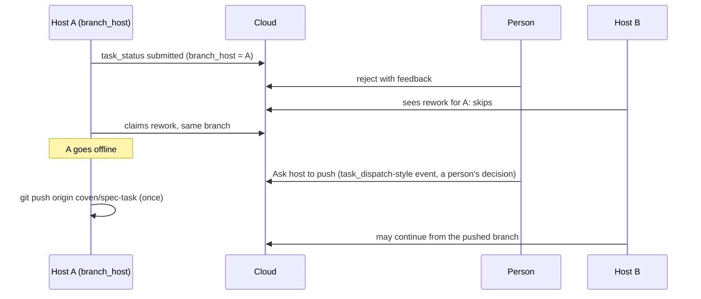
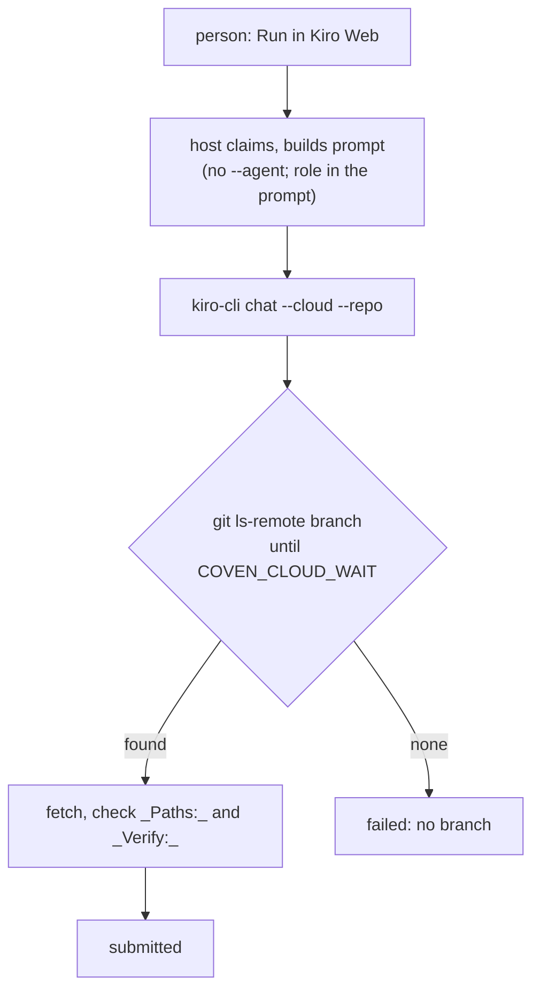

# Multi-host — Design

## Identity and ownership

`host_id` is `h_` plus 8 hex characters, written once to `.coven/host.json`. `board.member()` stays the label.
`task_claimed`, `host_online` and `task_status` carry it. The board view joins `branch_host` to the host list to
show offline hosts.

The push request is a new event type from a person (refused from `/v1/events`, like `plan_decision`): `push_request {task, branch, host_id, author}`. The addressed host pushes that one branch and posts `push_done`. Both go into ADD §6.

## Lease check

`host.py` calls `board.holds(claim)` (the cloud's claim, not a local cache) before `commit` and before the final status. A lapsed lease ends the run with a `failed` status that says "lease lost", and the worktree is kept for the next holder.

## Capacity

`host_online` adds `free_slots`. The Chair prompt line per witch becomes `elf: online on wsl-a (1 free), wsl-b (0 free)`.

## Kiro Web

The CLI exit code only decides whether to wait: `exit 0` and `exit 4 at init` are both followed by the `ls-remote` check; an error that names the source provider ends the run at once with the fix message.

## Risks

- A cloud session sees only what is on GitHub. Uncommitted local work is not in it.
- `ls-remote` needs the host's git credentials for the remote; a host without them reports that and does not run cloud tasks.
