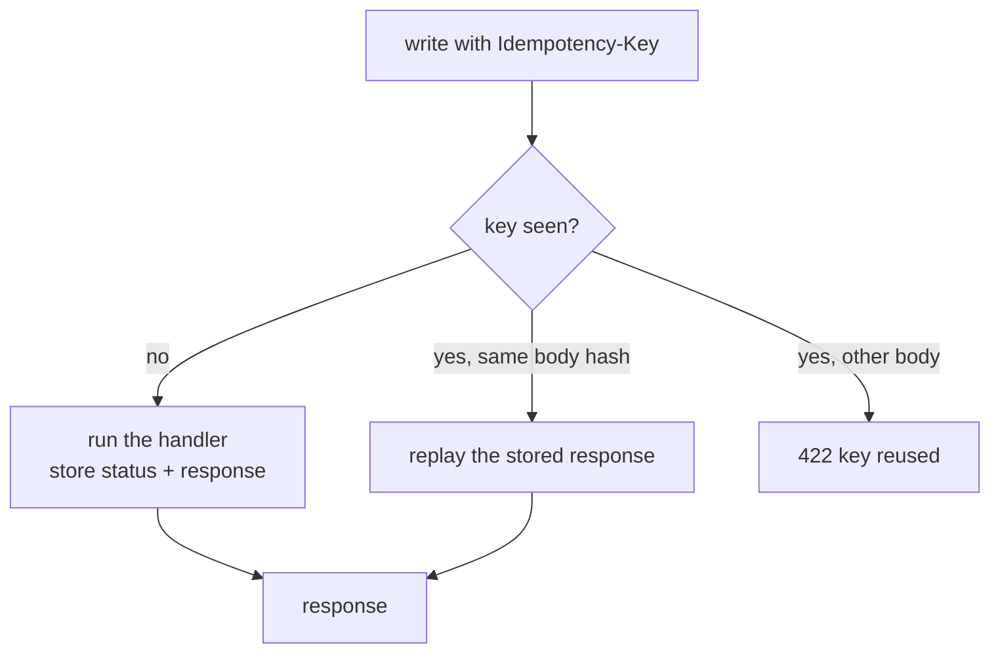

# Task keys and witch roles — Design

## Task key

`src/coven/taskkey.py` and `server/src/taskkey.ts` expose `task_key(project, kind, *parts)` and
`attempt_id(task_key, n)`. Both hash `"|".join(parts)` with SHA-256 and keep 16 hex characters.
`tests/fixtures/task_key_parity.json` is generated from Python; both suites read it (the same method
as `redaction_parity.json`).

The host derives the key when it reads a task (`host.py`, `work.py`); the cloud derives it for events
that arrive without one. Council job ids stay `r{reply[-6:]}-{n}`; the key is metadata beside them.

The attempt counter is the number of `task_status` events of state `working` already recorded for the
key. A rework or a retry after a failure therefore gets the next number.

## Idempotency

`server/src/idempotency.ts` holds a small table: `(scope, key) -> {body_hash, status, response, at}`.



- Memory store: a `Map`. Durable Object store: SQL table `idempotency` beside the events, expired
  by the same pass that applies `ttlDays`.
- Only 2xx responses are stored, so a refusal (such as a held claim) or a server error can be retried for real.
- The cloud runs one instance, so there is no race between the lookup and the store.
- `body_hash` is SHA-256 of the canonical JSON of the redacted body.

Client side, `board._call` takes an optional `key`. The host builds it as
`f"{task_key}.{attempt}.{action}"` (`claim`, `note`, `status`...). Board writes made by people from
the dashboard send a random key per click, held while the request is in flight.

## Roles

```python
ROLES = {
  "elder-witch": {"owns": ["design, and the plan of a change"], "produces": ["plan_proposed", "idea note"],
                  "consumes": ["spec", "board notes", "past plan decisions"], "hands_off_to": ["a person (approval)"],
                  "never": ["write code", "approve her own plan"]},
  ...
}
```

`agents.py` is the one source. A small script, `python3 -m coven.cli agents sync`, writes the generated
block between `<!-- roles:start -->` and `<!-- roles:end -->` in each agent prompt, and `--check`
(used by the harness) fails when a file is out of date. `events.ts` and the dashboard receive the data
through the existing four-place agreement, with a harness test that compares them.

The report-only check lives in `host.py` after a run: for each witch it compares what was posted with
`produces` and emits one `warning` per mismatch.

## Risks

- Idempotency table growth: bounded by the TTL, and each entry holds one response.
- A client that reuses a key by mistake gets 422, not a wrong replay.
- Kiro rewrites agent files on upgrade; the generated block sits between markers so a rewrite that keeps
  the prompt keeps the block, and `agents sync --check` catches the rest.
- The Kiro Web path is blocked until a source provider is connected (see FR-H11); nothing here depends on it.
