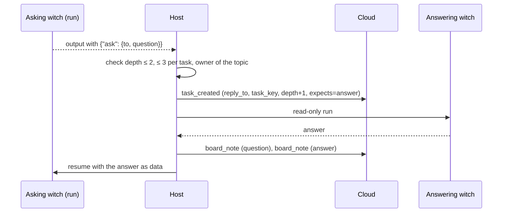

# Witch collaboration — Design

## Consultation

The host, not the model, counts depth and asks. The question and the answer are put into the next prompt
in a block that says they are data. A consultation that fails is answered "unavailable" and the asker continues.

## Design questions for the Chair

`chair prompt` gains a step: if the message is about design (a keyword and a flag from the Chair's own first
reading), the host runs one Elder Witch consultation and passes her answer into the Chair's second call, so she
answers with it. The Chair's reply names the witch.

## Planning stages

Stages are council jobs chained by `reply_to`, in order: elf → elder-witch → black-hat → scribe → plan for a person.
Each stage is one job of `expects` `answer` or `plan`. A plan reaches the person only when every stage answered.
Plan decisions store `reasons`; the Elder Witch job reads the last five.

## Threads and delivery

A thread is every event with the same `task_key`, ordered by time; the dashboard task view renders it.
`delivery_state` is derived from existing events plus `expired` (a `requested` job with no claim after
`COVEN_JOB_EXPIRY`, default 30 minutes).

## Brief

`host.brief()` writes a text of at most 3000 characters from `tasks.md`, the board and plan decisions, passed through
`redact`. It is added to every witch prompt under a heading that says it is data.

## Risks

- Cost: each consultation is a model run. The limits (depth 2, three per task) and the read-only kind cap it.
- Prompt injection through answers: every answer is wrapped as untrusted data.
