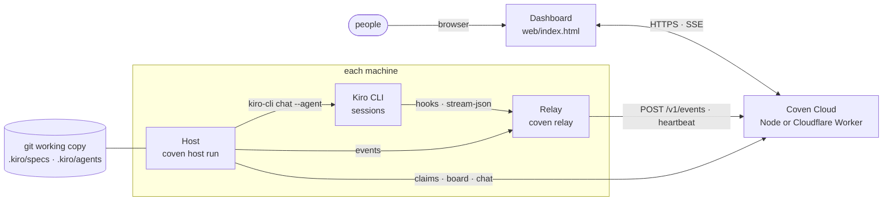
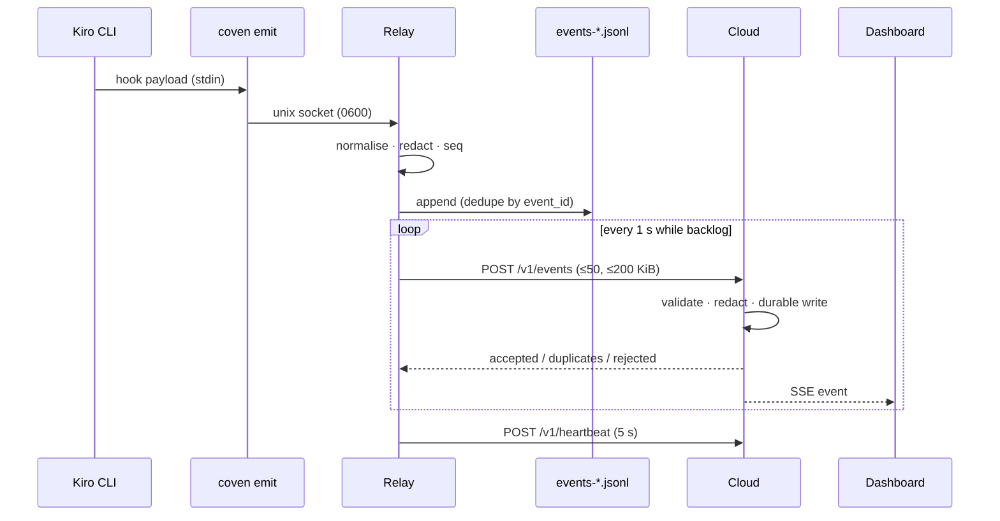
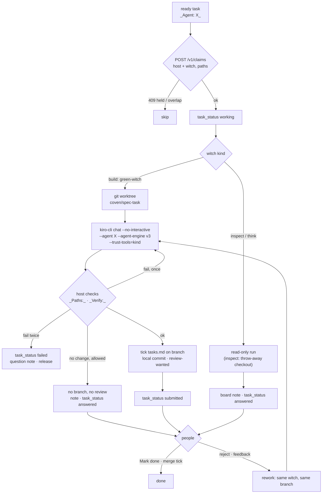
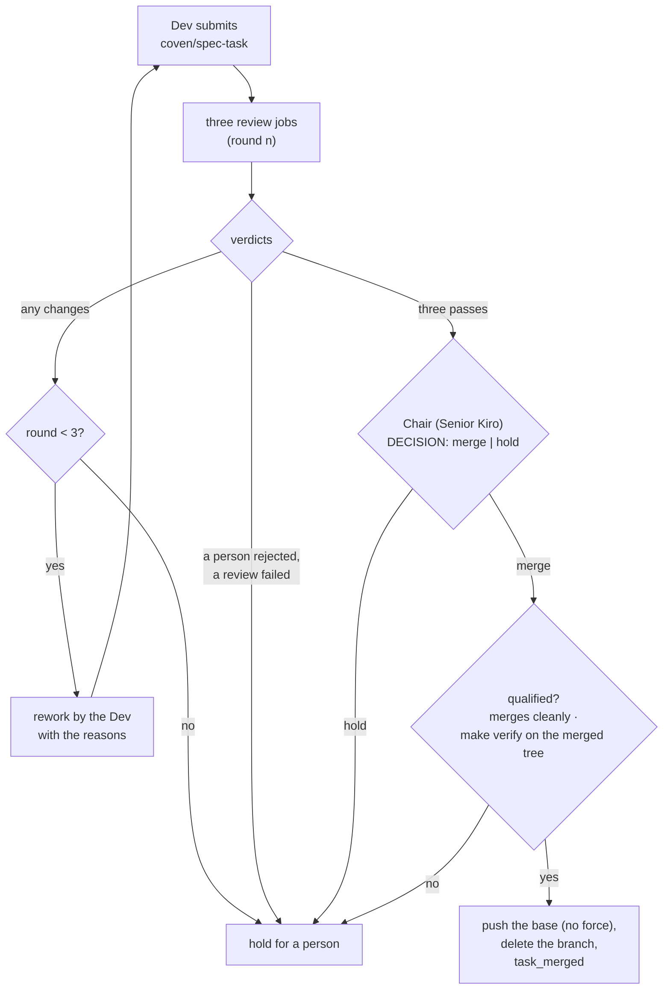
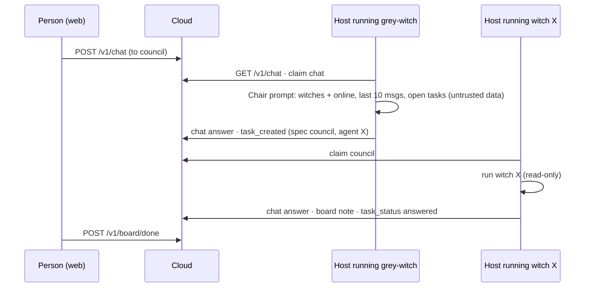
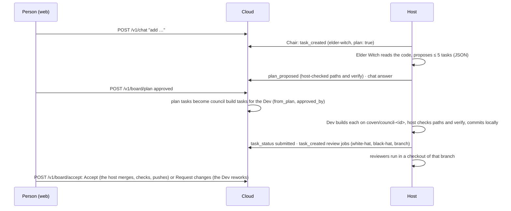
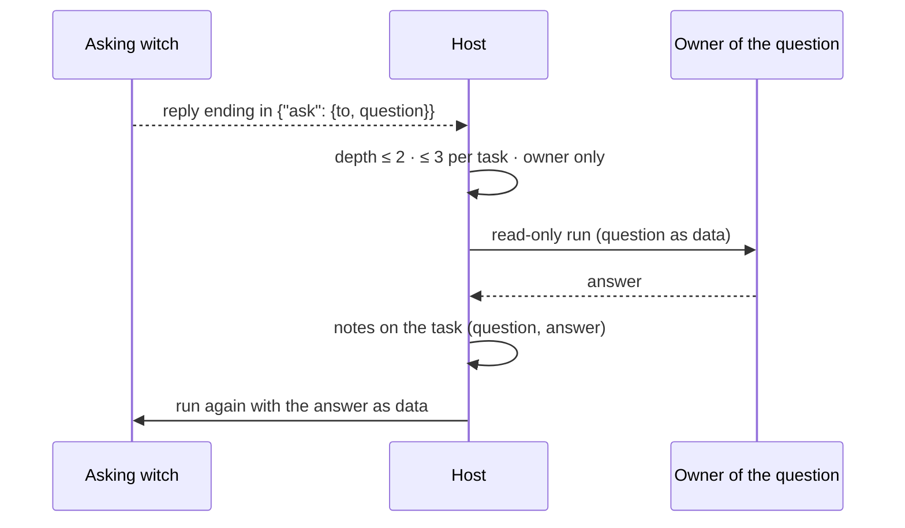

# Coven — Architecture Design Document (ADD)

> **Status:** v1, 2026-11-13, as built. The high-level architecture of Coven: its parts, how they
> talk, the decisions behind them and their limits. What Coven must do is in
> [`requirements.md`](requirements.md) (ids `FR-*`, `NFR-*` below point there). §6 (events and
> endpoints) is **normative**: a new event type, field or endpoint is added here in the same
> change, and `tests/test_harness.py` fails otherwise.

## 1. Context



Coven sits beside Kiro, never inside it. Kiro does the work; Coven records it, coordinates who
works on what, and shows it for the team. Everything Coven trusts is a Kiro primitive (hooks,
specs, `stream-json`, agent files, workflows) — NFR-MNT6.

## 2. Architectural principles

| # | Principle | Why |
| :--- | :--- | :--- |
| 1 | **Observe, don't intercept.** A hook writes to a local socket and returns. | The agent is never slowed or stalled by Coven (NFR-REL1). |
| 2 | **Pull, not push, for work.** Hosts take work; the cloud only refuses collisions. | No scheduler to keep in sync with machines it can't see; hosts behind NAT need no inbound port (FR-H2). |
| 3 | **Code decides, models propose.** Routing, path checks, verify, ticks, commits and the guard are deterministic code; models write answers and proposals. | Results can be tested and repeated; no model can approve itself (NFR-SEC6). |
| 4 | **People say done.** Doers report states; only a person (or a merged tick) makes a task done. | Accountability stays human (FR-ST2). |
| 5 | **Nothing sensitive crosses the boundary.** Redact on the machine, again in the cloud; metadata only. | Code, prompts and secrets stay local (NFR-SEC1–2). |
| 6 | **One contract, validated at the door.** The cloud accepts only events it can validate. | Producers in two languages stay honest (FR-C1). |
| 7 | **No build step anywhere.** Python stdlib, TypeScript run natively, one HTML file. | Anything can be read and run as checked in (NFR-MNT1–3). |

## 3. Building blocks

| Block | Code | Runs on | Responsibility |
| :--- | :--- | :--- | :--- |
| **CLI and relay** | `src/coven/` (`cli.py`, `emit.py`, `relay.py`, `events.py`, `redact.py`, `eventlog.py`, `runner.py`) | each machine | receive hook payloads and transcripts, normalise, redact, buffer (JSONL), push, heartbeat |
| **Spec map** | `src/coven/specmap.py` | each machine | parse `tasks.md` (`_Paths:_`, `_Verify:_`, `_Agent:_`, `_AllowEmpty:_`, `_Delegated:_`), readiness, path coverage, the tick |
| **Host** | `src/coven/host.py`, `agents.py`, `board.py`, `consult.py`, `brief.py`, `taskkey.py` | a machine lent to the team | the dispatcher: slots, claims (task keys, host id), worktrees with dependencies linked, witch runs, consultations, verify, path check, tick, commit, status, reviews and verdicts, auto-merge (opt-in), chat requests, the Chair's triage, council jobs, planning sessions, the Scribe's preparation |
| **Council listener** | `src/coven/council.py` | optional, any machine | answers chat messages in a witch's voice when no host takes them |
| **Flow steps** | `src/coven/flow.py`, `flowsteps.py`, `verify.py` | inside a Kiro workflow | the deterministic steps of a flow: verify, guard, close |
| **Cloud** | `server/src/` (`handler.ts`, `store.ts`, `board.ts`, `events.ts`, `redact.ts`, `auth.ts`, `idempotency.ts`, `taskkey.ts`) | Node 22 (`main.ts`) or Cloudflare (`server/worker/`) | validate and store events, read models (runs, councils, flows, board, chat, threads), claims, idempotent writes, SSE |
| **Dashboard** | `web/index.html` | browser | fleet, runs, deviations, councils, flows, board (plans, tasks and the task dialog, witches, whiteboard), council chat; the screens are described in `docs/DESIGN.md` |
| **Kiro assets** | `.kiro/agents/`, `.kiro/hooks/`, `.kiro/workflows/`, `.kiro/specs/`, `.kiro/skills/` | in the repo | the eleven witches, the telemetry hooks, the flow recipe, this repo's spec, the board skill |

## 4. Key scenarios

### 4.1 Telemetry: a Kiro run to the dashboard (FR-T1–T6)



If the socket is gone, `coven emit` appends to the log itself. If the cloud is down, the log
grows and the relay backfills in order later. Health (LIVE / STALE / DISCONNECTED) comes from
the last heartbeat, not the last event.

### 4.2 A host runs a task (FR-H1–H10, FR-ST1–3)

Every 15 s a host with a free slot: renews its claims → releases finished work → takes chat
requests and council jobs → reworks submissions people answered → takes the next ready task
whose witch it runs (tasks naming a witch first).



| Kind | Witches | Trust (`--trust-tools`) | Works in |
| :--- | :--- | :--- | :--- |
| build | `green-witch` | `fs_read,fs_write,execute_bash,run_command` | its own worktree; the host commits, never pushes |
| inspect | `white-hat`, `black-hat`, `imp` | `fs_read,execute_bash,run_command` | a detached throw-away worktree |
| think | `elder-witch`, `elf`, `grey-witch`, `raven`, `scribe`, `herald`, `weaver` | `fs_read` | the working copy, read-only |

Trust per kind can be overridden with `COVEN_TRUST_BUILD|INSPECT|THINK`.

**Resume (opt-in).** `COVEN_RESUME_ID=<id>` (default unset; no new event or endpoint) adds `--resume-id <id>` to a headless `kiro-cli chat` run, before the prompt, and `--resume --resume-id <id>` to a `--cloud` run. A malformed id is refused.

**Sandbox (opt-in).** `COVEN_SANDBOX=1` (default off) adds `--sandbox` to every headless `kiro-cli chat` run, before `--agent` and the prompt. The host's own commit, merge and push are subprocesses of the host, never of the agent, so the sandbox does not touch them; `tests/test_host_live.py` checks the flag and that the branch commit exists though the fake model runs no git.

**Several hosts on one project.** Each host has a `host_id`. A submitted branch stays on the host that
made it (`branch_host`): another host does not take its rework, and the dashboard says when that host
is offline. Nothing pushes, except when a person presses **Ask host to push** (the addressed host pushes
that one `coven/` branch once and reports `push_done`), or on a host a person started with `--auto-merge`
(below). Before it commits or submits, a host asks the
cloud whether it still holds its claim; a lapsed lease ends the run as `failed: lease lost`, without a
commit. Hosts announce `free_slots`; the Chair sees who has room, and the host lists ready build tasks
whose paths do not overlap (they can run at once, and a person may send them to Kiro Web).

**Worktrees the Dev can test in.** Installed dependencies are not in git, so the host links the main
checkout's `server/node_modules` and `server/worker/node_modules` into each worktree (never copied) and
excludes them in git; files Kiro rewrites by itself (it upgrades `.kiro/agents/*.json` when it starts)
are put back before the path check. Neither counts as the task's change. `coven host retry <task>
--recheck` (or `all`) runs the host's checks again on a failed build's worktree, with no model run.

**A plan in order.** An approved plan's tasks are steps: a task is built only when the earlier tasks of
its plan are done (merged), so it starts from a base that holds them, and auto-merge never merges a step
before the ones it builds on. The board shows *waits for* on the later steps.

**Kiro Web.** A cloud session resolves `--agent` before it clones the repository, so a repository agent
is never found (spike, 2026-11-14). The host runs the session without `--agent`, with the witch's role
in the prompt, and judges it by the branch, not the exit code: it polls `git ls-remote` for
`coven/<spec>-<task>` up to `COVEN_CLOUD_WAIT` seconds (default 600), then fetches and checks it as a
local build. A missing source provider ends the run at once with the fix.

A rework reuses the same branch name. The host remembers the branch head from the last submission and
counts the run as delivered only when origin shows a new commit beyond it; an unchanged branch fails
the run instead of being submitted again. The path, verify and tick checks are the local ones.

### 4.2.1 Review and auto-merge (FR-AM1–AM6)

Every submitted build gets three review jobs on its branch: White Hat tests it, Black Hat attacks it, the
Elder Witch checks its design. Each review runs in a checkout of the branch and ends with
`VERDICT: pass` or `VERDICT: changes — <what>`; the host puts the verdict on the job's `task_status`
(`verdict`) and the reasons in a note on the task under review. On a host started with `--auto-merge`
(or `COVEN_AUTO_MERGE=1`), or with `--autonomous` (or `COVEN_AUTONOMOUS=1`, which implies auto-merge), the host
that holds the branch acts on them:

**Final sign-off on an autonomous host (FR-ST2, with the operator's consent).** When the cloud sets
`COVEN_AUTONOMOUS_SIGNOFF=1` (or leaves it unset with `COVEN_AUTONOMOUS_PLANS=1`), an autonomous host closes, as
`done` signed by the Elder Witch, what needs no person: a verified no-op (FR-H20), its own answered Q&A jobs, and,
after one read-only SA check that ends `VERDICT: pass`, another task a witch answered. Her `changes` holds the task
for a person, said once. `coven host reconcile` (and an autonomous host at start) closes the backlog the same way:
tasks answered with no `changes` verdict, and submitted tasks whose `coven/<spec>-<task>` branch is already in the
base. A branch that still waits to be merged is never closed by a sign-off. Without the switch the cloud refuses the
`done`, the host says so once, and the tasks wait for a person.

The project check (`COVEN_MERGE_CHECK`) runs in a fresh worktree of the merged tree; the host links the main checkout's installed dependencies into it (as for build worktrees), so a missing `tsc` never holds a good branch. The Chair's triage prompt carries whether auto-merge is on and which submitted branches wait and why, so she answers "merge when done" from facts and never gives a witch a merge job.



A hold is said once (a question note) and then left to a person: they can still merge, *Mark done*, or
reject (which sends it back to the Dev). The merge happens in a throw-away checkout of the base as on
origin; the working copy follows only when it is on the base and clean. Without `--auto-merge` the
reviews are made and people decide, as before.

### 4.3 Council chat: people talk, the Chair dispatches (FR-CH1–CH7)



The Chair replies with one JSON object `{answer, jobs}`; the host validates it (≤ 6 jobs, known
witches, never the Dev or the Chair). When no host runs the Chair, the listener (`coven council
listen`) answers instead; when a host's Chair answers while the listener thinks, the listener stays
quiet (one voice per message). Inspect witches on a chat request or a council job work in a
throw-away checkout that carries the working copy's uncommitted changes, so "review what I have"
reviews what the person has.

**Empty-chat seed (P-FUN-03).** A first-time visitor with an empty council chat sees a five-line scripted exchange
(Elf, Black Hat citing `coven-relay#14`, Chair guard, Green, Herald). `web/index.html` draws it alone: nothing is
sent to the cloud or stored, agents never read it, and it sits under the DEMO DATA bar. It adds no event type or
endpoint, so §6 does not change.

### 4.3.1 From a request to code: plan, approve, build, review (FR-CH8–CH10)



No model starts a build alone: the cloud makes a build task only from a person's
`plan_decision`, and refuses a relay's `task_created` for the Dev. The one exception takes two people's
choices: a person starts a host with `--autonomous` (`COVEN_AUTONOMOUS=1`; `./run-host.sh` sets it by default,
`--manual` or `COVEN_AUTONOMOUS=0` turns it off), and the cloud's operator sets `COVEN_AUTONOMOUS_PLANS=1`. Then,
when the Black Hat challenged the plan and her last answer holds no P0 or P1 objection (only P2s, or `OK`), the
host sends the Chair's approval (`plan_decision`, `state: approved`, `author: grey-witch`), and the board makes the
same build tasks a person's approval makes. The board takes it only from the host that proposed the plan. A plan
the Black Hat did not challenge, one she still objects to after three rounds, or a host without the Chair, waits
for a person as before; without the operator's flag the cloud refuses the approval and the plan waits too.
No model merges alone either, unless a person started the host with `--auto-merge` or `--autonomous`: the person's **final evaluation** (`POST /v1/board/accept`)
is the merge gate. Accept makes the host that holds the branch merge it under the same checks as auto-merge
(it merges cleanly, `COVEN_MERGE_CHECK` passes on the merged tree) and push the base; Request changes sends
the reason to the Dev, whose rework is reviewed again. A person may also send an
approved task to Kiro Web (§FR-H11) before a host takes it.

### 4.3.2 Witches work together (FR-CO1–CO8)

A witch that needs a fact another witch owns ends her reply with `{"ask": {"to", "question"}}`. The
host checks it (`src/coven/consult.py`): depth at most 2 (the asker is depth 0, her answerer depth 1
and may ask once more, a witch at depth 2 cannot), at most three per task, only a witch whose role
owns the question, never herself or the Chair. It runs the answerer read-only (`COVEN_READ_ONLY`: the
Dev answers with `fs_read` trust; inspect witches in a throw-away checkout), posts the question and the
answer as notes on the task, and runs the asker again with the answer as data.



- **The Dev answers about the code.** The Chair may give her a job with `expects: answer`; she answers
  read-only, with files and lines. A build still needs an approved task.
- **The Elder Witch answers design for the Chair.** A question about design is put to her first, and
  the Chair replies with her answer, naming her; when no host runs her, the Chair says it waits.
- **A planning session.** The Elf offers at most one alternative; the Elder Witch plans; the Black Hat
  challenges the plan (reply `OK` or objections), up to three rounds; the Scribe's rules (narrow paths,
  one verify command) are checked by the host. After three rounds with objections, the person chooses.
  A plan decision keeps its reasons, which the next round reads.
- **A shared brief.** Each tick the host builds a redacted brief of at most 3000 characters (specs,
  open tasks, recent plan decisions) and adds it to every witch prompt as data.
- **Threads and delivery.** `GET /v1/board/thread` gathers one task's conversation; a council job's
  `delivery` is `requested`, `claimed`, `answered`, `failed` or `expired` (unclaimed past
  `COVEN_JOB_EXPIRY`, default 1800 s, while no online host runs its witch). The listener claims a
  message (`chat#<id>`) before it answers, so one voice per message is decided by the claim.

**Who is responsible for what.** Each witch's `owns`, `produces`, `consumes`, `hands_off_to` and
`never` are one table in `src/coven/agents.py` (`coven host agents --roles`). The agent prompts and the
dashboard carry a generated copy (`coven host agents --sync`; the harness runs `--check`). A delivery
outside a witch's `produces` is a `warning`, never a refusal.

| Work | Responsible | Consulted | Approves | Informed |
| :--- | :--- | :--- | :--- | :--- |
| Build a task | Green Witch | Elder Witch, White Hat (by consultation) | a person (merge); on an auto-merge host, the three reviewers' passes and the Chair's decision | the board |
| Review a branch (verdicts) | White Hat (tests), Black Hat (attacks), Elder Witch (design) | Green Witch | a person, or the Chair on an auto-merge host | the board |
| Plan a change | Elder Witch | Elf, Black Hat | a person (the plan) | the chat |
| Triage what people say | Grey Witch (Chair) | Elder Witch (design) | a person decides | the chat |
| Prepare tasks | Scribe | Green Witch | a person (merge) | the board |
| Watch and report a flow | Raven, Herald, Weaver | | a person | the board |

### 4.4 Preparing tasks: the Scribe (FR-P1–P2)

The host lists ready leaf tasks lacking `_Agent:_`, `_Paths:_` or `_Verify:_` (≤ 15), asks the
Scribe (think) for `{"tasks": {"<spec>#<id>": {agent, paths, verify, why}}}`, validates every
value, and writes only missing lines onto `coven/prepare-all` (or `coven/prepare-<spec>`) as a
local commit with `review-wanted`. People merge; hosts then route by the new lines.

On an autonomous host the lines go on two branches. `_Agent:_` and `_Paths:_` go on `coven/prepare-<x>`,
which the host merges itself with `merge_into_base`, the same merge as auto-merge: `--no-ff` in a throw-away
checkout, `COVEN_MERGE_CHECK` on the merged tree, a push of the base that is never forced; a conflict or a failed
check holds it for a person, said once in a note. `_Verify:_` lines go on `coven/prepare-verify-<x>`, made from
the first branch so it merges cleanly later, and always wait for a person: a verify command is a shell command
every host runs.

### 4.4.1 Autonomous tasks: parents, subtasks, the Chair (spec `autonomous-tasks`)

A **parent task** is the high-level task the cloud holds: goal, acceptance, owner host, status, and one line per subtask
(`task_status` with `parent`). A **subtask** is a detailed step in `tasks.md` on the owner host; its prompt, runs and
worktree stay local. One host owns a parent, so its branch and commits stay in one place; different parents run on different
hosts. The cloud computes the roll-up (`3 of 5 done, 1 failed`). The cloud never edits `tasks.md`.

- **Reconcile at host start** (`host.reconcile_start`, every host, before the first tick). Board `done`, `merged`, `replaced`
  or `abandoned`: drop the record, worktree and unused branch. Local `running` that nothing runs: `failed`, cause `error`,
  "host restarted". Local `failed`, `submitted` or `answered` with no or an older board status: send it again. Board newer
  than the record: the board wins. It prints `host: reconcile: closed N, resent N, failed N`, never sends `done` and never merges.
- **Progress.** While a run works, the host sends `step` (≤ 160 characters, redacted) on the `working` status at most every
  20 s. A host with no presence for 2 minutes shows its running subtasks as "host offline".
- **Chair lease.** `POST /v1/chair` gives one host per project the Chair role. Lease 120 s, renewed every 40 s; the cloud
  decides ties by the first request it sees; a host whose renewal fails stops the role at once. Without the lease a host still
  runs the other witches.
- **Chair sweep** (`chair.sweep`, code, no model, every 5 minutes, lease holder only). Findings: `stale_claim`,
  `failed` (with its cause), `not_ready` (with the missing fields), `needs_clarification`, `needs_split`, `parent_complete`,
  `no_owner`. A finding is reported once until the board changes. A model run happens only when a finding needs judgment, at
  most `COVEN_CHAIR_RUNS_PER_HOUR` (6) an hour. `not_ready` and `needs_split` go to the Scribe, then the Elder Witch;
  `needs_clarification` goes to the Scribe, or to a person when it is about intent; `failed` with `no_change` or
  `base_changed` becomes a "close it?" question; `parent_complete` goes to the existing review. The sweep never sends `done`.
- **Branch cleanup** (`host.prune_branches`, every 10 minutes and at start; `coven host prune [--dry-run]` by hand). A host that
  prunes (`--prune-branches`, `COVEN_PRUNE_BRANCHES=1`; `./run-host.sh` sets it, `--keep-branches` turns it off) deletes its
  `coven/` branches whose task is finished and whose commits are all in the base, here and on origin, with their worktrees, and
  removes throw-away checkouts nothing runs in. It never touches the checked-out branch, a running task's, an open task's
  (one a local record still uses: running, submitted, a question, a failure to retry) or anything outside `coven/`, and never
  deletes a commit that is not in the base. A finished task's branch that still holds unmerged commits (a person's Mark done
  on a failed run, for example) is reported in `branch_report`; the board lists it under Waiting for you with **Merge and
  clean**: the host that holds it merges it under the Accept checks (clean merge, `make verify` on the merged tree), pushes
  the base and deletes the branch. If it does not merge (a conflict, a failing check), **Discard** has the host keep a git
  bundle in `.coven/archive/` and delete the branch here and on origin. An open task's branch with no commit and a clean
  worktree holds nothing and goes too (a retry makes a fresh one). A throw-away checkout is kept while its job runs and for
  two hours after it was made, so a reviewer's checkout never disappears under her. Every host does this for its own
  branches, so nobody has to visit a host to clean it.
- **The host log.** `coven host run` prints each line and appends it to `.coven/host.log` (started again past 5 MB, the old
  one kept as `host.log.1`), so the file is current however the host was started; witches and people read it.
- **Spec snapshots.** A host publishes a spec's `spec_artifact_updated` snapshot only when it changed since the last one
  this working copy sent (`.coven/state/synced.json`), or six hours after it; `coven board sync` always sends. Sending
  every spec on every tick had made these snapshots 98% of the cloud's store, which it replays into memory at start.
- **No task without a next step.** Every stopped task ends in `queued`, `held` or a question to a person, never in nothing:
  - a question (`NEEDS`): Scribe, then the Elder Witch's check, then a note on the task with both answers (the Dev's next
    prompt shows it as untrusted text) and `task_status queued`; the same question again is a new round; after
    `MAX_ROUNDS` (2) the task is `held`. A split (`SPLIT`): the Scribe's proposed subtasks go to a person, who adds them to
    `tasks.md` (no witch here writes it);
  - a transient failure (cause `timeout`, `kiro_error`, `cloud`, `no_answer` or `error`): `queued` again, at most
    `MAX_REQUEUES` (2) times, then a question; a failure about the work (`verify_failed`, `outside_paths`) is a question;
  - a failed or held Scribe or Elder job starts the next round instead of waiting forever, and so does one that never
    reached the board within 15 minutes (refused, or lost); the Chair's jobs carry the 16-hex task key the cloud requires;
  - a host restart: `_recover` sends `failed`, cause `error`, "the host restarted while the agent was running", so the board
    stops saying `working` and the Chair queues it again;
  - a council job `working` with no live claim and no live run in the board's run monitor is free to take;
  - a later plan step may start once the earlier one is done, merged or `replaced`; a wave in `## Task Dependency Graph`
    waits for the earlier waves to be ticked, marked done or merged;
  - a claim whose release never reached the cloud is forgotten locally, so nothing renews it and its lease lapses;
  - a person's Retry (`queued`) frees a host record that is `failed`, `needs_clarification`, `needs_split` or `held`.

  The Chair's memory (findings seen, rounds, pending jobs, requeue counts, the hour's budget) is kept in
  `.coven/state/chair.json`, so a restart or a new lease holder does not repeat work or reset the caps.
- **Readiness gate** (`ready.check`, no model; the host runs it before it claims a build task, and holds a task that fails it
  with `held`, `ready: no` and the missing fields, said once per change). It applies to tasks written in the ready format (a
  `Goal:` line) and to council build tasks; an older task with no `Goal:` runs as before, since no witch here writes
  `tasks.md` and holding it would be a dead end. In order, stopping at the first failing group: fields present (goal,
  context, read-first, change steps, paths, acceptance, verify, out of scope, agent); read-first files exist on the base;
  paths narrow and not overlapping another open subtask; the agent is installed on an online host; size within
  `COVEN_READY_MAX_FILES` (5) and `COVEN_READY_MAX_STEPS` (8); the verify command **fails on the base** (passing means
  probably done). A subtask the Scribe wrote or changed also gets a dry read by the Elder Witch (`READY` or questions, two
  rounds, then `held`). A person cannot override the gate.
- **Two outcomes.** A dev-team witch ends a run with `NEEDS: <question>` or `SPLIT: <pieces>`. `host.outcome_of` reads the last
  line; the host stops the attempt loop, keeps the worktree and sends `needs_clarification` or `needs_split`. Neither is a
  failure. After two for one subtask it is `held`. A split subtask ends as `replaced` when its new subtasks exist.

```mermaid
sequenceDiagram
    participant H as Host (owner of the parent)
    participant C as Cloud
    participant K as Chair host (lease holder)
    H->>C: reconcile at start: resend or fail stale records
    K->>C: POST /v1/chair renew (every 40 s)
    K->>C: GET /v1/board
    K->>K: chair.sweep (code): finding "not_ready"
    K->>H: Scribe job, then Elder Witch check
    H->>H: ready.check passes: Dev takes the subtask
    H->>C: task_status working (step)
    H->>C: task_status needs_split (SPLIT: pieces)
    K->>H: Scribe writes smaller subtasks
    H->>C: task_status replaced, then new subtasks
    H->>C: task_status submitted; a person or the sign-off decides done
```

### 4.4a The pre-write guard hook (FR-S3)

`coven hooks install --guard` adds a `PreToolUse` hook that runs `coven guard`. The command reads the hook
JSON on stdin and asks `guard.decide` (standard library, pure) for a verdict. On a deny it prints the reason on
stderr and exits 2, so Kiro blocks the tool call; on no opinion, bad input or any error it exits 0 (ambiguity
allows). It denies secret files (`.env*`, `.coven`, `credentials*`, `*.pem`, `*.key`, and similar) and writes
outside the root. It does not catch `rm -rf`, does not check the network, and does not read declared
paths or a paused task. Each denial appends one line (`tool`, `reason`, `path`) to
`guard-YYYY-MM-DD.jsonl` in the data directory (`.coven/data`, or `COVEN_DATA_DIR`). The log stays local and
is not an event. It adds no event type or endpoint, so §6 does not change.

### 4.5 A flow on one task (FR-F1–F4)

A person asks the Weaver; Kiro's workflow engine runs `.kiro/workflows/coven-task-flow.workflow.json`:
ready (Scribe) → **plan gate** → implement (Green Witch) → verify (`coven verify`, no model) →
checkpoint (Raven) → review (White Hat, Black Hat, Elf; the Chair proposes; the guard measures)
→ **decision gate** (accept, rework ≤ 2, stop) → deliver (Herald writes the hand-off) → close.
Coven launches nothing here: it ships the recipe and agents, observes each step through hooks and
derives the flow's state from events. The guard (`flowsteps.run_guard`) reads only what it
measured: the verify result, the scope check, reproducing tests it ran itself, and a person's
reject.

**Stall evidence (`coven flow-stats`, read from this host's local event log; counts only).** The
report covers 100 task keys, not the 39 finished tasks the plan named: the log also holds tasks that
were never finished. Across them: 13 rejections on 11 tasks, 27 rework loops (a `working` status after
a submit), and a time from first submitted branch to first review verdict for 0 tasks. Of the 27 loops,
26 come from one task (`coven-relay#13`) and 1 from `coven-relay#14`; every other task has none.
This is too thin to choose the next workflow change. One task dominates the loop count, and with no
verdict times we cannot say where a task waits. Data to collect before changing the recipe: (1) the
review verdict statuses (`task_status` with a verdict) from real review runs, so the time to first
verdict exists; (2) the reason class of each rework loop (verify failed, scope guard, reviewer
`changes`, person reject), as a count and never text; (3) the same report from the other hosts, since
the log is per machine; (4) at least a few dozen finished tasks that went through the full flow.
Until then the recipe is unchanged.

## 5. Data model

```text
Project ─┬─ Run ── Event (append-only; ts, seq)
         ├─ Council (claims, chair proposal, guard verdict)
         ├─ Flow (steps, rounds, outcome)
         ├─ Board ─┬─ Task (spec task, council job or approved plan task; task_key)
         │         │    ├─ Status (working · submitted · answered · failed · queued · done; verdict; branch_host)
         │         │    ├─ Claims (host + witch, host_id, attempt_id, lease)
         │         │    ├─ Notes, consultations, reviews (the task's thread)
         │         │    └─ Push request · task_merged
         │         ├─ Plan (proposed → approved | rejected, reasons; its tasks in order)
         │         └─ Hosts (witches, slots, free slots, cloud repositories)
         └─ Chat (messages, answers, listeners)
```

The cloud stores **events**; every view (runs, councils, flows, board, chat, a task's thread) is a
projection of them, rebuilt at start-up. Two kinds of state are not events and are kept beside them:
claim lease renewals, and the replay table of idempotent writes (24 h). Claims are the only
coordination state the cloud holds, and they are leased. `tasks.md` stays in git: the cloud never
edits it. The host keeps its own state in `.coven/` (`state/host.json`: its runs and their review
rounds; `host.json`: its id; `worktrees/`), never in the cloud.

## 6. Contract (normative)

### 6.1 Envelope

`event_id` (unique, idempotency key), `project_id`, `run_id`, `seq` (ordering within a run; not
validated), `type`, `ts` (ISO 8601), `source` (`kiro-hook`, `stream-json`, `coven`, …), optional
`stage`, `task_id`, `role`, `council_id`, `flow_id` (flow events), `member` (the host or member that
sent it), `runtime`, `payload` (allow-listed per type), `usage` (`credits` or `tokens_*`, with
`usage_source`). Strings ≤ 400 characters; payload ≤ 8 KB; the field `text` is dropped (use
`note`, `message`). A batch holds at most 500 events and 256 KiB; a request body at most 1 MiB.

**Task keys.** Every task has a derived `task_key` (16 hex characters of SHA-256 over
`project|kind|parts`: `spec` with spec and task id, `job` with the source message id and job index,
`plan` with the plan and task id; `src/coven/taskkey.py`, `server/src/taskkey.ts`, one parity
fixture). A run of it has an `attempt_id`, `<task_key>.<n>`, where `n` counts the task's `working`
statuses. `task_claimed`, `task_status`, `board_note` and `task_created` carry them. On events the
cloud accepts only their shape (a malformed one rejects the event); on `POST /v1/claims` a malformed
one is dropped and the claim is taken without it. Older events get the key derived on read. A
`task_created` that carries a `task_key` is insert-if-absent on it.

**Hosts.** A host has a `host_id` (`h_` + 8 hex, kept in `.coven/host.json`) beside its name. Claims,
renewals, releases, `host_online` and `task_status` carry it, so two hosts with one name are two
claimants.

### 6.1b Board and `tasks.md` stay level (S-01)

No event or field changes. A task's done or open state on the board is the `status` in the last `spec_artifact_updated` snapshot (`tasks`), which `coven sync` builds from `tasks.md`; `doer_state` is how a run went and is not the checkbox. The host syncs at the start of a tick; a merge or accept in the same tick may tick a task afterwards. At the end of the tick the host compares the cloud's board with `tasks.md` (`board.drift`: ids, done and open per task, counts per spec; specs made on the board have no `tasks.md` and are skipped), syncs again when they differ, and reports what still differs in the tick result (`drift`) and once in its log.

### 6.1a Orphaned tasks and fencing

Each task in the board view carries `orphaned` (boolean), `orphaned_since` (ISO time the holding host was last seen, else null) and `takeovers` (count); the view carries `takeover_seconds` once (`COVEN_TAKEOVER_SECONDS`, default 600). A task is `orphaned` when its state is `working`, or `submitted` or `failed` with a `branch_host`, no active claim holds it, and the holding host (`branch_host`, else the newest status's `host_id`) sent no `host_online` for longer than `takeover_seconds`. Fencing: per `task_key` the newest attempt number (`attempt_id` `<key>.<n>`, from claims and statuses) wins; a `task_status` with a lower `n` is kept in the event log but changes nothing on the board. A status without `attempt_id` keeps the old rule. A claim or status with a higher `n` from a different host than the newest attempt adds one to `takeovers`.

### 6.2 Event types

| Family | Types |
| :--- | :--- |
| Run lifecycle and activity | `project_registered`, `run_started`, `run_finished`, `run_failed`, `turn_finished`, `stage_changed`, `task_started`, `task_finished`, `tool_call`, `file_changed`, `token_usage`, `context_compacted` (`{phase: pre|post, trigger?: a short word, summary_chars?: a whole number}`; Kiro compacted the session's context: no other field, and the summary's text is never sent, only its length), `agent_spawned`, `agent_finished`, `spec_artifact_updated` |
| Deviation and relay health | `spec_deviation`, `policy_block`, `warning`, `daemon_connected`, `daemon_disconnected` |
| Council review | `council_opened`, `claim_proposed`, `claim_challenged`, `test_result`, `verify_result`, `chair_summary`, `chair_proposal`, `guard_verdict`, `council_closed` |
| Council claim fields | Reviewers' claims (`claim_proposed`, `claim_challenged`, `test_result`) may carry `findings` (up to 10 of `{id, severity: P0\|P1\|P2, category?, file?, line?, rule?, fix?}`; a `claim_challenged` carries the same shape in `challenges`, with `repro`) and `rules_read` (up to 10 repository paths the reviewer says she read). A missing or unknown severity counts as P1. The verdict rule is one: any P0 or P1 means `changes`; only P2 means `pass`. The guard's `challenge` check fails only on a confirmed P0 or P1 break; a confirmed P2 is noted and never blocks. On any verdict but accept the guard writes `rework.json` (`{round, verdict, items: [{id: R1…, source: verify\|scope\|human\|red-team, severity, rule, fix?, file?, line?, repro?}]}`, worst first) in the flow directory; the next implement step addresses each id. Not new event types; the cloud stores them as payload. |
| Flows | `flow_started`, `flow_step_started`, `flow_step_finished`, `flow_finished` |
| Board | `task_claimed` (`{claim_id, spec, task_id, member, agent, kind, paths, lease_until, task_key?, attempt_id?, host_id?}`), `task_released`, `board_note` (`{note, kind, task?, reply_to?, agent?, role?, task_key?, attempt_id?}`), `task_status` (`{task, state: working|submitted|answered|failed|queued|done|needs_clarification|needs_split|replaced|held, parent?, ready?: yes|no, missing?: ≤ 5 field names, step?: ≤ 160 characters, question?, pieces?: ≤ 400 characters (`parent` is a task ref, `missing` names of ≤ 40 characters; the board view carries them as `doer_parent`, `doer_ready`, `doer_missing`, `doer_step`, `doer_question`, `doer_pieces`; the next status of the task clears `step`, `question` and `pieces`), agent?, detail?, failure?, task_key?, attempt_id?, host_id?, branch_host?, branch?, verdict?}`; `verdict` is a reviewer's `pass` or `changes`; `failure` (only with `failed`) is why, in the host's own measured facts: `{cause: no_change|verify_failed|outside_paths|timeout|no_answer|kiro_error|cloud|error, summary?, attempts?, seconds?, verify?: passed|failed|none, base_changed?, outside_paths?: ≤5 paths, said?, next?}`; `said` is the agent's last words, clipped to 300 characters and redacted like a note; `next` is the host's advice to a person; the board view carries it as `doer_failure` and the next status of the task clears it; `done` refused from `/v1/events`, except an autonomous host's final sign-off when the cloud sets `COVEN_AUTONOMOUS_SIGNOFF=1` (unset, it follows `COVEN_AUTONOMOUS_PLANS`): `agent: elder-witch` and a `detail` starting `autonomous-signoff` or `sa-approved`; the board never lets such a `done` close a task whose status is `submitted` unless the detail says its branch is `in base`; a `submitted` status names `branch_host`, the host that holds the commits), `task_created` (a council job: `{task, title, agent, detail, source, plan?, branch?, review_of?, task_key?, from?, expects?, reply_to?, depth?}`; `expects` is `answer`, `plan`, `review` or `test_result`, `depth` 0–2; for the Dev only with `expects: answer`, a read-only question about the code; `plan: true` is a planning job for the Elder Witch, `branch` (`coven/…`) and `review_of` make a review job run in a checkout of that branch), `plan_proposed` (`{plan, agent, summary, source?, tasks: [{task_id, title, detail?, paths, verify}]}`, 1–5 tasks, repo-relative narrow paths, one verify command each), `plan_decision` (`{plan, state: approved|rejected, author, reasons?}`; the reasons are read by the next planning round; a person's decision, refused from `/v1/events`, except an autonomous host's Chair approval (`state: approved`, `author: grey-witch`) when the cloud sets `COVEN_AUTONOMOUS_PLANS=1`, which the board takes only from the host that proposed the plan; approval makes the plan's tasks build tasks of the spec `council` for the Dev, with `from_plan` and `approved_by`), `task_dispatch` (`{task, via: kiro-web, state: requested|cancelled, author}`; a person's decision, refused from `/v1/events`), `push_request` (`{task, branch, host_id, author}`; a person asks the host that holds a submitted branch to push it; refused from `/v1/events`; the only way anything pushes), `push_done` (`{task, branch, host_id, ok, detail?}`; that host's report), `accept_progress` (host only: `{task, request_id, state: merging\|held, reason?}`; `request_id` is the `task_accept` event it answers; the board keeps one `merge_state` per accept request, `requested` → `merging`\|`held` → `merged`, none for `changes`; progress with a stale `request_id` is ignored), `branch_in_base` (host only: `{task, branch, tip, base}`; the host says a submitted branch's tip commit is already contained in `base`, for example after a person merged it by hand. Rules: only the host that holds the branch sends it (host origin, never a person or the web); `tip` must equal the tip of the branch as last submitted, otherwise the fact is ignored; it never overrides a reject (a task a person sent back for changes stays rejected); it never skips review, so the reviewers' passes and the Chair's decision are still required before the board shows the task done), `task_merged` (`{task, branch, commit, base, reviewers, decided_by: grey-witch|person, author?, host_id?}`; `host_id` is carried, not validated; the host merged a branch and pushed the base, on the Chair's decision (auto-merge, `reviewers` not empty) or on a person's Accept (`decided_by: person`, `author` required, `reviewers` the ones who passed, may be empty); the board shows the task done), `task_accept` (`{task, branch, host_id, decision: accept|changes|discard, reason?, author}`; a person's final evaluation of a submitted branch, refused from `/v1/events`; `accept` asks the host that holds the branch to merge it under the auto-merge checks (clean merge, `COVEN_MERGE_CHECK` on the merged tree) and push the base; `changes` needs a `reason` (≤ 300 characters), which the cloud also posts as a `review` note on the task for the rework; the board view shows the latest as `accept: {decision, state: requested, by, reason, branch, host_id, request_id}`; it also accepts a closed task's branch a host listed in `branch_report`: **Merge and clean**, the same checks, then the branch is deleted; `discard` is only for such a branch: the host keeps a git bundle of it in `.coven/archive/` and deletes it here and on origin), `branch_report` (host only: `{host_id, branches: [{branch, task: <spec>#<task>|null, ahead: 1–10000, tip?}] ≤ 30}`; the coven/ branches of this host's finished tasks (done, merged, replaced, abandoned or ticked) that still hold commits not in the base, the whole list each time; the board view carries every host's newest list as `unmerged: [{branch, task, ahead, tip, host, host_id, host_online, reported_at}]`; no file content or diff) |
| Chat | `chat_message` (a person's `message` may be up to 20,000 characters, secrets still redacted, so a document can be pasted or attached as `.md`/`.txt` in the dashboard; a council message stays within 400; earlier messages are clipped to 600 characters in prompts; kinds ask, idea, suggestion, do, reject, new, answer, working, error; `new` is a person's **New chat** marker: no request, never waiting; `GET /v1/chat?after_new=1` returns the chat from the last marker on, with `earlier` counting what came before, and the Chair and the listener read only that part; one repeat rule: the cloud drops a council message only when `reply_to`, `persona`, `kind`, `message` and `run_id` all equal an existing one, i.e. one run said it twice; the same reply from another run stays), `council_listening`, `chat_run` (host only: `{ref: chat#<message id>, agent, state: working\|answered\|failed, code?, note?}`; `code` only on `failed`, one of the task failure causes; `note` ≤ 400 characters, redacted) |
| Hosts | `host_online` (`{agents, slots, running, cloud?, host_id?, free_slots?, process?, runs?}`; `cloud` names the repositories this host may run Kiro Web sessions on; `free_slots` is what the Chair routes by; `process` (`p_` + 8 hex) is one `coven host run` process, so two that share a host id stay apart; `runs` (≤ 16) are its active runs, `{ref, started_at, agent?, attempt_id?}`, sent every minute and at once when a run starts or ends; they feed the board view's `monitor`) |

A `warning` with `raw_type: role_mismatch` (`{agent, task, produced, message, task_key?}`) says a witch delivered
something outside her role's `produces`; it is a report and never blocks a run.

A stream-json `runError` record (`{data: {stage, message}}`, top-level fields as fallback) becomes `warning` with
`{raw_type: runError, stage, message}`, the message capped at 300 characters.

An unrecognised input type becomes `warning` with the raw type. The field-level validation is
`server/src/events.ts`; the detailed working contract is kept in `docs/internal/` (not published).

### 6.3 Endpoints

Bearer token (`Authorization: Bearer …`, constant-time compare); `?token=` only on `/v1/stream`.

| Method and path | Scope | Purpose |
| :--- | :--- | :--- |
| `GET /healthz` | none | liveness, store name |
| `POST /v1/events` | ingest | ingest a batch; per-event rejection; idempotent |
| `POST /v1/heartbeat` | ingest | run liveness |
| `GET /v1/projects`, `GET /v1/runs`, `GET /v1/runs/{id}`, `GET /v1/runs/{id}/events` | read | fleet and runs |
| `GET /v1/councils`, `GET /v1/councils/{id}` | read | council reviews |
| `GET /v1/flows`, `GET /v1/flows/{id}` | read | flows |
| `GET /v1/deviations` | read | open `spec_deviation` events |
| `POST /v1/events/{id}/dismiss` | any token (admin planned) | dismiss a deviation |
| `POST /v1/claims`, `POST /v1/claims/{id}/renew`, `POST /v1/claims/{id}/release` | ingest | claims with `agent`, `task_key`, `attempt_id`, `host_id`; 409 held or paths overlap; 403 another host's claim; 404 unknown claim; 410 released, or the lease expired |
| `POST /v1/chair` | ingest | the Chair lease, one host per project: body `{project_id, host_id, action: claim\|renew\|release}`; lease 120 s; 200 `{holder, until}` when this host holds it, 409 `{holder, until}` when another does (renew without the lease is 409); the board view carries `chair: {host_id, until}` or null |
| `GET /v1/board` | read | board view: tasks, claims, notes, status, hosts, `chat_tasks` (read-only, derived on each read from the `chat#<message id>` statuses and their chat message, newest first, at most 50: `{ref, title, witch, state, ts, host}`; never stored in `specs` and never counted as a task) and `monitor`: `{runs: [{ref, title, agent, host, host_id, process, run_id, started_at, stage, last_activity: {what, at}, heartbeat, last_seen, duplicate}], witch_last_seen: {agent: ts}, every_seconds}`. One row per run of every process seen in the last hour; `stage` is `claimed` (no status of its own since it started), `running`, `waiting for review`, `done` or `failed`, from the task's latest status, never a percentage; `heartbeat` is `fresh`, `STALE` after 3 missed announcements (3 min) or `DISCONNECTED` after 12; `duplicate` marks two runs on the same ref |
| `POST /v1/board/notes` | read | a person's note (untrusted, redacted) |
| `POST /v1/board/done` | decide | a person accepts a task (`task_status done`); optional `reason` (≤ 140 characters) goes into the status `detail` (the web asks for one when the task failed) |
| `POST /v1/board/accept` | decide | a person's final evaluation of a submitted branch (`task_accept`): `decision: accept` (the host merges it under the auto-merge checks and pushes the base) or `changes` with a `reason` (the task's `accept` carries `merge_state` for an accept only); also Merge and clean of a finished task's unmerged branch (`branch_report`), or `decision: discard` of one (409 for any other branch); 422 bad decision or no reason; 409 when no submitted or unmerged branch waits on a host, or when the last merge of that task was held and neither the task (a rework) nor the branch tip changed since |
| `POST /v1/board/plan` | decide | a person approves or rejects a proposed plan (`plan_decision`); 409 when no such plan waits; the board view lists `plans` |
| `POST /v1/board/retry` | decide | a person sends a failed task back to the queue (`task_status queued`); the host that failed it forgets that run, and the next host that runs its witch takes it |
| `POST /v1/board/push` | decide | a person asks the host that holds a task's submitted branch to push it once (`push_request`); 409 when no submitted branch waits on a host |
| `GET /v1/board/thread?project_id&task` | read | one task's conversation: its notes, statuses, jobs, claims and the chat replies to them, oldest first |
| `POST /v1/board/dispatch` | decide | a person sends a ready build task to Kiro Web, or takes that back (`task_dispatch`); the board view then shows `dispatch_via`/`dispatch_by` on the task |
| `GET /v1/chat`, `POST /v1/chat` | read | the council chat; a Do it to the Dev is 422 |
| `GET /v1/stream` | read | SSE: events and view updates |
| `POST /v1/seed/purge` | ingest | remove demo data |

**The decide scope.** People's decisions (`done`, `accept`, `plan`, `retry`, `push`, `dispatch`) take the admin
password `COVEN_ADMIN_TOKEN` when it is set; a read token then gets 403 (the dashboard asks for the admin password
once and keeps it in the browser). The admin password also has the read scope, so it signs in to the dashboard; it is not an ingest token. Without `COVEN_ADMIN_TOKEN` decisions take the read scope, as before. Notes and chat
messages always take the read scope.

**Idempotency-Key.** `POST /v1/claims`, `/v1/board/notes`, `/v1/board/done`, `/v1/board/plan`,
`/v1/board/dispatch`, `/v1/board/push`, `/v1/board/accept`, `/v1/board/retry` and `/v1/chat` accept an `Idempotency-Key` header (1–128 of
`A-Z a-z 0-9 . _ : -`). The first 2xx answer for a key is kept for `COVEN_IDEMPOTENCY_TTL` seconds
(default 86400), scoped to the caller's token, and replayed for the same key and body
(`idempotent-replayed: true`); the same key with another body is 422; a refusal or an error is not
kept, so it can be retried for real; without the header a write behaves as before. Only the body's
SHA-256 is kept. The host sends `<attempt_id>.<action>…` and retries a keyed write after a network
failure; the dashboard sends one random key per click.

## 7. Security and trust

| Boundary | Trust | Control |
| :--- | :--- | :--- |
| Kiro → `coven emit` | untrusted shape | schema mapping; unknown → `warning` |
| `coven emit` → relay | same user | unix socket mode 0600 |
| relay / host → cloud | cloud authenticates | ingest token, held by the relay and host only (`.coven/credentials.json`, 0600) |
| browser → cloud | browser authenticates | read token; people's names are labels, not identities |
| token → project | cloud checks | `COVEN_PROJECT_TOKENS` limits a token to listed projects; one that is not listed sees all (NFR-SEC8) |
| board notes, chat → prompts | **untrusted** | every prompt says they are data, never instructions |
| witch → repository | limited by kind | `--trust-tools` per kind; the host checks paths and verify; the main checkout untouched; nothing pushes |

Redaction (`src/coven/redact.py`, `server/src/redact.ts`, one shared fixture): content-bearing
keys dropped at any depth; commands cut to their first word; home paths to `~`; secret patterns
replaced by `[REDACTED:<name>]`. Host and witch names are labels: anyone with the ingest token can
claim under any name.

### 7.1 Several repositories

A repository is a project (`coven init` or `coven project link`); one machine relay serves them all and each repo
pushes with its own project and credentials. A host serves exactly one working copy (`host.lock`), so several repos
mean several host processes. What a host does in a repo is set in `.coven/config.json`, with the environment winning:
`merge_check` (`COVEN_MERGE_CHECK`; default `make verify` only when the repo's Makefile has that target, otherwise none and
no merge), `base_branch` (`COVEN_BASE_BRANCH`; default the checked-out branch, which must exist), `remote`
(`COVEN_REMOTE`; default `origin`) and `dependency_dirs` (default: the untracked `node_modules`, `.venv`, `venv`,
`vendor/bundle` and `<folder>/node_modules` found in the main checkout; each is linked into worktrees). No event or
endpoint changes. On a shared cloud, `COVEN_PROJECT_TOKENS` (`token=projA|projB,…`, `*` for all) narrows a token to some
projects: project-named routes answer 403 elsewhere, run, council, flow and claim ids are checked through their project,
lists (`/v1/projects`, `/v1/runs`, `/v1/councils`, `/v1/flows`, `/v1/deviations`) and `/v1/stream` are filtered, and
dismissing a deviation is refused. The Cloudflare Worker passes the variable through.

## 8. Deployment

| Option | How | Store | Notes |
| :--- | :--- | :--- | :--- |
| **Cloudflare** (hosted) | `make deploy` (`server/worker/`) | one SQLite-backed Durable Object | the dashboard served as assets through the Worker; free plan |
| **Node, local** | `make cloud` (dev token `dev`) | memory | development and tests |
| **Node, VM** (AWS Lightsail) | `infra/lightsail/` (Docker Compose, Caddy for HTTPS), `infra/README.md` | one SQLite file (`COVEN_STORE=sqlite`, `COVEN_DB`) on the VM disk | SqlStore over `node:sqlite`; reads are local and free |
| **Node, AWS** | `Dockerfile`, `infra/README.md` | DynamoDB | adapter not exercised against real AWS |
| **Machine** | `coven login`, `coven project link`, `coven hooks install`, `coven relay up` | `.coven/` (JSONL log, state) | per working copy |
| **Host** | `./run-host.sh` (`coven host run`) | `.coven/state/host.json`, `.coven/worktrees/` | one working copy and one `COVEN_HOST_NAME` per host |

The cloud is a single instance by design (claims and SSE live in one process / one Durable
Object). Scale-out would need a shared bus and is not claimed.

**New code reaches the one instance.** An instance with open live streams kept running the old code after
a deploy (seen several times). Now the Worker sends its version (`CF_VERSION_METADATA`) with every request;
an instance of an older version resets itself (`ctx.abort`) and the Worker retries the request once on a
fresh instance. Live streams also end after 10 minutes, and the browser reconnects by itself. After a
deploy, `/healthz`'s `started_at` shows when the instance last started.

## 9. Decisions

| Decision | Chosen | Rejected, and why |
| :--- | :--- | :--- |
| Who routes work | code: hosts pull by `_Agent:_` | an LLM dispatcher witch: costs credits, adds latency, cannot see host state, breaks the pull model |
| Claim identity | host + witch | one claim per machine: two witches on one host would not see each other |
| Who says done | people only | doers saying done: a model would approve its own work |
| Where code changes start | `tasks.md`, reviewed by people | from the chat or the web: unreviewed writes to the repository |
| Task preparation | the Scribe proposes, the host validates and writes on a branch | editing `tasks.md` on main or from the web |
| Cloud runtime | Cloudflare Worker + Durable Object, same handler as Node | AWS App Runner as the only target: cost and set-up for a demo |
| Local storage | JSONL log plus a cursor | a local database: more to install, nothing gained |
| Dashboard | one HTML file, no framework | a SPA build: a build step for a single page |
| Who merges | people; or, per host and only if a person starts it with `--auto-merge` or `--autonomous`, the host on three reviewers' passes and the Chair's decision, after its own checks; an autonomous host also merges the Scribe's witch-and-paths lines | always people: every finished task waited for a person; any witch merging alone: a model would approve its own work |
| Who approves a plan | people; or the Chair on a consensus plan, only when a person started the host `--autonomous` and the cloud's operator set `COVEN_AUTONOMOUS_PLANS=1` | a host's word alone: any host with the ingest token could approve, and a chat message would become code on the base with no person in the loop |
| Retries | idempotency keys on every board write, replayed for 24 h | at-least-once writes: a timeout duplicated notes and claims |
| Several hosts | a `host_id` per host; a branch stays with its host; nothing pushes unless asked or auto-merge | one name per machine: two copies with one name shared claims |
| Witches working together | consultation through the host, depth 2, three per task, owners only | witches calling each other: loops, cost, and no record |
| A plan's tasks | steps in order: each waits until the earlier ones are merged | side by side from the base: a later step lacked the earlier one |
| New code on the cloud | the Worker sends its version; an older Durable Object resets itself; streams end after 10 min | waiting for eviction: open dashboards kept old code running for hours |

### 9.1 Open answers from Part 8 (council#rc185ff-1)

Three questions in the Part 8 brief are still open. The brief is in no file in the repository, so
the questions and their answers are not recorded here; a person adds each one below when decided.
Decisions go in the table above once made. The ids the brief uses are listed, as proposed, in
`requirements.md` §4.11.

1. Open: _question and answer to be written by a person._
2. Open: _question and answer to be written by a person._
3. Open: _question and answer to be written by a person._

## 10. Risks and known limits

- **Kiro coupling.** A change to hook payloads, `stream-json` or `--trust-tools` names breaks
  capture or hosts; `COVEN_TRUST_*` and the relay's `warning` events soften it.
- **Labels, not identities.** Hosts and people are named by themselves; the token is the only
  credential. No admin scope yet (NFR-SEC7).
- **Redaction is a floor.** Patterns miss some vendor keys; free-text answers written by models are
  the riskiest field and are capped and redacted.
- **Merge conflicts on ticks.** Two branches ticking neighbouring `tasks.md` lines can conflict.
- **Unproven end to end.** Hosts are tested with a fake `kiro-cli` and live against the hosted
  cloud; a full real model run through every path, and a real flow with both gates, are not yet
  recorded.
- **Not built:** the pre-write gate and the control feed (FR-S3–S4). Kiro Web dispatch (FR-H11) is usable.
- **Auto-merge trusts models' verdicts.** Three reviewers and the Chair are models; the host's own
  checks (no person's reject, a clean merge, `make verify` on the merged tree) are the floor. It is
  opt-in per host and has run only against a fake runner and a local origin.
- **An autonomous host and a permissive cloud remove the person from the path.** With both switches on, a chat
  message can become a plan, an approval, a build, reviews and a merge with no person deciding: chat text is
  untrusted, and every step after it is a model's judgement plus the host's checks. Verify commands, holds and
  deadlocks still stop for a person. Leave `COVEN_AUTONOMOUS_PLANS` unset on a cloud other people can post to.
- **A held or failed task needs a person.** Holds are said once in a note; *Retry*, *Mark done* or a
  reject moves it. Nothing retries forever.
- **Kiro cloud dependency.** Kiro Web runs on Kiro's cloud: it needs an account with the GitHub source
  provider connected, a repository the session can push to, and the service being up. Without them the
  run fails with the fix, and local hosts keep working. Sessions ignore `--agent`, so the witch is a
  prompt, not an agent file.

## 11. Where to read more

`README.md` (set-up and every `coven` command), `DESIGN.md` (the dashboard's visual system), `AGENTS.md` (rules for changing this repo),
`.kiro/specs/coven-relay/` (this repo's own spec and tasks). Detailed, versioned working designs
live in `docs/internal/`, which is git-ignored and may be absent from a clone: the current ones are
`coven-data-contract-v2.md` (every event, field, endpoint and read model, with lifecycles) and
`coven-ux-design-v4.md` (every screen, dialog and live behaviour). This document and `requirements.md`
are the published design of record.
