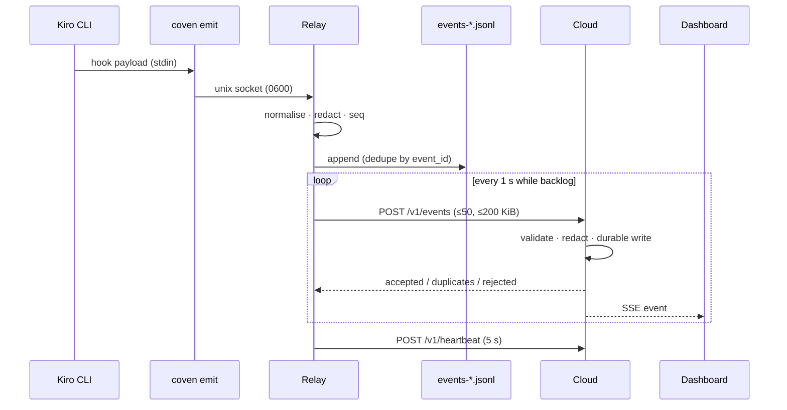
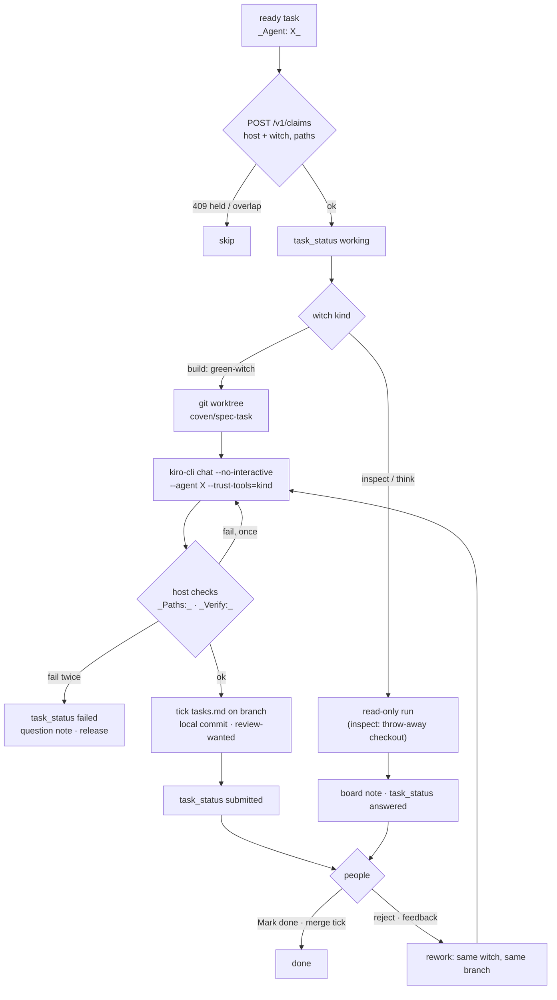
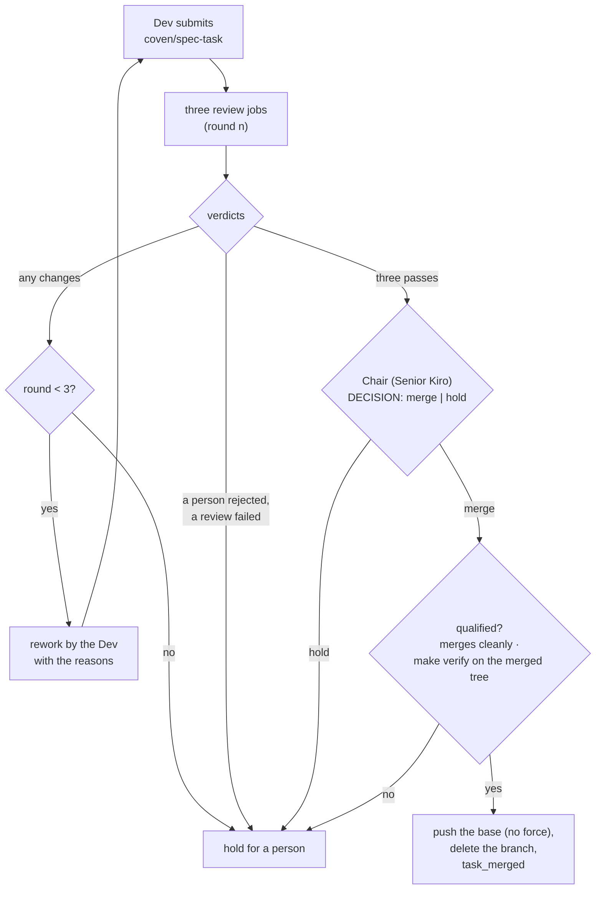
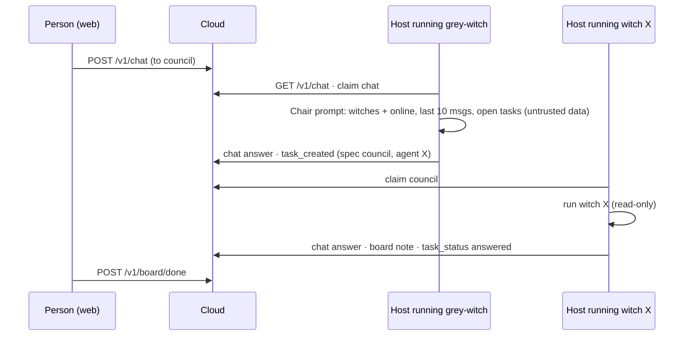
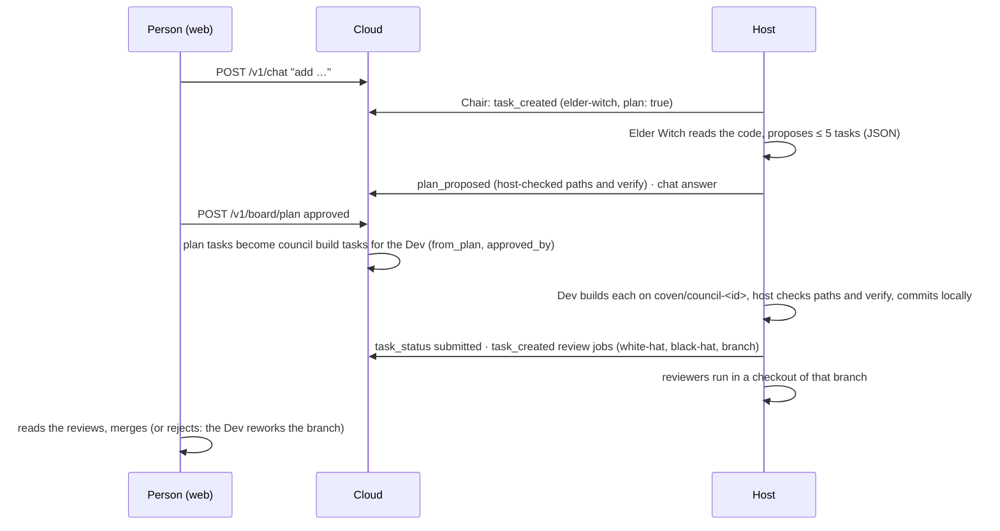
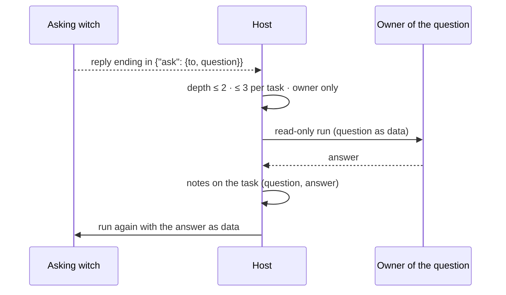

# Coven — Architecture Design Document (ADD)

> **Status:** v1, 2026-11-13, as built. The high-level architecture of Coven: its parts, how they
> talk, the decisions behind them and their limits. What Coven must do is in
> [`requirements.md`](requirements.md) (ids `FR-*`, `NFR-*` below point there). §6 (events and
> endpoints) is **normative**: a new event type, field or endpoint is added here in the same
> change, and `tests/test_harness.py` fails otherwise.

## 1. Context


Coven sits beside Kiro, never inside it. Kiro does the work; Coven records it, coordinates who
works on what, and shows it for the team. Everything Coven trusts is a Kiro primitive (hooks,
specs, `stream-json`, agent files, workflows) — NFR-MNT6.

## 2. Architectural principles

| # | Principle | Why |
| :--- | :--- | :--- |
| 1 | **Observe, don't intercept.** A hook writes to a local socket and returns. | The agent is never slowed or stalled by Coven (NFR-REL1). |
| 2 | **Pull, not push, for work.** Hosts take work; the cloud only refuses collisions. | No scheduler to keep in sync with machines it can't see; hosts behind NAT need no inbound port (FR-H2). |
| 3 | **Code decides, models propose.** Routing, path checks, verify, ticks, commits and the guard are deterministic code; models write answers and proposals. | Results can be tested and repeated; no model can approve itself (NFR-SEC6). |
| 4 | **People say done.** Doers report states; only a person (or a merged tick) makes a task done. | Accountability stays human (FR-ST2). |
| 5 | **Nothing sensitive crosses the boundary.** Redact on the machine, again in the cloud; metadata only. | Code, prompts and secrets stay local (NFR-SEC1–2). |
| 6 | **One contract, validated at the door.** The cloud accepts only events it can validate. | Producers in two languages stay honest (FR-C1). |
| 7 | **No build step anywhere.** Python stdlib, TypeScript run natively, one HTML file. | Anything can be read and run as checked in (NFR-MNT1–3). |

## 3. Building blocks

| Block | Code | Runs on | Responsibility |
| :--- | :--- | :--- | :--- |
| **CLI and relay** | `src/coven/` (`cli.py`, `emit.py`, `relay.py`, `events.py`, `redact.py`, `eventlog.py`, `runner.py`) | each machine | receive hook payloads and transcripts, normalise, redact, buffer (JSONL), push, heartbeat |
| **Spec map** | `src/coven/specmap.py` | each machine | parse `tasks.md` (`_Paths:_`, `_Verify:_`, `_Agent:_`), readiness, path coverage, the tick |
| **Host** | `src/coven/host.py`, `agents.py`, `board.py` | a machine lent to the team | the dispatcher: slots, claims, worktrees, witch runs, verify, path check, tick, commit, status, chat requests, the Chair's triage, council jobs, the Scribe's preparation |
| **Council listener** | `src/coven/council.py` | optional, any machine | answers chat messages in a witch's voice when no host takes them |
| **Flow steps** | `src/coven/flow.py`, `flowsteps.py`, `verify.py` | inside a Kiro workflow | the deterministic steps of a flow: verify, guard, close |
| **Cloud** | `server/src/` (`handler.ts`, `store.ts`, `board.ts`, `events.ts`, `redact.ts`, `auth.ts`) | Node 22 (`main.ts`) or Cloudflare (`server/worker/`) | validate and store events, read models (runs, councils, flows, board, chat), claims, SSE |
| **Dashboard** | `web/index.html` | browser | fleet, runs, deviations, councils, flows, board, witches, council chat |
| **Kiro assets** | `.kiro/agents/`, `.kiro/hooks/`, `.kiro/workflows/`, `.kiro/specs/`, `.kiro/skills/` | in the repo | the eleven witches, the telemetry hooks, the flow recipe, this repo's spec, the board skill |

## 4. Key scenarios

### 4.1 Telemetry: a Kiro run to the dashboard (FR-T1–T6)



If the socket is gone, `coven emit` appends to the log itself. If the cloud is down, the log
grows and the relay backfills in order later. Health (LIVE / STALE / DISCONNECTED) comes from
the last heartbeat, not the last event.

### 4.2 A host runs a task (FR-H1–H10, FR-ST1–3)

Every 15 s a host with a free slot: renews its claims → releases finished work → takes chat
requests and council jobs → reworks submissions people answered → takes the next ready task
whose witch it runs (tasks naming a witch first).



| Kind | Witches | Trust (`--trust-tools`) | Works in |
| :--- | :--- | :--- | :--- |
| build | `green-witch` | `fs_read,fs_write,execute_bash,run_command` | its own worktree; the host commits, never pushes |
| inspect | `white-hat`, `black-hat`, `imp` | `fs_read,execute_bash,run_command` | a detached throw-away worktree |
| think | `elder-witch`, `elf`, `grey-witch`, `raven`, `scribe`, `herald`, `weaver` | `fs_read` | the working copy, read-only |

Trust per kind can be overridden with `COVEN_TRUST_BUILD|INSPECT|THINK`.

**Several hosts on one project.** Each host has a `host_id`. A submitted branch stays on the host that
made it (`branch_host`): another host does not take its rework, and the dashboard says when that host
is offline. Nothing pushes, except when a person presses **Ask host to push** (the addressed host pushes
that one `coven/` branch once and reports `push_done`), or on a host a person started with `--auto-merge`
(below). Before it commits or submits, a host asks the
cloud whether it still holds its claim; a lapsed lease ends the run as `failed: lease lost`, without a
commit. Hosts announce `free_slots`; the Chair sees who has room, and the host lists ready build tasks
whose paths do not overlap (they can run at once, and a person may send them to Kiro Web).

**Worktrees the Dev can test in.** Installed dependencies are not in git, so the host links the main
checkout's `server/node_modules` and `server/worker/node_modules` into each worktree (never copied) and
excludes them in git; files Kiro rewrites by itself (it upgrades `.kiro/agents/*.json` when it starts)
are put back before the path check. Neither counts as the task's change. `coven host retry <task>
--recheck` (or `all`) runs the host's checks again on a failed build's worktree, with no model run.

**A plan in order.** An approved plan's tasks are steps: a task is built only when the earlier tasks of
its plan are done (merged), so it starts from a base that holds them, and auto-merge never merges a step
before the ones it builds on. The board shows *waits for* on the later steps.

**Kiro Web.** A cloud session resolves `--agent` before it clones the repository, so a repository agent
is never found (spike, 2026-11-14). The host runs the session without `--agent`, with the witch's role
in the prompt, and judges it by the branch, not the exit code: it polls `git ls-remote` for
`coven/<spec>-<task>` up to `COVEN_CLOUD_WAIT` seconds (default 600), then fetches and checks it as a
local build. A missing source provider ends the run at once with the fix.

A rework reuses the same branch name. The host remembers the branch head from the last submission and
counts the run as delivered only when origin shows a new commit beyond it; an unchanged branch fails
the run instead of being submitted again. The path, verify and tick checks are the local ones.

### 4.2.1 Review and auto-merge (FR-AM1–AM6)

Every submitted build gets three review jobs on its branch: White Hat tests it, Black Hat attacks it, the
Elder Witch checks its design. Each review runs in a checkout of the branch and ends with
`VERDICT: pass` or `VERDICT: changes — <what>`; the host puts the verdict on the job's `task_status`
(`verdict`) and the reasons in a note on the task under review. On a host started with `--auto-merge`
(or `COVEN_AUTO_MERGE=1`), the host that holds the branch acts on them:



A hold is said once (a question note) and then left to a person: they can still merge, *Mark done*, or
reject (which sends it back to the Dev). The merge happens in a throw-away checkout of the base as on
origin; the working copy follows only when it is on the base and clean. Without `--auto-merge` the
reviews are made and people decide, as before.

### 4.3 Council chat: people talk, the Chair dispatches (FR-CH1–CH7)



The Chair replies with one JSON object `{answer, jobs}`; the host validates it (≤ 6 jobs, known
witches, never the Dev or the Chair). When no host runs the Chair, the listener (`coven council
listen`) answers instead; when a host's Chair answers while the listener thinks, the listener stays
quiet (one voice per message). Inspect witches on a chat request or a council job work in a
throw-away checkout that carries the working copy's uncommitted changes, so "review what I have"
reviews what the person has.

### 4.3.1 From a request to code: plan, approve, build, review (FR-CH8–CH10)



No model starts a build alone: the cloud makes a build task only from a person's
`plan_decision`, and refuses a relay's `task_created` for the Dev. A person may also send an
approved task to Kiro Web (§FR-H11) before a host takes it.

### 4.3.2 Witches work together (FR-CO1–CO8)

A witch that needs a fact another witch owns ends her reply with `{"ask": {"to", "question"}}`. The
host checks it (`src/coven/consult.py`): depth at most 2 (the asker is depth 0, her answerer depth 1
and may ask once more, a witch at depth 2 cannot), at most three per task, only a witch whose role
owns the question, never herself or the Chair. It runs the answerer read-only (`COVEN_READ_ONLY`: the
Dev answers with `fs_read` trust; inspect witches in a throw-away checkout), posts the question and the
answer as notes on the task, and runs the asker again with the answer as data.



- **The Dev answers about the code.** The Chair may give her a job with `expects: answer`; she answers
  read-only, with files and lines. A build still needs an approved task.
- **The Elder Witch answers design for the Chair.** A question about design is put to her first, and
  the Chair replies with her answer, naming her; when no host runs her, the Chair says it waits.
- **A planning session.** The Elf offers at most one alternative; the Elder Witch plans; the Black Hat
  challenges the plan (reply `OK` or objections), up to three rounds; the Scribe's rules (narrow paths,
  one verify command) are checked by the host. After three rounds with objections, the person chooses.
  A plan decision keeps its reasons, which the next round reads.
- **A shared brief.** Each tick the host builds a redacted brief of at most 3000 characters (specs,
  open tasks, recent plan decisions) and adds it to every witch prompt as data.
- **Threads and delivery.** `GET /v1/board/thread` gathers one task's conversation; a council job's
  `delivery` is `requested`, `claimed`, `answered`, `failed` or `expired` (unclaimed past
  `COVEN_JOB_EXPIRY`, default 1800 s, while no online host runs its witch). The listener claims a
  message (`chat#<id>`) before it answers, so one voice per message is decided by the claim.

**Who is responsible for what.** Each witch's `owns`, `produces`, `consumes`, `hands_off_to` and
`never` are one table in `src/coven/agents.py` (`coven host agents --roles`). The agent prompts and the
dashboard carry a generated copy (`coven host agents --sync`; the harness runs `--check`). A delivery
outside a witch's `produces` is a `warning`, never a refusal.

| Work | Responsible | Consulted | Approves | Informed |
| :--- | :--- | :--- | :--- | :--- |
| Build a task | Green Witch | Elder Witch, White Hat (by consultation) | a person (merge); on an auto-merge host, the three reviewers' passes and the Chair's decision | the board |
| Review a branch (verdicts) | White Hat (tests), Black Hat (attacks), Elder Witch (design) | Green Witch | a person, or the Chair on an auto-merge host | the board |
| Plan a change | Elder Witch | Elf, Black Hat | a person (the plan) | the chat |
| Triage what people say | Grey Witch (Chair) | Elder Witch (design) | a person decides | the chat |
| Prepare tasks | Scribe | Green Witch | a person (merge) | the board |
| Watch and report a flow | Raven, Herald, Weaver | | a person | the board |

### 4.4 Preparing tasks: the Scribe (FR-P1–P2)

The host lists ready leaf tasks lacking `_Agent:_`, `_Paths:_` or `_Verify:_` (≤ 15), asks the
Scribe (think) for `{"tasks": {"<spec>#<id>": {agent, paths, verify, why}}}`, validates every
value, and writes only missing lines onto `coven/prepare-all` (or `coven/prepare-<spec>`) as a
local commit with `review-wanted`. People merge; hosts then route by the new lines.

### 4.5 A flow on one task (FR-F1–F4)

A person asks the Weaver; Kiro's workflow engine runs `.kiro/workflows/coven-task-flow.workflow.json`:
ready (Scribe) → **plan gate** → implement (Green Witch) → verify (`coven verify`, no model) →
checkpoint (Raven) → review (White Hat, Black Hat, Elf; the Chair proposes; the guard measures)
→ **decision gate** (accept, rework ≤ 2, stop) → deliver (Herald writes the hand-off) → close.
Coven launches nothing here: it ships the recipe and agents, observes each step through hooks and
derives the flow's state from events. The guard (`flowsteps.run_guard`) reads only what it
measured: the verify result, the scope check, reproducing tests it ran itself, and a person's
reject.

## 5. Data model

```text
Project ─┬─ Run ── Event (append-only; ts, seq)
         ├─ Council (claims, chair proposal, guard verdict)
         ├─ Flow (steps, rounds, outcome)
         ├─ Board (claims with leases; notes; task status; council jobs; hosts' presence)
         └─ Chat (messages, answers, listeners)
```

The cloud stores **events**; every view (runs, councils, flows, board, chat) is a projection of
them, rebuilt at start-up. Claims are the only coordination state the cloud holds, and they are
leased. `tasks.md` stays in git: the cloud never edits it.

## 6. Contract (normative)

### 6.1 Envelope

`event_id` (unique, idempotency key), `project_id`, `run_id`, `seq`, `type`, `ts` (ISO 8601),
`source` (`kiro-hook`, `stream-json`, `coven`, …), optional `stage`, `task_id`, `role`,
`council_id`, `payload` (allow-listed per type), `usage` (`credits` or `tokens_*`, with
`usage_source`). Strings ≤ 400 characters; payload ≤ 8 KB; the field `text` is dropped (use
`note`, `message`).

**Task keys.** Every task has a derived `task_key` (16 hex characters of SHA-256 over
`project|kind|parts`: `spec` with spec and task id, `job` with the source message id and job index,
`plan` with the plan and task id; `src/coven/taskkey.py`, `server/src/taskkey.ts`, one parity
fixture). A run of it has an `attempt_id`, `<task_key>.<n>`, where `n` counts the task's `working`
statuses. `task_claimed`, `task_status`, `board_note` and `task_created` carry them; the cloud
accepts only their shape and derives the key for older events. `task_created` is insert-if-absent
on its key.

**Hosts.** A host has a `host_id` (`h_` + 8 hex, kept in `.coven/host.json`) beside its name. Claims,
renewals, releases, `host_online` and `task_status` carry it, so two hosts with one name are two
claimants.

### 6.2 Event types

| Family | Types |
| :--- | :--- |
| Run lifecycle and activity | `project_registered`, `run_started`, `run_finished`, `run_failed`, `turn_finished`, `stage_changed`, `task_started`, `task_finished`, `tool_call`, `file_changed`, `token_usage`, `agent_spawned`, `agent_finished`, `spec_artifact_updated` |
| Deviation and relay health | `spec_deviation`, `policy_block`, `warning`, `daemon_connected`, `daemon_disconnected` |
| Council review | `council_opened`, `claim_proposed`, `claim_challenged`, `test_result`, `verify_result`, `chair_summary`, `chair_proposal`, `guard_verdict`, `council_closed` |
| Flows | `flow_started`, `flow_step_started`, `flow_step_finished`, `flow_finished` |
| Board | `task_claimed` (`{claim_id, spec, task_id, member, agent, kind, paths, lease_until, task_key?, attempt_id?, host_id?}`), `task_released`, `board_note` (`{note, kind, task?, reply_to?, agent?, role?, task_key?, attempt_id?}`), `task_status` (`{task, state: working|submitted|answered|failed|queued|done, agent?, detail?, task_key?, attempt_id?, host_id?, branch_host?, branch?, verdict?}`; `verdict` is a reviewer's `pass` or `changes`; `done` refused from `/v1/events`; a `submitted` status names `branch_host`, the host that holds the commits), `task_created` (a council job: `{task, title, agent, detail, source, plan?, branch?, review_of?, task_key?, from?, expects?, reply_to?, depth?}`; `expects` is `answer`, `plan`, `review` or `test_result`, `depth` 0–2; for the Dev only with `expects: answer`, a read-only question about the code; `plan: true` is a planning job for the Elder Witch, `branch` (`coven/…`) and `review_of` make a review job run in a checkout of that branch), `plan_proposed` (`{plan, agent, summary, source?, tasks: [{task_id, title, detail?, paths, verify}]}`, 1–5 tasks, repo-relative narrow paths, one verify command each), `plan_decision` (`{plan, state: approved|rejected, author, reasons?}`; the reasons are read by the next planning round; a person's decision, refused from `/v1/events`; approval makes the plan's tasks build tasks of the spec `council` for the Dev, with `from_plan` and `approved_by`), `task_dispatch` (`{task, via: kiro-web, state: requested|cancelled, author}`; a person's decision, refused from `/v1/events`), `push_request` (`{task, branch, host_id, author}`; a person asks the host that holds a submitted branch to push it; refused from `/v1/events`; the only way anything pushes), `push_done` (`{task, branch, host_id, ok, detail?}`; that host's report), `task_merged` (`{task, branch, commit, base, reviewers, decided_by: grey-witch, host_id}`; an auto-merge host merged a reviewed branch and pushed the base; the board shows the task done) |
| Chat | `chat_message` (kinds ask, idea, suggestion, do, reject, answer, working, error), `council_listening` |
| Hosts | `host_online` (`{agents, slots, running, cloud?, host_id?, free_slots?}`; `cloud` names the repositories this host may run Kiro Web sessions on; `free_slots` is what the Chair routes by) |

A `warning` with `raw_type: role_mismatch` (`{agent, task, produced, task_key?}`) says a witch delivered
something outside her role's `produces`; it is a report and never blocks a run.

An unrecognised input type becomes `warning` with the raw type. The field-level validation is
`server/src/events.ts`; the detailed working contract is kept in `docs/internal/` (not published).

### 6.3 Endpoints

Bearer token (`Authorization: Bearer …`, constant-time compare); `?token=` only on `/v1/stream`.

| Method and path | Scope | Purpose |
| :--- | :--- | :--- |
| `GET /healthz` | none | liveness, store name |
| `POST /v1/events` | ingest | ingest a batch; per-event rejection; idempotent |
| `POST /v1/heartbeat` | ingest | run liveness |
| `GET /v1/projects`, `GET /v1/runs`, `GET /v1/runs/{id}`, `GET /v1/runs/{id}/events` | read | fleet and runs |
| `GET /v1/councils`, `GET /v1/councils/{id}` | read | council reviews |
| `GET /v1/flows`, `GET /v1/flows/{id}` | read | flows |
| `GET /v1/deviations` | read | open `spec_deviation` events |
| `POST /v1/events/{id}/dismiss` | any token (admin planned) | dismiss a deviation |
| `POST /v1/claims`, `POST /v1/claims/{id}/renew`, `POST /v1/claims/{id}/release` | ingest | claims with `agent`, `task_key`, `attempt_id`, `host_id`; 409 held or paths overlap; 403 for another host's claim |
| `GET /v1/board` | read | board view: tasks, claims, notes, status, hosts |
| `POST /v1/board/notes` | read | a person's note (untrusted, redacted) |
| `POST /v1/board/done` | read | a person accepts a task (`task_status done`) |
| `POST /v1/board/plan` | read | a person approves or rejects a proposed plan (`plan_decision`); 409 when no such plan waits; the board view lists `plans` |
| `POST /v1/board/retry` | read | a person sends a failed task back to the queue (`task_status queued`); the host that failed it forgets that run, and the next host that runs its witch takes it |
| `POST /v1/board/push` | read | a person asks the host that holds a task's submitted branch to push it once (`push_request`); 409 when no submitted branch waits on a host |
| `GET /v1/board/thread?project_id&task` | read | one task's conversation: its notes, statuses, jobs, claims and the chat replies to them, oldest first |
| `POST /v1/board/dispatch` | read | a person sends a ready build task to Kiro Web, or takes that back (`task_dispatch`); the board view then shows `dispatch_via`/`dispatch_by` on the task |
| `GET /v1/chat`, `POST /v1/chat` | read | the council chat; a Do it to the Dev is 422 |
| `GET /v1/stream` | read | SSE: events and view updates |
| `POST /v1/seed/purge` | ingest | remove demo data |

**Idempotency-Key.** `POST /v1/claims`, `/v1/board/notes`, `/v1/board/done`, `/v1/board/plan`,
`/v1/board/dispatch`, `/v1/board/push` and `/v1/chat` accept an `Idempotency-Key` header (1–128 of
`A-Z a-z 0-9 . _ : -`). The first 2xx answer for a key is kept for `COVEN_IDEMPOTENCY_TTL` seconds
(default 86400), scoped to the caller's token, and replayed for the same key and body
(`idempotent-replayed: true`); the same key with another body is 422; a refusal or an error is not
kept, so it can be retried for real; without the header a write behaves as before. Only the body's
SHA-256 is kept. The host sends `<attempt_id>.<action>…` and retries a keyed write after a network
failure; the dashboard sends one random key per click.

## 7. Security and trust

| Boundary | Trust | Control |
| :--- | :--- | :--- |
| Kiro → `coven emit` | untrusted shape | schema mapping; unknown → `warning` |
| `coven emit` → relay | same user | unix socket mode 0600 |
| relay / host → cloud | cloud authenticates | ingest token, held by the relay and host only (`.coven/credentials.json`, 0600) |
| browser → cloud | browser authenticates | read token; people's names are labels, not identities |
| board notes, chat → prompts | **untrusted** | every prompt says they are data, never instructions |
| witch → repository | limited by kind | `--trust-tools` per kind; the host checks paths and verify; the main checkout untouched; nothing pushes |

Redaction (`src/coven/redact.py`, `server/src/redact.ts`, one shared fixture): content-bearing
keys dropped at any depth; commands cut to their first word; home paths to `~`; secret patterns
replaced by `[REDACTED:<name>]`. Host and witch names are labels: anyone with the ingest token can
claim under any name.

## 8. Deployment

| Option | How | Store | Notes |
| :--- | :--- | :--- | :--- |
| **Cloudflare** (hosted) | `make deploy` (`server/worker/`) | one SQLite-backed Durable Object | the dashboard served as assets through the Worker; free plan |
| **Node, local** | `make cloud` (dev token `dev`) | memory | development and tests |
| **Node, AWS** | `Dockerfile`, `infra/README.md` | DynamoDB | adapter not exercised against real AWS |
| **Machine** | `coven login`, `coven project link`, `coven hooks install`, `coven relay up` | `.coven/` (JSONL log, state) | per working copy |
| **Host** | `./run-host.sh` (`coven host run`) | `.coven/state/host.json`, `.coven/worktrees/` | one working copy and one `COVEN_HOST_NAME` per host |

The cloud is a single instance by design (claims and SSE live in one process / one Durable
Object). Scale-out would need a shared bus and is not claimed.

## 9. Decisions

| Decision | Chosen | Rejected, and why |
| :--- | :--- | :--- |
| Who routes work | code: hosts pull by `_Agent:_` | an LLM dispatcher witch: costs credits, adds latency, cannot see host state, breaks the pull model |
| Claim identity | host + witch | one claim per machine: two witches on one host would not see each other |
| Who says done | people only | doers saying done: a model would approve its own work |
| Where code changes start | `tasks.md`, reviewed by people | from the chat or the web: unreviewed writes to the repository |
| Task preparation | the Scribe proposes, the host validates and writes on a branch | editing `tasks.md` on main or from the web |
| Cloud runtime | Cloudflare Worker + Durable Object, same handler as Node | AWS App Runner as the only target: cost and set-up for a demo |
| Local storage | JSONL log plus a cursor | a local database: more to install, nothing gained |
| Dashboard | one HTML file, no framework | a SPA build: a build step for a single page |

## 10. Risks and known limits

- **Kiro coupling.** A change to hook payloads, `stream-json` or `--trust-tools` names breaks
  capture or hosts; `COVEN_TRUST_*` and the relay's `warning` events soften it.
- **Labels, not identities.** Hosts and people are named by themselves; the token is the only
  credential. No admin scope yet (NFR-SEC7).
- **Redaction is a floor.** Patterns miss some vendor keys; free-text answers written by models are
  the riskiest field and are capped and redacted.
- **Merge conflicts on ticks.** Two branches ticking neighbouring `tasks.md` lines can conflict.
- **Unproven end to end.** Hosts are tested with a fake `kiro-cli` and live against the hosted
  cloud; a full real model run through every path, and a real flow with both gates, are not yet
  recorded.
- **Not built:** the pre-write gate and the control feed (FR-S3–S4), relay split and quarantine
  (FR-T7), a unique host id (FR-H12). Kiro Web dispatch (FR-H11) is usable.
- **Kiro cloud dependency.** Kiro Web runs on Kiro's cloud: it needs an account with the GitHub source
  provider connected, a repository the session can push to, and the service being up. Without them the
  run fails with the fix, and local hosts keep working. Sessions ignore `--agent`, so the witch is a
  prompt, not an agent file.

## 11. Where to read more

`README.md` (set-up and every `coven` command), `DESIGN.md` (the dashboard's visual system), `AGENTS.md` (rules for changing this repo),
`.kiro/specs/coven-relay/` (this repo's own spec and tasks). Detailed, versioned working designs
live in `docs/internal/`, which is git-ignored and may be absent from a clone; this document and
`requirements.md` are the published design of record.
