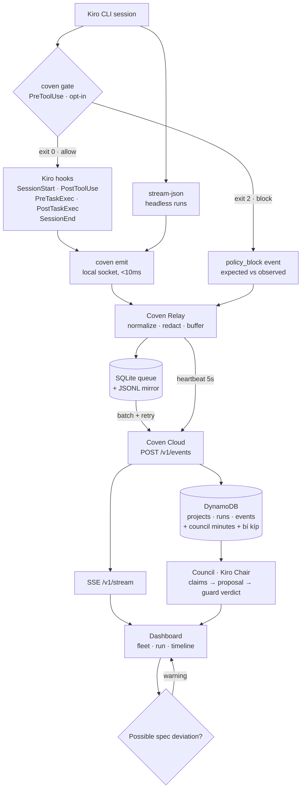

# Coven: Conceptual Solution Design v1.1

> **Status: DRAFT v1.1 for implementation. Supersedes v1.0 for building; v1.0 remains the uploaded original.**
> **What changed from v1.0 (2026-11-02):** (1) Kiro-only is now an explicit design decision, not an implication. (2) The witches / council metaphor is now the product story: each Kiro agent is a witch working alone; Coven is the council where they gather. (3) Council: five role-agents (SA, Dev, Tester, Red Team, Brainstorm) debate by structured claims with evidence, chaired by a Kiro Chair. (4) Task control via guard: pause / resume / skip per task. (5) Memory: Coven manages three layers — ledger, council minutes, and bí kíp (the council's distilled playbook). (6) `allowed_paths` convention is now defined (§4.5.1). (7) Watcher is defined as a Kiro agent reading the fleet via read-only MCP `query_fleet`, not as Coven calling a model.
> **Revision 2 (2026-11-10, after design review) — decisions that change the text below. Where this block conflicts with a later section, this block wins until the sections are fully rewritten:**
> 1. **Council timing = post-task review.** The council reviews a *completed* task (Dev has finished, work is on the working tree or branch). It never decides individual writes. Pre-write enforcement is exactly two things: PATH_DRIFT (opt-in) and task pause. The council's guard verdict is `accept` / `reject` on the *task*, recorded as an event and shown on the dashboard; it does not merge, commit or revert anything (§4.6.1).
> 2. **The guard runs its own checks.** "Tests pass" means `coven verify` ran the task's declared `## Verify` command and recorded its exit code. A Tester's claim is evidence for humans, never an input to the guard. "Confirmed break" is replaced by "Red Team's reproducing test fails when `coven verify` runs it" (§4.6.1).
> 3. **Cloud → machine control channel is specified** (§4.6.2): relay polls, writes `.coven/control.json`, the gate reads that file only. Pause is enforced whenever the gate hook is installed, independent of the off-spec-write rule.
> 4. **Identity is a label, not authentication.** A separate `admin` token scope guards pause / resume / skip / approve / reject. `actor` is a free-text label supplied by the dashboard user. The UI says so (§4.6.3).
> 5. **A council is a first-class entity** with its own `council_id` linking role runs (§4.7.1). Mutable state (task state, bí kíp status) lives in versioned state items, not in the event log (§4.3).
> 6. **Build order** (§8.1): hardened relay/cloud + three-failure demo first; pause/skip with the control channel second; council as *seeded, replayable events* third; live council runner last and only if time allows.
> 7. **Live diff is out.** The dashboard shows path, line range and added/removed counts. File contents never leave the machine (§7, UX §4.2).
>
> **What did NOT change:** v1.1 is still relay + ingest + dashboard + guard + watcher. No orchestration, no dispatch queue, no editing `tasks.md` from the cloud, no multi-tenant RBAC, no policy engine, no audit-grade ledger. Team dev/test/SA as a full PM dashboard, universe-scale claims, and a general chatbot remain out of scope (§7).
> **Open decisions still in this file (see §9):** chair identity (per-task headless run — the v1.1 default — vs a persistent Kiro Bot), who writes the first bí kíp entries (chair proposes, human approves — the v1.1 default), and seed-vs-demo numbers (12-repo fleet vs 3-run seed).

> **One-liner:** Coven is the flight recorder — and the council chamber — for AI coding agents: it watches local Kiro runs, redacts and buffers their events, pushes them to Coven Cloud, and gathers the Kiro witches into one council where they debate by evidence, chaired by a Kiro, guarded by one deterministic rule, and remembered by Coven itself — so the team can answer one question no observability platform can: *is the agent still on the task it was given?*

> **Kiro-only, by design.** Coven is built for Kiro only. It is not a generic agent observability platform. Every input it trusts is a Kiro primitive: `.kiro/hooks`, `.kiro/specs` and `tasks.md`, `stream-json`, `PreToolUse` exit 2, and credits via `meteringUsage`. Porting to another coding agent is a new product, not a configuration flag. This is why the Kiro-use story is not "built with Kiro" as a build tool, but "runs on Kiro" as a runtime dependency: remove Kiro and Coven has no events, no spec, no tasks to map, and no gate to enforce. The tradeoff is stated, not hidden: if Kiro changes its hook schema or `stream-json`, Coven must change with it (§7).

## 1. Challenge & Problem Statement

### 1.1 The Fleet Is Invisible — and the Witches Never Meet

A platform team running Kiro across a dozen repositories has no shared answer to basic questions:

- Which runs are alive right now, and which died 40 minutes ago?
- Which stage is each one in — plan, implement, verify — and which `tasks.md` item is it on?
- How many credits has this run consumed, and which project is on pace to blow its budget?
- Is the agent still working on the task it was given, or has it wandered into another module?

Each Kiro agent works alone, like a witch in her own house: powerful on her own machine, invisible to the others. Kiro answers these questions **per session, on the developer's machine**: the TUI `/usage` panel, session files, and hook output. It does not answer them **across repos, across machines, in real time, for a team**. And it does not gather the witches anywhere: a Dev witch never hears what the Tester witch found, a Red Team witch never gets to challenge the Dev witch's diff, and a Brainstorm witch never gets to propose an alternative where the others can see it. That gap — invisible fleet, no council — is the product.

### 1.2 What Exists, and What It Misses

| Existing option | What it does well | What it does not do |
| :--- | :--- | :--- |
| **Kiro `/usage` + session files** | Exact credits and token detail for one session | Local only, no history, no fleet, no comparison, no council |
| **Kiro Crew** | Multi-agent orchestration in one workspace: Bots coordinate worker sessions, subagents delegate, shared memory, schedules, Apps (Issue Radar, DevFleets, Task Runner) | Coordinates *work*; it does not referee a debate by evidence, does not guard file writes against a spec across machines, and does not keep a cross-machine council memory. Coven does not replace Crew and does not run agents itself — see the distinction table in §1.4 |
| **Kiro admin console + OTel export** | Aggregate usage dashboard; daily per-user activity CSV to S3; per-user usage metrics to an OTLP platform, delivered server-side daily at 02:00 UTC (since 1 Sep 2026) | Admin/billing telemetry, daily, aggregate — not live, not per-run, not per-task, not spec-aware. It answers "what did we spend?" not "is the agent still on the task, right now?" |
| **LLM observability platforms** (LangSmith, Langfuse, AgentOps, Helicone, Braintrust, Arize Phoenix) | Deep tracing, evals, prompt inspection; Phoenix already traces Kiro CLI turns, tool calls and credit usage via hooks | Usually need SDK or proxy instrumentation *inside* the app; they see model spans, not repo specs, `tasks.md`, or which developer's Kiro session is running — and they are not a council |
| **CI logs / OTel** | Durable, queryable, familiar | After the fact; no live per-turn view; a coding agent in a terminal is not a service |
| **Kiro hooks alone** | Deterministic triggers inside `.kiro/`, can even block a tool call | Fire on one machine, into one shell; no aggregation, no buffer, no dashboard, no council |

The missing layer is not "more tracing". It is a **relay plus a council chamber**: something that turns local, transient Kiro events into durable, comparable, multi-project telemetry — and gathers the role-agents around that telemetry to debate by evidence — without asking the agent to change how it works.

### 1.3 Why This Fits Kiroween 2026

- **Frankenstein category:** the chimera is a Kiro CLI session, `.kiro/hooks` events, a local relay daemon, an AWS ingestion path, a live dashboard, and a council of Kiro role-agents debating on top of it — pieces that were never designed to meet.
- **New project:** created during 2026-10-30 → 2026-12-04, with `/.kiro` committed at the root.
- **Kiro is load-bearing, at runtime, not just at build time:** Kiro CLI runs the agents, Kiro hooks emit the events, Kiro specs define the telemetry schema, task → path mapping and the stage names, Kiro role-agents do the debating, and a Kiro Chair moderates the council. Redaction rules live in `src/coven/redact.py`, next to the code that applies them. The MCP query surface in §6 is read-only and talks to the local relay, so no token ever reaches the model.
- **Honest scope:** v1.1 is monitoring plus guard plus council debate on exactly one task at a time, plus exactly one opt-in block rule. Coven ships one policy — *block a file write outside the current `tasks.md` task's declared paths* — enforced at the hook (`PreToolUse` exit code 2), off by default. It ships no policy engine, no approvals and no RBAC. Claiming governance we did not build would be the fastest way to lose a judge's trust; shipping one rule we can name, test and show is not the same claim.

### 1.4 Kiro vs Coven — the distinction (user-authored, kept verbatim in substance)

Kiro (IDE / CLI / Crew) provides the primitives; Coven assembles them into a fleet observation layer and a council chamber. Kiro does the work; Coven records the work, shows it at spec level for the whole team, and referees the debate about it.

| Aspect | Kiro IDE / CLI / Crew does | Coven adds |
| :--- | :--- | :--- |
| Run & coordinate agents | Runs agents, writes code, runs spec/tasks, Crew coordinates many agents in one workflow | Coven does not run or coordinate agents; it observes runs (including Crew runs) |
| Spec & task (`tasks.md`, steering, hooks) | Defines the plan, tasks, hook triggers in `.kiro/` | Links spec to live telemetry: which stage/task a run is on, whether an edited file is in the task's declared paths → `spec_deviation` warning (and 1 opt-in block rule) |
| Hooks | Fire local events on one machine, into one shell/command (and `PreToolUse` can block) | A hook alone does not aggregate, buffer durably, or show a dashboard; Coven uses hooks as the source → relay normalize/redact/buffer → cloud |
| State / usage | `/usage`, session/log on the dev machine (per-session, local) | Cross-repo, cross-machine, realtime: fleet LIVE/STALE/DISCONNECTED, timeline, credit burn labelled by source, via SSE |
| Network / machine sleep | The session runs locally | Durable outbox + retry + backfill in order when back online |
| Council | Crew coordinates workers; Bots have memory/Notes and coordinate sessions | Coven is the council chamber: role-agents debate by structured claims with evidence, chaired by a Kiro, guarded deterministically, remembered as bí kíp (§4.7–§4.9). Crew coordinates work; Coven referees the debate about that work |

In one sentence (user's tagline, kept): **"Kiro làm việc, Coven ghi chép và trình chiếu việc đó ở mức spec cho cả đội."** — Kiro does the work, Coven records it and presents it at spec level for the whole team.

## 2. Value Proposition & Target Users

| User persona | Pain before Coven | What changes |
| :--- | :--- | :--- |
| **Platform / DevEx lead** | Asks "who is running what?" in Slack and gets five different answers | One dashboard: every project, run, stage, current spec task and credit burn — plus one council view per task showing what the roles agreed and disagreed on |
| **Engineering manager** | Learns about a runaway agent when the bill arrives | Live credit burn per project and per run, labelled as credits, plus runs that go quiet and turn `STALE`, plus a chair summary that says in one sentence whether a task is on track |
| **Developer running Kiro** | Cannot tell whether a long run is progressing or stuck | Stage timeline, last event age, stale/disconnected state — and a red-team challenge with a reproducing test, instead of a silent failure |
| **Reviewer** | Receives "it's done" with no evidence of what happened | Event timeline tied to `tasks.md`, including off-spec file writes, plus the council debate: dev claim, tester result, red-team challenge, chair proposal, guard verdict — with dissent preserved |
| **Hackathon judge** | Has seen a hundred "AI dashboard" demos | Real Kiro hooks, real relay buffering, real multi-project data, a real council debate on one task with a guard verdict, and labels that admit what is estimated |

**What v1.1 does not claim:** it does not pause runs by itself, approve merges, invent policy, enforce anything beyond the one opt-in off-spec-write rule plus task pause/skip via guard (§4.6), or produce an audit-grade ledger. It does not run a dispatch queue, does not edit `tasks.md` from the cloud, and does not let a model approve its own work. The dashboard says so on the first screen. Trust comes from the limits being visible, not from a feature list.

## 3. Conceptual Solution Design & Workflow

### 3.1 One Run, End to End (unchanged from v1.0, plus council)

1. **LOGIN** — `coven login` stores the cloud URL and token in `~/.coven/credentials.json`, mode 0600.
2. **LINK** — `coven project link checkout-api` writes `.coven/config.json` with `project_id`, `cloud_url` and an optional token. One repo, one project identity.
3. **RELAY UP** — `coven relay up` starts a background daemon bound to a local unix socket. It never binds a public interface.
4. **RUN** — either `coven run -- kiro-cli chat ...` (wrapper mints `COVEN_RUN_ID`) or a plain `kiro-cli` session (relay falls back to the hook's `session_id`).
5. **EMIT** — Kiro hooks call `coven emit` with the event JSON on stdin. The call writes to the local socket and returns; it never touches the network, so it cannot stall the agent.
6. **NORMALIZE + REDACT** — the relay maps hook payloads and `--output-format stream-json` lines into one event schema, strips secrets and file contents, and attaches `project_id`, `run_id`, `seq`.
7. **BUFFER** — events append to a SQLite queue (`.coven/outbox/events.db`, WAL) with `event_id` as the idempotency key, plus a JSONL mirror (`.coven/outbox/events.jsonl`) so the demo can be inspected with `tail -f`.
8. **PUSH** — the relay batches (50 events or 1s) and posts to Coven Cloud, retrying every second while the cloud is unreachable. Offline is normal, not an error.
9. **STREAM** — the cloud stores the batch, then fans it out over SSE to every connected dashboard.
10. **WATCH** — heartbeats every 5s drive `LIVE` / `STALE` / `DISCONNECTED`; credit burn is displayed per project and per run, and a possible spec deviation raises a warning a human can dismiss.
11. **COUNCIL (new in v1.1, one completed task at a time)** — after the Dev has finished a task, the role-agents review it by structured claims (§4.7), the Kiro Chair proposes `accept` / `reject` / `no-consensus` (§4.8), the guard runs its own checks (§4.6.1), and Coven records the debate, the proposal, the dissent, and the verdict as events. The council never writes files and never decides individual writes; only the Dev role-agent writes code, and only the PATH_DRIFT gate and task pause can block a write (§3.4, §4.6).
12. **CLOSE** — `run_finished` / `run_failed` seals the run. Late events are accepted: each event carries its own `ts`, and the dashboard shows age from the last heartbeat, not from the last event.



### 3.2 Where Events Come From

Two sources, one normalizer — because neither covers every case:

| Source | Covers | Notes |
| :--- | :--- | :--- |
| **Kiro hooks** (`.kiro/hooks/*.json`) | `SessionStart`, `PostToolUse`, `PreTaskExec`, `PostTaskExec`, `SessionEnd` | Works for interactive sessions; command actions receive the event JSON on stdin and run in the project root. File create/save/delete is mapped by the normalizer but is not registered in v1 |
| **`kiro-cli chat --no-interactive --output-format stream-json`** | Full JSONL run transcript for headless/CI runs | Better fidelity for scripted runs; requires a Kiro CLI build that emits `stream-json` |

Both are tagged with `source` in the event, so the dashboard can show whether a run is hook-instrumented (interactive) or transcript-instrumented (headless). Council claims (§4.7) are a third source in v1.1: they are written as Coven events by role-agents via the relay (local only, never directly to the cloud), with the same `event_id` idempotency and redaction rules as hook events.

### 3.3 Run Identity Is Minted, Not Scraped

Kiro headless mode does not emit the session ID to stdout in a machine-readable form, and `--list-sessions` races when two runs start in the same directory. Coven therefore:

1. mints `COVEN_RUN_ID` in the `coven run` wrapper and exports it into the child environment so hooks inherit it;
2. falls back to the hook payload's `session_id` when the developer runs `kiro-cli` directly;
3. never parses human-readable CLI output to guess identity.

Council sessions follow the same rule: the Chair is a separate Kiro run with its own minted `COVEN_CHAIR_RUN_ID` (v1.1 default — see §9, open decision 1), and each role-agent run carries its own `COVEN_RUN_ID` plus a `role` tag (`dev` / `sa` / `tester` / `red-team` / `brainstorm` / `chair`). A claim without a `run_id` and a `role` is not a council claim; it is an anonymous note, and the UI must show it as such.

### 3.4 The Policy Gate (opt-in, one rule) — unchanged in substance from v1.0

`tasks.md` declares the file paths each task may touch. Coven can enforce exactly that, and nothing else:

1. The developer opts in per project: `coven policy on --rule off-spec-write`. Off by default.
2. A `PreToolUse` hook calls `coven gate` with the pending tool call on stdin.
3. `coven gate` resolves the current task from the run's stage/task state and compares the target path against that task's declared paths (§4.5.1).
4. Outside the declared paths → exit code 2, which Kiro treats as *block this tool call*; the relay records `policy_block` with expected vs observed path.
5. Inside the declared paths, or with the rule off, or when Coven cannot tell which task is current → exit 0 and the call proceeds.

**Unknown means allow.** A gate that blocks on ambiguity turns an observability tool into a liability, and a false positive blocks legitimate work. The gate reads only local state, never touches the network, and every block it makes is visible on the dashboard. Coven does not invent policy and does not ship a policy engine — it enforces one rule the developer wrote down. The Chair (§4.8) cannot override a guard `reject`. If the guard rejects and the Chair proposed `accept`, the reject wins, and the disagreement is recorded as dissent. The gate itself (PATH_DRIFT and pause) is independent of the council and blocks writes only, never tasks.

---

## 4. System & Agent Architecture

### 4.1 Three Components, One Contract (unchanged from v1.0, plus council store)

| Component | Runs on | Responsibility |
| :--- | :--- | :--- |
| **Coven Relay** | Developer machine | collect, normalize, redact, buffer, batch, push, heartbeat |
| **Coven Cloud** | AWS | ingest, store, project, fan out over SSE |
| **Coven Dashboard** | Browser | fleet view, run detail, event timeline, warnings, council debate view |

The contract between relay and cloud is one versioned event schema. Nothing else crosses the boundary — no source code, no prompts, no model responses. In v1.1 the cloud store gains two more entity kinds alongside `Project → Run → Event` (see §4.9): council minutes (one per task, written by the Chair) and bí kíp entries (versioned, cited, approved — never auto-promoted).

### 4.2 Relay Pipeline (deliberately narrow, unchanged from v1.0)

| Stage | Behaviour | Failure mode |
| :--- | :--- | :--- |
| **Collect** | unix socket + tail of `stream-json` | socket gone → hook writes directly to outbox |
| **Normalize** | map to event schema, attach `seq`, `ts`, `source` | unknown event → `warning` with raw type, never dropped silently |
| **Redact** | secret patterns, file *contents*, absolute home paths, byte counts | redaction failure → a `warning` event naming the dropped id, never a raw payload |
| **Buffer** | SQLite queue for unsent events + append-only JSONL mirror | disk full → the event is dropped with a note on stderr; the agent turn is never blocked |
| **Push** | batch 50 / 1s, retry every second while offline, idempotency key | offline → buffer grows, dashboard shows `STALE` |
| **Heartbeat** | 5s status frame with active agents and stage | missed 3 → `STALE`, missed 12 → `DISCONNECTED` |

The relay holds the cloud token; Kiro hooks never do. A hook only knows a local socket path.

The policy gate is hook-side, not relay-side: `coven gate` runs synchronously in the `PreToolUse` hook, touches no network, and reads only the current task's declared paths from `.coven/`. Its budget is stricter than `coven emit`'s, because a slow gate delays the agent's very next action — and a gate that cannot answer in time fails open (exit 0) rather than stalling the run.

### 4.3 Cloud: Ingest, Store, Stream (unchanged from v1.0, plus §4.9)

- `POST /v1/events` — authenticated batch ingest (ingest-scope bearer token). De-duplication on `event_id` makes retries idempotent: a repeated event is counted as a duplicate, not an error, and a mismatched envelope is rejected per event instead of failing the batch. Payload cap 256 KB per batch (413 above it), 8 KB per event.
- `POST /v1/heartbeat` — run liveness; the dashboard derives `LIVE` / `STALE` / `DISCONNECTED` from `last_heartbeat_at`, not from the last event. `FINISHED` and `FAILED` come from events.
- `GET /v1/projects`, `GET /v1/runs`, `GET /v1/runs/{id}`, `GET /v1/runs/{id}/events` — read models.
- `GET /v1/stream` — SSE, one unfiltered stream per dashboard connection. Tokens scope the whole fleet; v1.1 has no per-project or per-org filtering.
- **Storage:** single DynamoDB table. `PK = PROJECT#<id>`, `SK = RUN#<run_id>#META` for the run summary and `SK = RUN#<run_id>#EVT#<seq>` for events. Council minutes use `SK = RUN#<run_id>#TASK#<task_id>#MINUTES`; bí kíp entries use `PK = PLAYBOOK#<id>`, `SK = VERSION#<n>`. No GSI in v1.1: the in-process read model is rebuilt with one table scan at start-up, which is acceptable at demo scale. Events carry a TTL (30 days by default). Bí kíp entries carry no TTL; they carry an expiry/review date instead (§4.9).
- **Mutable state (Revision 2).** The event log is append-only; current state is not. Task state, council meta and bí kíp status live in versioned state items: `SK = TASK#<task_id>#STATE`, `SK = COUNCIL#<council_id>#META`, `PK = PLAYBOOK#<id>, SK = VERSION#<n>`. Each carries a monotonically increasing `version`; writers use a conditional put (`version = :expected`), so concurrent dashboard actions fail loudly instead of silently overwriting. Every state change also appends an event (`task_state_changed`, `bikip_status_changed`) so history is replayable. `GET /v1/control` serves task states with `version > since`.
- **Durable writes are not best-effort (Revision 2).** An event is acknowledged to the relay only after its durable write succeeds. A failed DynamoDB write returns 5xx so the relay retries; it is never swallowed. The relay splits batches by byte size (≤ 200 KiB) and treats 413/422 as per-batch poison (quarantine and continue) rather than stalling the queue. These fix defects found in the v1 code review; control and council events cannot be allowed to vanish.
- **Streaming:** a single App Runner instance keeps an in-process subscriber registry. Scale-out would need a bus; v1.1 does not pretend to have one.

### 4.4 Event Model (v1.0 + council claim events in v1.1)

Three base entities: `Project` → `Run` → `Event`. `coven project link --org-id` stores an org label, but no event carries it in v1.1: one token sees one fleet, and pretending otherwise would be a permission boundary that does not exist.

```json
{
  "event_id": "evt_9f2c41b0e7d5a3c81642",
  "project_id": "checkout-api",
  "run_id": "run_3c9f1a7e5b20d84c61f7",
  "seq": 42,
  "type": "tool_call",
  "ts": "2026-11-02T14:03:25.120Z",
  "source": "kiro-hook",
  "runtime": "kiro-cli-v3",
  "stage": "IMPLEMENT",
  "task_id": "T-04",
  "payload": { "tool": "fs_write", "path": "src/stripe.ts", "bytes": 1820 },
  "usage": {
    "credits": 0.42,
    "tokens_in": null,
    "tokens_out": null,
    "usage_source": "kiro-credits"
  }
}
```

Event types for v1.1 (`src/coven/events.py`): the v1.0 set (`project_registered`, `run_started`, `run_finished`, `run_failed`, `turn_finished`, `stage_changed`, `task_started`, `task_finished`, `tool_call`, `file_changed`, `token_usage`, `agent_spawned`, `agent_finished`, `spec_artifact_updated`, `spec_deviation`, `warning`, `daemon_connected`, `daemon_disconnected`) **plus** the council set: `claim_proposed`, `claim_challenged`, `test_result`, `verify_result`, `chair_summary`, `chair_proposal`, `guard_verdict`, `council_closed`, and the control set: `task_state_changed`, `control_applied`, `bikip_status_changed`. Anything the normalizer cannot recognise becomes `warning` with the raw type in the payload, so a new Kiro trigger shows up as noise on the dashboard instead of vanishing.

A council claim event has this shape (all fields required except `evidence`, which is required for `claim_challenged` and `test_result`):

```json
{
  "event_id": "evt_claim_01",
  "type": "claim_proposed",
  "task_id": "T-04",
  "role": "red-team",
  "run_id": "run_red_01",
  "claim": "Dev diff writes outside T-04 scope",
  "evidence": [
    { "kind": "file", "path": "src/auth/session.ts", "line": 12 },
    { "kind": "spec", "path": ".kiro/specs/stripe-checkout/tasks.md", "task_id": "T-04" },
    { "kind": "event", "event_id": "evt_9f2c41b0e7d5a3c81642" }
  ],
  "ts": "2026-11-10T10:54:58.120Z"
}
```

A claim with no evidence is not a council claim. It is rendered in the UI as `claim without evidence — not counted`, in grey. The Chair must record it as such and must not use it to decide.

**Usage is never invented.** Kiro currently reports consumption primarily as **credits**, and the per-turn token breakdown is not consistently exposed to headless clients. Coven therefore sends `credits` + `usage_source: "kiro-credits"` when Kiro reports credit metering (exact), and `tokens_in` / `tokens_out` + `usage_source: "estimate"` plus the tokenizer name when it does not. A dashboard that quietly converts credits to tokens, or presents an estimate as a measurement, would destroy the only thing this product sells. Council credit is counted the same way: each role-agent run burns credits, and the council total is the sum of its role runs plus the Chair run. The demo must show that total, not hide it.

### 4.5 Spec-Aware Mapping (the interesting part)

Telemetry from a coding agent is only useful if it maps back to the plan:

- `tasks.md` is parsed into `task_id`, title, declared file paths and checkboxes.
- `PreTaskExec` / `PostTaskExec` hooks give authoritative task boundaries when Kiro runs spec tasks.
- A `tool_call` writing to a path outside the current task's declared paths raises `spec_deviation` with severity `possible`, never `confirmed`.
- The dashboard shows it as a warning a human can dismiss, with the expected vs observed path.

This is monitoring by default and enforcement only by explicit opt-in (§3.4): the warning is always shown, and a write is only blocked when the developer has turned the off-spec-write rule on.

#### 4.5.1 Spec Deviation Ruleset — Deterministic Drift Detection (NEW in v1.1; closes the biggest v1.0 gap)

`allowed_paths` convention (v1.1 default, chosen to unblock implementation; see §9): each task in `tasks.md` declares its paths in a `## Allowed paths` section directly under the task heading. Exact paths and globs are both allowed (e.g. `src/stripe.ts`, `src/payments/**`). If a task has no `## Allowed paths` section, it has no declared paths, and the rules below treat it as **unknown — no deviation is raised and the gate allows**. Coven never invents allowed paths from a diff or from a model guess.

| Rule | Trigger (deterministic) | Severity | Enforceable? |
| :--- | :--- | :--- | :--- |
| **PATH_DRIFT** | On a `tool_call` file-write event (`fs_write`, `str_replace`, `create_file`), the target path is outside the current task's declared `allowed_paths` and outside the global whitelist (`tests/**`, `package-lock.json`) | `possible` | Yes — the only enforceable rule, via `PreToolUse` exit 2, opt-in only (§3.4) |
| **SHELL_DRIFT** | A shell command in a tool call matches a side-effect pattern (`sed -i`, `rm`, `mv`, `> file`, `pip install` / `npm install` for a package not in `design.md`) | `possible` | **No — observe-only, never enforce.** Shell regex has false positives, and `design.md` has no machine-readable dependency list, so "package not in design.md" is currently unmeasurable as a hard rule. It is a warning for the council, not a block. |
| **STAGE_DRIFT** | Code in `src/**` is modified while the run's stage is `PLAN`, or `.kiro/specs/**/requirements.md` is modified during `IMPLEMENT` / `VERIFY` without a recorded human confirmation | `possible` | No in v1.1 — observe-only. The stage source is the run's `stage_changed` events plus `PreTaskExec` / `PostTaskExec`; "human confirmation" has no defined measurement yet, so a STAGE_DRIFT warning must say so and must not block. |

Every deviation event carries `expected` vs `observed`, the rule id, and the task id. Dismissal is a human action recorded in the timeline; it does not change the rule and does not allow the next drift automatically.

### 4.6 Task Control via Guard (NEW in v1.1)

Task control in v1.1 means **guard control**, not file editing and not dispatch. The `tasks.md` file stays the source of truth, owned by the repo; the dashboard never edits it from the cloud.

Task states (one per task, derived from checklist + events + guard): `queued` (grey `○`), `active` (yellow `▶`, from `PreTaskExec`), `done` (green `✓`, checkbox `- [x]` + `task_finished`), `paused` (yellow-grey `⏸ Paused by <user>`, human-set, guard-enforced), `skipped` (grey `⊘ Skipped by <user>`, terminal, human-set with a one-line reason), `blocked` (red `⛔ Blocked`, guard-set in enforce mode).

Controls (all human-initiated, all logged as events):

- **Pause task** — sets `paused`. Effect: the next `PreToolUse` for a write in this task returns exit 2 with `Task <id> is paused by <user>.` The run is not killed. Reads and tests are still allowed, so the task can resume cleanly.
- **Resume task** — clears `paused` to `queued`, not directly to `active`. Effect: the next run starts from this task with a new run id. It does not resume the old drifted run.
- **Skip task** — sets `skipped`, terminal. Requires a one-line reason, shown in the timeline. Un-skip is only by editing `tasks.md` directly in the repo and re-deriving; the dashboard offers no Unskip button.

Explicitly NOT in v1.1: reordering tasks by drag-and-drop in the dashboard (order is the `tasks.md` order; edit the file to reorder), assigning a task to a specific agent/machine (dispatch — Crew owns this), and auto-pausing a task by LLM judgement (pause is human-only or deterministic guard-only).

If the file says done but the guard says blocked for the same task, the UI shows `blocked` with a grey note `tasks.md says done — reconcile by re-deriving`. The file is never auto-edited to match the guard.

#### 4.6.1 Guard checks and timing (Revision 2)

The guard is one deterministic procedure that runs **after** the Chair proposes, on a completed task. It reads no model output. Its inputs are all produced by Coven commands on the developer machine:

| Check | How it is measured | Pass condition |
| :--- | :--- | :--- |
| **verify** | `coven verify <task_id>` runs the command declared under `## Verify` in `tasks.md` and records `verify_result` with exit code and duration (log excerpt id only, never contents) | exit code 0. A task with no `## Verify` section has this check **unknown → the verdict cannot be `accept`**, only `no-consensus` or `reject` |
| **scope** | Every file-write `tool_call` recorded for the task is inside `allowed_paths` or the global whitelist (§4.5.1) | zero PATH_DRIFT events not dismissed by a human |
| **challenge** | Each Red Team challenge carries a reproducing test. `coven verify --repro <claim_id>` runs it | every reproducing test passes (the break does not reproduce). A reproducing test that fails is a **confirmed break** and sets verdict `reject` |

`confirmed` therefore has a definition: *a Red Team reproducing test that fails under `coven verify --repro`*. PATH_DRIFT stays `possible`; it is never promoted by the Chair.

Verdicts: `accept` (all checks pass, Chair proposed `accept`), `reject` (any check fails, regardless of the Chair), `no-consensus` (check unknown, or 3 rounds without agreement → human). The guard verdict is an **event on the task**. It does not commit, merge, revert or delete anything. If the guard rejects while the Chair proposed `accept`, the reject wins and the disagreement is recorded as dissent. If the guard passes but the Chair proposed `reject`, the verdict is `no-consensus` and a human decides.

#### 4.6.2 Control channel: cloud → relay → gate (Revision 2)

Pause, resume and skip are set in the dashboard but enforced at a local `PreToolUse` hook that must not touch the network. The bridge:

1. The dashboard calls `POST /v1/projects/{id}/tasks/{task_id}/state` (admin scope, §4.6.3) with `state`, `actor` and, for skip, `reason`. The cloud writes a versioned state item (§4.3) and emits a `task_state_changed` event.
2. The relay polls `GET /v1/control?project_id=<id>&since=<version>` every 5 s (it already holds the token and already pushes; this is the only downlink) and writes `.coven/control.json` atomically (write temp file, rename).
3. `coven gate` reads only `.coven/control.json`. It never calls the network and fails open on a missing, unreadable or malformed file.
4. The relay acks each applied version with a `control_applied` event, and the dashboard shows `pending sync` on the task until it arrives.

Behaviour that must be shown, not hidden: while the laptop is offline the last known control state applies and the task shows `pending sync` (not `Paused`). Target sync latency is under 10 s when online and is a measured number, not a promise (UX §11). **Pause is enforced whenever the gate hook is installed**, independent of the `off-spec-write` rule; if the gate hook is not installed, the dashboard shows `Pause not enforced on this machine — gate hook missing` instead of `Paused`. `coven doctor` reports gate installation.

Skipping and resuming do not start runs. Resume sets the task back to `queued`; a human (or a later dispatch feature, which is out of scope) starts the next run.

#### 4.6.3 Identity and scopes (Revision 2)

v1.1 still has no user model. What it adds is honesty plus one scope:

- Token scopes: `read` (dashboard), `ingest` (relay), `admin` (pause / resume / skip / approve / reject / dismiss). `COVEN_ADMIN_TOKEN` configures it; with it unset, write actions are disabled rather than defaulting to the dev token in any non-dev store.
- `actor` is a free-text label the dashboard sends (the person types or selects their name once). It is recorded on every state-change event. **It is an attribution label, not authentication**, and the UI footer says so: `Actions are attributed to a name you type; there is no login in v1.1.`
- Agents hold only `ingest`. A role-agent or the Chair therefore cannot call the admin endpoints, which is what makes "human-only" true for pause / skip / approve in practice.

### 4.7 The Council — Witches, Roles, and Claims (NEW in v1.1)

**The metaphor, stated once and then used precisely.** Each Kiro agent is a witch working alone on her own machine. Coven is the council where the witches gather. The council is not a chat room. It is a structured debate: each role speaks by leaving a checkable claim with evidence, the Chair summarises and proposes, the guard verifies deterministically, and Coven records everything. A claim without evidence is not counted. A debate without a guard verdict is not finished.

Roles (one Kiro run per role per task in the v1.1 demo slice; a single run may not hold two roles for the same task):

| Role | Job | Must leave as a claim (with evidence) | Must NOT do |
| :--- | :--- | :--- | :--- |
| **SA (Solution Architect)** | Designs; proposes spec/design changes | Design claim: what changes, why, tradeoff, which `requirements.md` / `design.md` lines it touches | Must not write code, must not change `tasks.md` by itself |
| **Dev** | Implements; proposes a diff | Diff claim: files changed, task id, tests it ran | Must not approve its own diff, must not merge |
| **Tester** | Verifies; runs tests | Test result: test names, pass/fail, time, log excerpt id (never full log contents) | Must not edit source to make a test pass, must not invent a test result |
| **Red Team** | Tries to break it; finds drift, edge cases, security issues | Challenge: file + line + rule violated + reproducing test or event id; or `no break found` with what it tried | Must not block by itself; it challenges, the guard blocks. Must not invent a vulnerability without a reproducing case |
| **Brainstorm** | Proposes alternatives | Alternative claim: what is different, tradeoff, credit cost estimate (labelled `estimate` if estimated) | Must not propose an alternative with no tradeoff and no cost; must not decide which alternative wins |

**Council protocol — one completed task, max 3 rounds.** The council starts when the Dev has finished a task. One round is: SA (only on round 1, or when design changes) → Dev explains the finished diff → Tester runs tests (informational) → Red Team challenges, each challenge with a reproducing test → Brainstorm proposes one alternative (optional, max 1 per round) → Chair summarises and proposes `accept` / `reject` / `no-consensus` (§4.8) → Guard runs its own checks (§4.6.1). After round 3 with no agreement, the Chair must declare `no-consensus` and escalate to a human with a one-sentence summary of what is stuck. There is no round 4 automatically. Credit for the council is the sum of all role runs plus the Chair run, shown in the Run Room KPI row — the demo must show that cost, not hide it.

#### 4.7.1 The council entity (Revision 2)

Each role is its own Kiro run with its own `run_id`, so a debate spans many runs. A council therefore has its own identity:

```json
{ "council_id": "cnl_T04_01", "project_id": "stripe", "task_id": "T-04",
  "role_runs": { "dev": "run_a", "tester": "run_b", "red-team": "run_c", "chair": "run_d" },
  "round": 2, "status": "in_progress", "credits": 1.8 }
```

Council claim events carry `council_id` in addition to `run_id` and `role`. The state item is `PK = PROJECT#<id>`, `SK = COUNCIL#<council_id>#META`; minutes use `SK = COUNCIL#<council_id>#MINUTES`. The Run Room's Council tab (UX §4.5) is keyed by `council_id`, not by a single run. Who launches the role runs is deliberately **not** decided here: in the live-council build step (§8.1) a human runs `coven council start <task_id>` (a thin sequential wrapper around `coven run`, the one bounded exception to "Coven does not run agents"); until then councils are seeded, replayable event sequences. Do not describe seeded councils as live.

**What the council is NOT:** it is not Crew orchestration (Crew coordinates work; Coven referees the debate about that work), it is not a general chatbot, and it is not a PM meeting. If a role speaks in free-form chat with no claim and no evidence, the UI renders it as a note, not as a council claim, and the Chair must not use it to decide.

### 4.8 The Chair — a Kiro as Moderator (NEW in v1.1, user decision 2026-11-10)

**Decision (user, 2026-11-10): "để kiro làm chủ toạ luôn" — a Kiro agent is the Chair.**

The Chair is a separate Kiro run (v1.1 default: one headless run per council session, minted `COVEN_CHAIR_RUN_ID`; see §9, open decision 1 for the persistent-Bot alternative). It reads the fleet through the read-only MCP `query_fleet` tool and the council claim events, and it writes only two kinds of events: `chair_summary` and `chair_proposal`. It writes no code, edits no spec, and touches no network except through the relay like any other role-agent.

**What the Chair CAN do:** order turns; ask a role for missing evidence ("Red Team: where is the reproducing test?"); summarise in one sentence where the council agrees and where it disagrees; request one more test; propose a final decision — `accept` / `reject` / `no-consensus` — with reasons and links to each claim it relies on; declare `no-consensus` after 3 rounds and escalate to a human.

**What the Chair CANNOT do:** write a file; change a spec or `tasks.md`; override a guard `reject`; approve its own proposal; hide dissent (a Red Team dissent must appear directly under the proposal, even when the Chair disagrees with it); spend unlimited credits (the Chair run is counted in the council total, and the council stops at 3 rounds); decide on a claim with no evidence; pause or skip a task (those are human-only, §4.6.3).

**Chair proposes, guard disposes.** The Chair's proposal is a claim like any other, with evidence links. The guard then runs its own checks (§4.6.1): verify command exit code, scope, reproducing tests. If the guard rejects, the reject wins, even if the Chair proposed accept — and the disagreement is recorded as dissent. If the guard passes but the Chair proposed reject (e.g. on a Brainstorm tradeoff the guard cannot judge), the verdict is `no-consensus` and a human decides; the Chair does not reject by itself.

**Chair failure modes, stated in advance:** the Chair hallucinates a consensus (mitigation: the proposal must link every claim it relies on; a claim with no link is not counted); the Chair favours the Dev (mitigation: dissent is always shown, and the guard does not read the Chair's opinion — it reads tests, paths, and confirmed breaks only); the Chair loops (mitigation: 3-round cap, then escalate).

### 4.9 Memory — Coven Manages It; the Council Keeps Its Bí Kíp (NEW in v1.1)

Memory has three layers. Coven manages all three; no single witch owns the council's memory.

1. **Ledger (raw, immutable).** Events, claims, chair summaries/proposals, guard verdicts, heartbeats. Stored in DynamoDB / SQLite outbox as in §4.3. Never edited, never deleted except by TTL (30 days for events). This is what happened.
2. **Council minutes (one per task, written by the Chair).** After a council closes (by verdict or by `no consensus`), the Chair writes one `chair_summary` minute: what was agreed, what was disagreed, what evidence decided it, what is still open. Dissent is preserved verbatim in the minute. Minutes are read-only once written; a correction is a new minute that cites the old one.
3. **Bí kíp — the council's distilled playbook (NEW).** A bí kíp entry is a pattern learned from multiple minutes, not a single run. Each entry has: `id` (e.g. `BK-01`), `statement` (one sentence, plain language), `evidence_runs` (run ids that prove it), `occurrences` (how many times on how many runs), `status` (`proposed` / `approved` / `rejected`), `version`, `review_by` date, and `source_minutes` (minute ids). Examples (from the T-04 demo, labelled as examples, not measured results): `BK-01 — Stripe checkout tasks drift to src/auth/session.ts; guard that path first.` `BK-02 — Tester fails 3× on the same file without task_finished means the SA design is wrong, not the Dev code; ask SA first.` `BK-03 — A Brainstorm alternative that changes payment mode costs ~2× credits; propose it only when the first approach is blocked.`

**Promotion path (no auto-promotion, ever):** Chair proposes a candidate entry after a council closes → a human approves it, or the guard verifies it by replaying it on held-out past runs → it becomes `approved` and is shown as briefing at the start of the next relevant council, labelled `Bí kíp BK-01 (from 3 runs)`. A bí kíp entry is **advice, not evidence and not a rule**: Red Team and Tester must still prove their claim fresh; bí kíp never auto-blocks a write, never auto-changes `allowed_paths`, and never auto-creates a policy or taxonomy term. A bí kíp entry that is wrong is `rejected` with a reason, not silently deleted. Bí kíp entries have a review date because Kiro, specs, and prices change; a stale bí kíp is worse than no bí kíp.

**How bí kíp differs from Kiro Bot Notes and Crew shared memory:** a Bot's Notes are memory for one bot; Crew's shared memory is for one workspace. Coven's bí kíp is council memory — cross-project, cross-machine, learned from debates, not from one session. That is why memory is managed by Coven, not by any single witch.

**Open (user said "chưa biết", 2026-11-10):** who writes the first bí kíp entries — Chair proposes after each council (v1.1 default) vs a human writes them by hand after review. The v1.1 default is Chair-proposes, human-approves. The file does not decide this for the user; it records the default and the alternative in §9.

### 4.10 The Chimera Seams (Frankenstein proof, v1.0 + council seam)

| Seam | Why the pieces do not fit | Glue Coven writes | What the combination buys |
| :--- | :--- | :--- | :--- |
| **Kiro process ↔ cloud dashboard** | A terminal agent emits process-local events; a dashboard needs durable, ordered data shared by many repos | Relay: normalize + buffer + idempotent batch push | Live fleet view with zero changes to how the agent works |
| **Markdown specs ↔ live event stream** | Specs are prose and checkboxes; telemetry is timestamps and tool calls | `tasks.md` parser, task → path mapping, `possible` deviation scoring | "Is the agent still on the task?" answered from evidence |
| **Local machine ↔ central cloud** | Network is unreliable, demos are offline, laptops sleep | Durable outbox, fixed-interval retry, heartbeat + TTL staleness | A dashboard that survives flaky Wi-Fi and still tells the truth |
| **Many repos ↔ one organization view** | Each repo has its own config; the team needs one picture | Project identity, one shared fleet token, read model grouped by project | Cross-project comparison and credit oversight |
| **Five witches ↔ one council (NEW)** | Each role-agent works alone, in its own session, with its own memory; a debate needs shared evidence and one referee | Council claim events + Chair summary/proposal + deterministic guard verdict + bí kíp briefing | A debate you can replay: who claimed what, with what evidence, who dissented, and what the guard decided — instead of five separate chat logs |

The two headliners for the demo are **process ↔ cloud** and **specs ↔ event stream**. The council seam is the third headliner in v1.1, shown in the Run Room debate timeline, not as a separate screen.

---

## 5. Technology Stack & Frameworks

| Layer | Choice | Reason |
| :--- | :--- | :--- |
| **Relay** | Python 3.12, `argparse`, `httpx` | Same language as the rest of the repo; no Node runtime on the developer machine; one console script |
| **Local state** | SQLite (WAL) queue plus a JSONL mirror in `.coven/` | Atomic `event_id` de-duplication and an unsent/sent flag without a queue service; the JSONL file stays inspectable with `tail -f` |
| **Cloud API** | FastAPI on App Runner | SSE works, containers are predictable, one deploy target |
| **Storage** | DynamoDB, on-demand | Single table, TTL, conditional writes for idempotency; bí kíp entries are versioned items in the same table (§4.3) |
| **Streaming** | Server-Sent Events | Simpler than WebSockets, sufficient for one-way telemetry; a subscriber with a full queue is dropped instead of blocking the fan-out |
| **Dashboard** | Single-file HTML/CSS/vanilla-JS, served by the same container as the API | No build step to demo and no second host to maintain |
| **Infra** | Deploy notes in `infra/README.md` (ECR · App Runner · DynamoDB) | One container and one table; a CDK stack is more machinery than a single service needs |
| **Agent tree** | `agent_spawned` / `agent_finished` events rendered as a live tree | Kiro Crew runs show parent → child agents with their own stage and task; council roles are shown as a debate timeline, not as a tree (§4.7) |
| **Policy gate** | `coven gate` in a `PreToolUse` hook (exit code 2 blocks) | One rule, off by default, enforced exactly where Kiro already supports blocking |
| **Council** | Kiro role-agents + Kiro Chair via `coven run` headless + MCP `query_fleet` (read-only) | No new model, no new agent framework — the council reuses the Kiro agents and the fleet read model Coven already has |
| **MCP surface** | `coven` MCP server exposing `query_fleet` (stdio, read-only) | A Kiro agent reads its own fleet instead of guessing; the token stays in the relay |
| **Testing** | pytest: fixture hook payloads, redaction, outbox idempotency, ingest de-duplication, relay socket round trip, store fan-out, gate allow/block/unknown paths, council claim validation (claim without evidence is not counted), chair proposal linking (every relied-on claim must have a link), guard-over-chair (guard block wins) | The failure modes are the product |

**Deliberately not in v1.1:** a policy engine (one hardcoded rule is not one), approval gates, RBAC, hash-chained ledger, replay verification, Claude Code adapter, sandbox orchestration, multi-tenant enterprise auth, a dispatch queue, a general chatbot, and a full team PM dashboard. The `runtime` field and a thin `Source` interface leave room without paying for it now.

---

## 6. Key Agent Capabilities & Tool Specifications

v1.0 tools, kept, plus council tools. All guardrails from v1.0 still apply; council tools add the claim-evidence guardrail.

```json
[
  {
    "tool_name": "relay_emit",
    "description": "Accept one Kiro hook event on stdin and append it to the local outbox.",
    "parameters": { "socket": ".coven/relay.sock", "stdin": "Kiro hook event JSON", "timeout_ms": 5000 },
    "guardrail": "Local only: never opens a network connection, never writes to the cloud, and does no I/O beyond redaction plus a unix-socket write (or a direct outbox append), so a hook cannot stall the agent on a slow network. Relay down is not an error — the event goes straight to the outbox file and coven emit still exits 0."
  },
  {
    "tool_name": "run_wrapper",
    "description": "`coven run -- <command>` wraps a Kiro CLI run: mints the run id, exports it to the child, tails `stream-json` and normalises each JSONL record into events.",
    "parameters": { "command": "kiro-cli chat --no-interactive --output-format stream-json ...", "environment": "COVEN_RUN_ID", "exit_code": "returned unchanged from the child" },
    "guardrail": "Pass-through by design: non-JSON stdout is forwarded verbatim so the operator loses nothing, an unrecognised record becomes a `warning` event with its raw type instead of being dropped, and the wrapper never rewrites or swallows the child's exit code."
  },
  {
    "tool_name": "project_link",
    "description": "Bind the current repository to a Coven Cloud project and store the cloud token.",
    "parameters": { "project_id": "checkout-api", "cloud_url": "https://api.coven.example.com", "token": "ingest or read token for the fleet", "store": ".coven/config.json (mode 0600)" },
    "guardrail": "Writes only inside `.coven/`. The token is written at mode 0600 and never enters an event. It is a fleet-wide credential: v1.1 has no per-project scoping, so a leak of one repo's config sees the whole fleet — a stated limitation, not an implied permission boundary."
  },
  {
    "tool_name": "ingest_events",
    "description": "Cloud batch ingest for relay events.",
    "parameters": { "method": "POST /v1/events", "relay_batch_events": 50, "server_max_events": 500, "batch_max_bytes": 262144, "idempotency": "event_id de-duplication in process; conditional put per event item in DynamoDB" },
    "guardrail": "Bearer token required; events are re-checked for secret patterns server-side; over-size batches are rejected with 413, not truncated; a duplicate event_id succeeds without writing twice and is counted as a duplicate."
  },
  {
    "tool_name": "heartbeat",
    "description": "Report run liveness so the dashboard can distinguish slow from dead.",
    "parameters": { "run_id": "run_01J8Z3K1", "status": "running | finished | failed", "active_agents": 2, "stage": "IMPLEMENT", "last_event_at": "2026-11-02T14:03:26Z" },
    "guardrail": "The relay derives status from the last event, so it cannot claim `running` for a run that already finished. The server records the heartbeat as reported, and the dashboard derives health from `last_heartbeat_at` — never from the last event, which would keep a dead run looking alive. Three missed intervals are shown as `STALE`, twelve as `DISCONNECTED`, never as `LIVE`."
  },
  {
    "tool_name": "stream_events",
    "description": "SSE stream of events for the dashboard.",
    "parameters": { "method": "GET /v1/stream", "auth": "Authorization header or `token` query parameter", "filters": "none — one fleet per token" },
    "guardrail": "Read-only, unfiltered: v1.1 has one fleet per token and no org or project claim to narrow against. A subscriber whose queue fills is dropped instead of blocking the fan-out to everyone else."
  },
  {
    "tool_name": "policy_gate",
    "description": "Decide, at a Kiro PreToolUse hook, whether a pending file write may proceed against the current task's declared paths. Opt-in, one rule, off by default.",
    "parameters": { "rule": "off-spec-write", "stdin": "PreToolUse tool-call JSON", "declared_paths": "current tasks.md task", "exit_code": "0 = allow · 2 = block (Kiro blocks the call)" },
    "guardrail": "Unknown means allow: no current task, an unparseable hook payload, a timeout or the rule being off all return 0, so the gate can never wedge a run. Every block is recorded as a policy_block event with expected vs observed path and shown on the dashboard. The gate reads only local state, never the network, and enforces exactly one rule — Coven does not invent policy."
  },
  {
    "tool_name": "task_guard",
    "description": "NEW in v1.1. Enforce a human-set task pause/skip at the next PreToolUse for a write in that task. Pause blocks writes only; reads and tests still run.",
    "parameters": { "task_id": "T-04", "state": "paused | queued | skipped", "reason": "one line, required for skip", "actor": "free-text label supplied by the dashboard user", "transport": "POST /v1/projects/{id}/tasks/{task_id}/state (admin scope) → relay poll → .coven/control.json → coven gate" },
    "guardrail": "Human-only because only the admin token can call it; agents hold ingest tokens. No LLM — not even the Chair — can set paused or skipped. Resume goes to queued; it does not start a run. Enforced whenever the gate hook is installed, independent of the off-spec-write rule; shown as `pending sync` until the relay acks, and as `not enforced — gate hook missing` when the hook is absent. `actor` is an attribution label, not authentication. Every state change is an event in the timeline."
  },
  {
    "tool_name": "council_claim",
    "description": "NEW in v1.1. A role-agent leaves a structured claim with evidence, via the relay (local only).",
    "parameters": { "role": "sa | dev | tester | red-team | brainstorm | chair", "task_id": "T-04", "claim": "one sentence", "evidence": [{ "kind": "file | spec | event | test", "ref": "path / id" }] },
    "guardrail": "Evidence is required for claim_challenged and test_result, and for any claim the Chair relies on. A claim without evidence is rendered as 'claim without evidence — not counted' and the Chair must not use it to decide. File contents, prompts, secrets and model responses are never in a claim payload — redaction applies exactly as for hook events."
  },
  {
    "tool_name": "chair_propose",
    "description": "NEW in v1.1. The Kiro Chair proposes a final decision for one task, with reasons and evidence links, plus dissent.",
    "parameters": { "task_id": "T-04", "council_id": "cnl_T04_01", "proposal": "accept | reject | no-consensus", "reasons": ["one sentence each"], "relies_on": ["event_id / claim ids"], "dissent": ["red-team dissent, verbatim"] },
    "guardrail": "Proposal only — it does not execute. Every relied-on claim must have a link; a proposal that relies on an unlinked claim is invalid and the UI must show it as such. The guard runs its own checks (verify command, scope, reproducing tests — §4.6.1), never reads the Chair's opinion or the Tester's claim, and a guard reject always wins over a chair accept. Max 3 rounds per task; after round 3 the only valid proposal is no-consensus with escalation to a human."
  },
  {
    "tool_name": "query_fleet",
    "description": "MCP tool (stdio, read-only): a Kiro agent reads its own fleet — which runs are stale, over budget or off-spec — instead of guessing. In v1.1 this is also how the Chair and the Watcher read the fleet.",
    "parameters": { "question": "which runs are stale and over 80% budget?", "scope": "fleet", "transport": "MCP stdio against the local relay" },
    "guardrail": "Read-only and fleet-scoped; returns derived status only — never raw prompts, source code, file contents or credentials. The fleet token stays in the relay's credentials file and is never passed to the model or the tool. v1.1 has one fleet per token, so the tool returns project labels and run status and nothing a leak would amplify; per-project token scoping is the precondition for narrowing it further — see §7."
  },
  {
    "tool_name": "bikip_propose",
    "description": "NEW in v1.1. The Chair proposes a bí kíp entry after a council closes, with evidence runs and source minutes.",
    "parameters": { "id": "BK-01", "statement": "one sentence", "evidence_runs": ["run ids"], "source_minutes": ["minute ids"], "status": "proposed" },
    "guardrail": "Proposed only. Promotion to approved needs a human approval or a guard replay on held-out past runs. An approved entry is briefing advice for the next council, never a hard rule: it never auto-blocks, never auto-changes allowed_paths, and never auto-creates policy. A rejected entry keeps its reason; it is not silently deleted."
  }
]
```

---

## 7. Production Considerations, Risks & Mitigations

v1.0 risks, kept, plus v1.1 council risks. The scope-creep warning is now the most important risk in this file.

- **Hook latency can stall the agent.** Kiro command hooks run synchronously with a default 60s timeout. `coven emit` therefore does no network I/O: the work is redaction, a unix-socket write (or a direct outbox append) and nothing else. The hook's own timeout is set to 5s, and a relay that is down is not an error — the event goes to the outbox and returns `0` so the turn continues.
- **Hook coverage is not total.** Not every action produces a hook, and some tool calls are only visible under internal names. The relay tags `source` and treats `stream-json` as the second source; unknown events become a `warning` instead of disappearing.
- **Run identity is fragile if scraped.** Headless Kiro does not print a machine-readable session ID, and `--list-sessions` races across concurrent runs. Coven mints `COVEN_RUN_ID` and only falls back to the hook's `session_id`.
- **Credits are not tokens.** Kiro reports credit metering; a token breakdown is not guaranteed. The schema carries both, with `usage_source`, and the dashboard never silently converts one into the other. Council credit is the sum of all role runs plus the Chair run, and must be shown as such.
- **Event loss and duplication.** Durable SQLite outbox + monotonic `seq` + `event_id` idempotency + fixed-interval retry, so an offline laptop keeps buffering and the timeline backfills in order when the network returns. There is no backpressure: a very long outage grows the outbox on disk, which is acceptable for a demo and not for a fleet.
- **Secrets and source code.** Redaction happens on the developer machine, before anything leaves it. Tool inputs are dropped by default, only paths and byte counts travel, absolute home paths are rewritten, and payloads are capped at 8 KB. A redaction failure replaces the event with a `warning` that names the dropped id rather than sending it raw. Council claims follow the same redaction: no file contents, prompts, or secrets in a claim.
- **Public dashboard.** One token per fleet, sent as a bearer header or a URL fragment; the ingest token can be separate (`COVEN_INGEST_TOKEN`) so a leaked dashboard token cannot write telemetry. There is no multi-tenant SSO in v1.1, and the demo data is seeded so the URL works before the first real run.
- **DynamoDB partitioning and cost.** The partition key is `PROJECT#<id>`, so one busy project is one partition and every event for a run lands next to its summary. On-demand capacity with TTL on events keeps a demo inside a trivial bill; a genuinely busy project would need a finer key, which is not claimed to be solved.
- **SSE on one instance.** In-process fan-out is honest for a demo and documented as a limit; scaling out requires a bus (EventBridge/SNS), which v1.1 does not claim. The container is ordinary FastAPI, so it runs unchanged on ECS Fargate behind an ALB if App Runner is not suitable for long-lived streams.
- **Spec-deviation false positives.** Only task-scoped path mismatches with a declared task raise a warning, severity is `possible`, and a human can dismiss it. When the off-spec-write rule is opted in, the same heuristic blocks the call — which is exactly why the rule is off by default, why unknown means allow, why every block is shown with expected vs observed path, and why `coven policy off` is a one-command escape hatch. A false positive blocks legitimate work; that cost is explicit, visible and the developer's choice.
- **The gate must never wedge a run.** `coven gate` fails open: no current task, an unparseable hook payload, a timeout or the rule being off all return exit 0. Its budget is stricter than `coven emit`'s, because a slow gate delays the agent's very next action and a wedged hook is worse than a slow one.
- **Council circular approval (NEW, the v1.1 trust risk).** Kiro agents propose, a Kiro Chair proposes the decision, and the same system would like to approve it. That is circular self-approval. Mitigations, all mandatory: the Chair proposes only; the deterministic guard verifies tests/paths/confirmed breaks independently and a guard block always wins; dissent is always shown; a claim without evidence is not counted; max 3 rounds, then human. If any of those mitigations is removed, the council must not be presented as a decision-maker — only as a debate recorder.
- **Council cost (NEW).** Five role-agents plus a Chair burn roughly 6× the credits of a single Dev run for one task. The demo must show the council total and must show what it bought: breaks caught, false alarms, and rework loops avoided. A council that costs 6× and catches nothing is a failed demo, and the UX must say so with numbers, not hide the total.
- **Bí kíp staleness and self-reinforcement (NEW).** A bí kíp entry learned from old runs can go stale when Kiro, a spec, or a library changes, and a council that follows its own old bí kíp can reinforce its own mistake. Mitigations: every entry has a review date, evidence runs, and a status; promotion needs human approval or guard replay on held-out runs; bí kíp is briefing advice only, never a hard rule; a rejected entry keeps its reason.
- **Chair favouritism and hallucinated consensus (NEW).** The Chair can hallucinate that the council agreed, or favour the Dev. Mitigations: every relied-on claim must have a link; dissent is preserved verbatim in the minute and under the proposal; the guard does not read the Chair's opinion.
- **Measured evidence before submission.** Numbers replace adjectives. (1) Fault injection: seed three faults into the test fleet and time detection from event to dashboard — target under 5 s. (2) Hook overhead: `hyperfine` over `coven emit` and `coven gate`, printing the measured numbers instead of the design's `<10 ms` claim. (3) Offline backfill: stop the cloud for 8 minutes mid-run, then count the returning events and assert the order is intact. (4) Council (NEW): run the T-04 council once end to end and report — rounds used, credits per role + chair total, breaks caught by Red Team (with reproducing tests), false alarms, and whether the guard verdict matched the chair proposal.
- **Prior-art objection ("why not Langfuse/AgentOps?").** Those tools instrument an application from the inside. Coven instruments a developer's repo from the outside: `.kiro/hooks` already exist, no SDK, no proxy, and the unit of observation is a project + spec task, not a model span. Only one of those can answer *is the agent still on the task it was given?* Crew is the other prior art to answer explicitly: Crew coordinates work; Coven referees the debate about that work and remembers it as bí kíp.
- **Kiro telemetry objection ("Kiro already has telemetry").** Correct, and the CSD must not claim otherwise. Kiro has admin/billing telemetry (aggregate dashboard, daily CSV to S3, OTel export daily at 02:00 UTC since 1 Sep 2026) and local per-session `/usage`. What it does not have is live, cross-machine, per-run/per-task, spec-aware fleet telemetry plus a council debate on top of it. That is the gap, not zero telemetry.
- **Scope creep.** The failure mode is rebuilding the control plane — and, in v1.1, rebuilding Crew as a chat room. Hard cap: relay + ingest + dashboard + one policy rule + task guard (pause/resume/skip) + council debate on one task (max 3 rounds) + one read-only MCP tool + bí kíp briefing. No policy engine, no approvals, no second adapter, no dispatch queue, no general chatbot, no full team PM dashboard in v1.1.
- **Kiroween compliance, checked 2026-11-02, re-checked 2026-11-10:**
  - `.kiro/hooks/telemetry.json` committed at the repository root and not gitignored — **done** (v1.0 claim; re-verify on push).
  - MIT `LICENSE` in the repository — **done** (v1.0 claim; re-verify on push).
  - Test suite covering redaction, outbox idempotency, ingest de-duplication, deviation detection and the relay → cloud round trip — **done** (v1.0 claim). Policy-gate allow/block/unknown tests and the MCP `query_fleet` read path — **not written yet** (v1.0). Council claim validation, chair-proposal linking, and guard-over-chair tests — **not written yet** (v1.1, must be written before the council is demoed as working).
  - Public GitHub repository — **not pushed yet** as of 2026-11-02; the commands are in §8. Repo creation date must be verified after push: it must fall in 2026-10-30 → 2026-12-04 for Kiroween eligibility.
  - Hosted URL — **not deployed yet**; needs an AWS login and an image build, runbook in the Coven repository's `infra/README.md`.
  - Kiro CLI visible in the recorded demo and a sub-3-minute video — **not recorded yet**.

---

## 8. Source & Git Repository Insights

- **Status:** v1.0 concept with a local, tested prototype (relay, cloud and dashboard implemented and covered by tests, per v1.0). v1.1 adds the council, the Chair, task guard, and bí kíp — **not yet implemented** at the time this file was written (2026-11-10). Do not present v1.1 features as shipped until the tests in §7 are written and the demo in this section is recorded from a real run.
- **Repository:** `https://github.com/duynguyendang/coven` — planned, **not pushed yet** as of 2026-11-02 (link returned 404). No hosted URL yet either; both are required for Kiroween submission.
- **Push commands, prepared but not yet run:**

  ```bash
  cd coven
  gh repo create duynguyendang/coven --public --source . --remote origin
  git push -u origin main
  ```

- **Competition:** Kiroween 2026 — Frankenstein category. Requires a public GitHub repo with `/.kiro` at the root, a working URL, and a <3-minute video. Submission period 2026-10-30 → 2026-12-04 14:00 PT (= 2026-12-05 05:00 VN). Credits: 4,000 Kiro credits requestable before 2026-12-01 12:00 PT.
- **Demo beat (90 seconds, one screen, updated for v1.1):** three failures at once in a 12-repo fleet — run A writes `src/stripe.ts` while task T-04 declares `src/payments.ts` (a red **possible spec deviation** card with expected vs observed path and a **Dismiss** button), run B silent for 40 minutes (turns `STALE`), run C burning credits live (the burn bar moves). Then unplug the network mid-run: events buffer locally, the dashboard goes quiet, and on reconnect the timeline backfills in order. **Then the council beat (30 seconds, same Run Room, same task T-04, shown as a seeded replay unless the live council runner exists — label which):** the Chair summarises in one sentence, Red Team shows its challenge with a reproducing test, the guard runs `coven verify` and the verdict appears — `accept` only when the Chair proposal and the guard checks agree; if the guard rejects while the Chair proposed accept, show that disagreement line. The seam between a local terminal and a cloud dashboard is the point of the Frankenstein category, and this is where it shows. Total video must stay under 3 minutes; if the council beat does not fit, cut it and keep the three-failure beat — do not cut the three-failure beat to fit the council.
- **Design rules for the dashboard (20% of the score):** the first screen must tell the story in two seconds without captions — a 12-cell fleet grid with `LIVE / STALE / DISCONNECTED / FINISHED` dots, one large **possible spec deviation** card with expected vs observed path, and a per-project credit burn bar labelled **credits**, never silently converted to tokens. It must not look like Grafana; the Kiroween theme gets a light touch, and the product's own restraint is the visual identity. See the companion UX design v1.1 for the full screen specs.
- **Presentation:** the video opens with a number, not a logo — *"12 repos. 3 agents. One wrote to the wrong file — and Coven caught it before the commit."* — then the demo beat, then the council beat, then the one-line positioning: **Flight recorder for AI coding agents — and the council where the Kiro witches gather.** The witches line is the pitch; the flight-recorder line is the product. Use both, in that order.
- **Kiro surface to widen if time allows, strictly after the three submission artifacts:** render `agent_spawned` / `agent_finished` as a live agent tree for Kiro Crew runs, and ship the `coven` MCP server so an agent can ask its own fleet what is stale or over budget. Both deepen the "variety of Kiro tools used impactfully" score; neither is worth delaying the repo, the hosted URL or the video.
- **Platform sources that shaped this design:**
  - Kiro hooks: triggers, `.kiro/hooks/*.json` schema, command actions receiving event JSON on stdin, and `PreToolUse` blocking via exit code 2 — `https://kiro.dev/docs/hooks/` and `https://kiro.dev/docs/hooks/types/`.
  - Kiro headless mode: `--no-interactive`, `--output-format stream-json`, `--sandbox` — `https://kiro.dev/docs/cli/headless/`.
  - Kiro CLI reference (flags, engines, trust settings) — `https://kiro.dev/docs/reference/cli-commands/`.
  - Open Kiro issues on usage/identity visibility: per-turn token breakdown over ACP (#9992), machine-readable headless usage (#5423), and session ID in headless mode (#9066). These are the reasons Coven labels usage and mints run IDs instead of scraping.
- **Prior art:** Kiro `/usage` and session files (single session), Kiro Crew (orchestration, not a council referee), Kiro admin console + OTel export (daily, aggregate), LLM observability platforms (in-app SDK/proxy tracing), CI logs and OTel (post-hoc), Kiro hooks (single machine).
- **Verified locally on 2026-11-02** (no AWS required, v1.0 claims — re-verify after any v1.1 change):
  - `coven emit` is silent on stdout and exits 0 with the relay down, the cloud down and even with `httpx` absent from the environment; events land in the SQLite outbox instead.
  - Cloud stopped → events queued → cloud started: the timeline backfills in order and the outbox drains to zero pending.
  - A write outside the current `tasks.md` task raises `spec_deviation` with severity `possible`, and the dashboard's **dismiss** button clears it from the timeline.
  - Ingest de-duplicates by `event_id` (a repeated batch reports `duplicates`), rejects a batch over 256 KiB with 413, and every `/v1/*` read needs a bearer token (`/healthz` deliberately does not).
  - The dashboard was driven headlessly: the stream pill reaches `LIVE STREAM`, the run table and timeline render, and the browser console stays clean.
- **Reproduce the demo locally:**

  ```bash
  make cloud          # terminal 1: FastAPI + in-memory store on :8787
  make relay          # terminal 2: local relay, foreground
  make seed-watch     # terminal 3: demo fleet, live run kept alive for 5 minutes
  ```

  Then open `http://127.0.0.1:8787/#token=dev`. `make test` runs the suite without any of this.

- **Repository layout (v1.0 implemented; v1.1 additions marked):**

  ```text
  .kiro/hooks/telemetry.json         SessionStart · PostToolUse · Pre/PostTaskExec · SessionEnd
  .kiro/specs/coven-relay/           requirements, design, tasks (also the spec-mapping input)
  src/coven/                         relay: config, events, redaction, outbox, socket, runner
  src/coven/cloud/                   FastAPI ingest, SSE fan-out, read models (memory or DynamoDB)
  src/coven/council/                 NEW in v1.1: claim validation, chair proposal, guard verdict, bí kíp store
  web/                               single-file fleet dashboard (no build step)
  scripts/seed_demo.py               demo fleet for reviewing the dashboard
  infra/                             AWS deploy notes (ECR · App Runner · DynamoDB)
  tests/                             fixture events, redaction, outbox and ingest idempotency
                                     + NEW in v1.1: gate, council claims, chair linking, guard-over-chair
  ```

### 8.1 Build order (Revision 2 — Dec 4 deadline; cut from the bottom)

1. **Harden v1 and ship the three-failure demo.** Relay batch splitting + poison handling, durable-write 5xx, boto3 off the event loop, restore CI, fix hook install (`coven` on PATH, verify the `SessionEnd` trigger), 12-or-3 seed decision. Then the three submission artifacts: public repo, hosted URL, video.
2. **Task control.** Admin scope, state items, `GET /v1/control`, relay poll, `.coven/control.json`, gate reads it, `pending sync` UI, measured sync latency.
3. **Council as seeded replay.** `council_id`, claim/chair/guard/verify events, the Council tab, `coven verify` and `--repro`. Seed one council on T-04; label it `SEEDED REPLAY`.
4. **Live council runner** (`coven council start`) and bí kíp library. Only if steps 1–3 are done and recorded. If time is short, cut here and keep the three-failure beat from UX §12.

Do not start step N+1 while step N has failing tests.

- **Open questions (v1.0, still open in v1.1):** hook payload schema stability across Kiro versions; whether `PostToolUse` fires for every MCP tool; the credits → USD mapping the dashboard should use; how to scale SSE past one instance without adding a queue in v1.1.

---

## 9. Open Decisions (v1.1 — do not build past these without a user call)

**Resolved in Revision 2 (change by editing this file, not by building around it):** council timing = post-task review (§4.6.1); guard runs its own checks via `coven verify`; control channel = relay poll to `.coven/control.json` (§4.6.2); identity = admin scope + attribution label (§4.6.3); council entity (§4.7.1); live diff removed; build order (§8.1). **Still open:** the role-run launcher (§4.7.1), `## Verify` convention as the verify command source, and the items below.

1. **Chair identity (default in this file: per-task headless run, minted `COVEN_CHAIR_RUN_ID`).** Alternative: a persistent Kiro Bot with long memory (Notes) that chairs many councils. The Bot version is better for bí kíp continuity; the per-task run version is simpler to demo and cheaper to test. The user has not chosen. Do not build both.
2. **First bí kíp author (default in this file: Chair proposes, human approves).** Alternative: a human writes the first entries by hand after review. The user said "chưa biết" (2026-11-10). Either way, no auto-promotion, ever.
3. **`allowed_paths` convention (default in this file: `## Allowed paths` section in `tasks.md`).** Alternative: a separate `.coven/spec-map.json`. Until one is chosen, PATH_DRIFT cannot be implemented deterministically.
4. **Seed-vs-demo numbers.** CSD §8 says a 12-repo fleet; `make seed` says 3 runs / 1 deviation. Choose one consistent number before recording the video, and update §8 and the UX §11 together.
5. **Repo / URL / video.** Per §7: repo not pushed, hosted URL not deployed, video not recorded (as of 2026-11-02). These are submission blockers, not CSD work. Verify the repo creation date after push (must be 2026-10-30 → 2026-12-04).
6. **Guard + Watcher direction.** This v1.1 file assumes it. If the user instead freezes v1.0, delete §4.6–§4.9 and §6 council tools from this file and ship monitoring + one rule only.

---

*End of CSD v1.1 draft. This file is a design document for implementation. It does not change any code by itself, and it must not be copied into the Coven repo as the canonical CSD until the user approves it. The canonical uploaded original remains `~/workspace/user/files/coven.md` (v1.0, 2026-11-02).*
