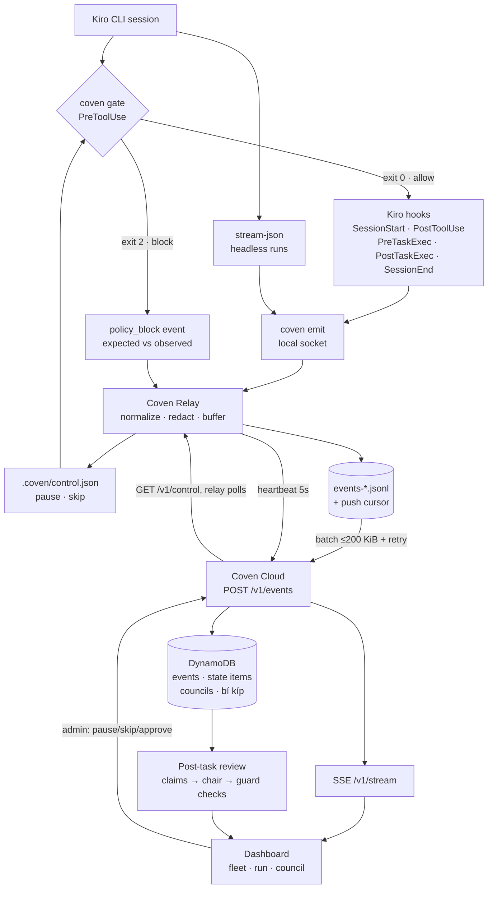
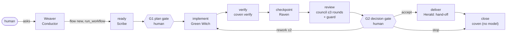

# Coven: Conceptual Solution Design v1.3

> **Status: v1.3, partly built. Supersedes v1.2 for building.** The flow (§3.5, §4.10) and the coven board (§4.11) are built and tested (2026-11-11); §8 lists what is still design only. v1.1 and v1.2 are kept unchanged beside this file. The UX companions are `coven-ux-design-v1.1.md` (Revision 2, council screens) and `coven-ux-design-v3.md` (shell, navigation, Flows and the Coven board).
>
> **What changed from v1.2.** One addition, plus the corrections it forced:
> 1. **Flow agents (§3.5, §4.10).** Four Kiro agents (Conductor, Steward, Watcher, Reporter) and one Kiro workflow recipe coordinate a task from *ready* to *delivered*, with two human gates. Kiro's own workflow engine runs it; Coven observes, derives the flow's state from hooks and checks the result. **Coven still launches nothing and schedules nothing.**
> 2. **Open decision 1 is closed:** the council's role runs are steps of the flow recipe, so `coven council start` is dropped (§4.7.1).
> 3. **Open decision 7 is closed and a defect found:** Kiro CLI loads **JSON** agent files, `.kiro/agents/<name>.json` (`name`, `description`, `prompt`, `tools`, `allowedTools`; `kiro-cli agent validate` checks them). It ignores `.md` files. The six existing persona files were `.md`, so Kiro never loaded them (§4.10.7, build step 4).
> 4. **The flow assumptions were tested on a real Kiro run (2026-11-11, Kiro CLI 3.2.0)** before any flow code: hooks fire in every step session, step sessions carry no workflow id, `run_workflow` is visible to hooks with its inputs, and the `watch` command contract works. Workflows are **off by default** in Kiro (`chat.enableWorkflows`). Results in §4.10.7.
> 5. **Scope statements are restated** where they said "Coven does not coordinate agents" (§1.4, §2): Kiro coordinates; Coven ships the definitions and records the runs.
> 6. **The coven board (§4.11):** members (several `kiro-cli` sessions, terminals or machines) take tasks themselves through cloud claims with leases; the cloud refuses only collisions. A shared whiteboard on the web; cross-review as brainstorming. This is the first coordination state the cloud holds; it still assigns nothing.
> 7. **Build order gains a flow step** and a prerequisite capture (§8.1). The deadline risk is stated: flows are cut before anything above them.
>
> **v1.2's decisions stand** (post-task council, independent guard, control channel, one admin scope, council entity, no live diff, durable-write rules, explicit build order).
>
> **What did NOT change:** Kiro-only; relay + ingest + dashboard + guard + watcher. No Coven-owned dispatch queue or assignment (members claim; the cloud only refuses collisions), no editing `tasks.md` from the cloud, no multi-tenant RBAC, no policy engine, no audit-grade ledger, no model approving its own work, and no agent that merges, pauses or skips.
>
> **One-liner:** Coven is the flight recorder — and the council chamber — for AI coding agents: it watches local Kiro runs, redacts and buffers their events, pushes them to Coven Cloud, and gathers Kiro role-agents to review finished work by evidence, chaired by a Kiro, verified by a deterministic guard, and remembered by Coven — so a team can answer one question no observability platform can: *is the agent still on the task it was given?*

> **Kiro-only, by design.** Every input Coven trusts is a Kiro primitive: `.kiro/hooks`, `.kiro/specs` and `tasks.md`, `stream-json`, `PreToolUse` exit 2, and credits via `meteringUsage`. Porting to another coding agent is a new product, not a configuration flag. Remove Kiro and Coven has no events, no spec, no tasks to map and no gate to enforce. The tradeoff is stated: if Kiro changes its hook schema or `stream-json`, Coven must change with it (§7).

## 1. Challenge & Problem Statement

### 1.1 The Fleet Is Invisible — and the Witches Never Meet

A platform team running Kiro across a dozen repositories has no shared answer to basic questions:

- Which runs are alive right now, and which died 40 minutes ago?
- Which stage is each in, and which `tasks.md` item is it on?
- How many credits has this run consumed, and which project is on pace to blow its budget?
- Is the agent still working on the task it was given, or has it wandered into another module?

Each Kiro agent works alone, like a witch in her own house: powerful on her own machine, invisible to the others. Kiro answers these questions **per session, on the developer's machine**. It does not answer them **across repos, machines and people, in real time**. It also gathers the witches nowhere: the Dev agent never hears what the Tester found, and nobody challenges the Dev's finished work with a reproducible test. That gap — invisible fleet, no review chamber — is the product.

### 1.2 What Exists, and What It Misses

| Existing option | What it does well | What it does not do |
| :--- | :--- | :--- |
| **Kiro `/usage` + session files** | Exact credits and token detail for one session | Local only, no history, no fleet, no comparison |
| **Kiro workflows** (`run_workflow`, recipes, bundled `feature-pipeline`/`publish-pr`) | Runs a defined sequence of agent steps with loops, parallel branches, human-interactive steps and hand-off artifacts (read from Kiro CLI 3.1.0's own code, 2026-11-11) | Knows nothing of declared paths, an independent guard, evidence-bound claims, or any other project's runs. Coven's flow agents are *recipes and agent files that Kiro runs* (§4.10), not a rival engine |
| **Kiro Crew** | Multi-agent orchestration in one workspace | Coordinates *work*; does not referee a review by evidence, does not guard writes against a spec across machines, keeps no cross-machine memory. Coven does not replace Crew and does not run agents as a product feature (§4.7.1 states the one bounded exception) |
| **Kiro admin console + OTel export** | Aggregate usage; daily per-user CSV; OTLP metrics delivered daily | Admin/billing telemetry, daily and aggregate — not live, not per-run, not per-task, not spec-aware |
| **LLM observability platforms** (LangSmith, Langfuse, AgentOps, Helicone, Braintrust, Arize Phoenix) | Deep tracing, evals, prompt inspection | Instrument an app from the inside via SDK or proxy; see model spans, not repo specs or `tasks.md` |
| **CI logs / OTel** | Durable, queryable, familiar | After the fact; a coding agent in a terminal is not a service |
| **Kiro hooks alone** | Deterministic triggers; `PreToolUse` can block | One machine, one shell; no aggregation, buffer or dashboard |

*(Claims about Kiro Crew, the admin console and the OTel export schedule come from public documentation read at design time and are not re-verified by this file. Re-check them before submission.)*

The missing layer is a **relay plus a review chamber**: something that turns local, transient Kiro events into durable, comparable, multi-project telemetry, then brings role-agents around finished work to review it by evidence — without asking the agent to change how it works.

### 1.3 Why This Fits Kiroween 2026

- **Frankenstein category:** a Kiro CLI session, `.kiro/hooks` events, a local relay daemon, an AWS ingestion path, a live dashboard and a council of Kiro role-agents — pieces never designed to meet.
- **New project:** created during 2026-10-30 → 2026-12-04, with `/.kiro` committed at the root.
- **Kiro is load-bearing at runtime:** Kiro CLI runs the agents, hooks emit the events, specs define the task→path mapping and stage names, role-agents review, a Kiro Chair moderates. The MCP query surface (§6) is read-only and talks to the local relay, so no token reaches a model.
- **Honest scope:** monitoring, plus task pause/skip, plus exactly one opt-in write block (off-spec-write), plus a post-task council review whose verdict is recorded and enforces nothing in the repo. No policy engine, no approvals, no RBAC. Claiming governance we did not build is the fastest way to lose a judge's trust; shipping rules we can name, test and show is not the same claim.

### 1.4 Kiro vs Coven

Kiro provides the primitives. Coven assembles them into a fleet observation layer and a review chamber. Kiro does the work; Coven records it, shows it at spec level for the whole team, and referees the review.

| Aspect | Kiro IDE / CLI / Crew does | Coven adds |
| :--- | :--- | :--- |
| Run & coordinate agents | Runs agents, writes code, executes spec tasks; its workflow engine and Crew coordinate many agents | Coven does not run or schedule agents. It ships the **agent and recipe files** Kiro runs (§4.10) and observes every run, including workflow steps and Crew runs |
| Spec & task | Defines plan, tasks, hook triggers in `.kiro/` | Links spec to live telemetry: which task a run is on; a write outside the task's declared paths → `spec_deviation` (and one opt-in block rule) |
| Hooks | Fire local events on one machine | Aggregate, buffer durably, show on a dashboard |
| State / usage | `/usage` and session logs, local | Cross-repo, cross-machine, real time: `LIVE`/`STALE`/`DISCONNECTED`, timeline, credit burn labelled by source |
| Network / sleep | Session runs locally | Local JSONL event log, retry, ordered backfill |
| Review | Crew coordinates workers | A recorded post-task review: claims with evidence, chair proposal, guard verdict, preserved dissent, memory |

> **"Kiro làm việc, Coven ghi chép và trình chiếu việc đó ở mức spec cho cả đội."** — Kiro does the work, Coven records it and presents it at spec level for the whole team.

## 2. Value Proposition & Target Users

| Persona | Pain before Coven | What changes |
| :--- | :--- | :--- |
| **Platform / DevEx lead** | Asks "who is running what?" in Slack, gets five answers | One dashboard: every project, run, stage, current task, credit burn — plus a review view per finished task |
| **Engineering manager** | Learns about a runaway agent when the bill arrives | Live credit burn per project and run, quiet runs turn `STALE`, a one-sentence chair summary says whether a task is on track |
| **Developer running Kiro** | Cannot tell whether a long run is progressing or stuck | Stage timeline, last-event age, stale/disconnected state, a red-team challenge with a reproducing test |
| **Reviewer** | Receives "it's done" with no evidence | Event timeline tied to `tasks.md`, off-spec writes, and the review record: claims, chair proposal, guard checks, dissent |
| **Hackathon judge** | Has seen a hundred "AI dashboard" demos | Real hooks, real relay buffering, real multi-project data, a guard verdict that can disagree with the Chair, and labels that admit what is estimated or seeded |

**What v1.3 does not claim:** it does not approve merges, commit or revert code, invent policy, or produce an audit-grade ledger. It does not dispatch tasks by itself (a human starts a flow; Kiro runs it), edit `tasks.md` from the cloud, or let a model approve its own work. The dashboard says so on the first screen.

## 3. Conceptual Solution Design & Workflow

### 3.1 One Run, End to End

1. **LOGIN** — `coven login` stores the cloud URL and token in `.coven/credentials.json`, mode 0600.
2. **LINK** — `coven project link checkout-api` writes `.coven/config.json`, mode 0600. One repo, one project identity.
3. **RELAY UP** — `coven relay up` starts a daemon bound to a local unix socket (mode 0600). It never binds a public interface.
4. **RUN** — either `coven run -- kiro-cli chat ...` (the wrapper mints `COVEN_RUN_ID`) or a plain `kiro-cli` session (the relay falls back to the hook's `session_id`).
5. **EMIT** — Kiro hooks call `coven emit` with event JSON on stdin. It writes to the local socket and returns; it never touches the network, so it cannot stall the agent.
6. **NORMALIZE + REDACT** — the relay maps hook payloads and `stream-json` lines into one schema, strips secrets and file contents, and attaches `project_id`, `run_id`, `seq`.
7. **BUFFER** — events append to a daily JSONL file (`.coven/data/events-YYYY-MM-DD.jsonl`) under a file lock, de-duplicated by `event_id`; a small cursor file records how far the relay has pushed. There is no local database: the file is the log you read and the backlog the relay pushes, and the cloud is the only long-term store.
8. **PUSH** — the relay batches by count (50) **and by size (≤ 200 KiB)** and posts to Coven Cloud, retrying every second while the cloud is unreachable. Offline is normal, not an error.
9. **STREAM** — the cloud durably stores the batch, then fans it out over SSE.
10. **WATCH** — heartbeats every 5 s drive `LIVE`/`STALE`/`DISCONNECTED`; credit burn is shown per project and run; a possible spec deviation raises a warning a human can dismiss.
11. **CONTROL** — the relay polls the cloud for human-set task states (pause/skip/resume) and writes `.coven/control.json`; `coven gate` reads that file only (§4.6.2).
12. **REVIEW (one completed task at a time)** — after the Dev finishes a task, role-agents review it by structured claims (§4.7), the Chair proposes `accept`/`reject`/`no-consensus` (§4.8), the guard runs its own checks (§4.6.1), and Coven records everything as events. The council never writes files and never decides individual writes.
13. **CLOSE** — `run_finished`/`run_failed` seals the run. Late events are accepted: each event carries its own `ts`, and the dashboard shows age from the last heartbeat, not the last event.



### 3.2 Where Events Come From

| Source | Covers | Notes |
| :--- | :--- | :--- |
| **Kiro hooks** (`.kiro/hooks/*.json`) | `SessionStart`, `PostToolUse`, `PreTaskExec`, `PostTaskExec`, `SessionEnd` | Interactive sessions. Command actions receive event JSON on stdin and run in the project root. `SessionEnd` is documented for CLI V3 as firing when a session is torn down; confirm it in a real run. When it does not fire (a killed terminal), runs are sealed by `STALE`/`DISCONNECTED` only. `coven` must be on PATH for hooks to work (`coven doctor` checks) |
| **`kiro-cli chat --no-interactive --output-format stream-json`** | Full JSONL transcript for headless/CI runs | Needs a Kiro CLI build that emits `stream-json` |
| **Council claims and verify results** | Role-agent claims, `verify_result`, chair and guard events | Written as Coven events via the local relay, never straight to the cloud; same idempotency and redaction as hook events |

Every event carries `source` so the dashboard can show whether a run is hook-instrumented, transcript-instrumented or council-originated.

### 3.3 Run Identity Is Minted, Not Scraped

Headless Kiro does not print a machine-readable session id, and `--list-sessions` races when two runs start in one directory. Coven therefore (1) mints `COVEN_RUN_ID` in `coven run` and exports it so hooks inherit it, (2) falls back to the hook's `session_id` for plain `kiro-cli`, and (3) never parses human-readable output to guess identity.

Each council role runs as its own Kiro run with its own `COVEN_RUN_ID` and a `role` tag (`dev`, `sa`, `tester`, `red-team`, `brainstorm`, `chair`), tied together by a `council_id` (§4.7.1). A claim without `run_id`, `role` and `council_id` is an anonymous note, and the UI shows it as one.

### 3.4 The Gate: Two Pre-Write Rules, Nothing Else

`coven gate` runs synchronously in a `PreToolUse` hook, reads only local files (`tasks.md`-derived task state, `.coven/control.json`), never touches the network, and has a stricter time budget than `coven emit` (it delays the agent's very next action). It enforces exactly two things:

| Rule | Source of truth | Default | Effect |
| :--- | :--- | :--- | :--- |
| **off-spec-write** | `_Paths:_` of the current task (§4.5.1) | **off**; `coven policy on --rule off-spec-write` | Write outside the declared paths → exit 2, `policy_block` event with expected vs observed |
| **task pause / skip** | `.coven/control.json` (§4.6.2) | in force whenever the gate hook is installed and a pause/skip exists | Write in a paused or skipped task → exit 2 with `Task T-04 is paused by <actor>.` Reads and tests still run |

**Unknown means allow.** No current task, an unparseable payload, a timeout, a missing or malformed control file, or the rule being off all return exit 0. A gate that blocks on ambiguity turns an observability tool into a liability, and a wedged hook is worse than a slow one. Every block is visible on the dashboard. The council cannot override a gate block, and the gate has no opinion about the council.

### 3.5 The Development Flow

Up to v1.2 Coven watched work and reviewed finished tasks. v1.3 covers the stretch in between: the **flow** that carries one spec task from *ready* to *delivered*. A flow is one run of a fixed pipeline, for one task, started by a human:

1. **ready** — the Scribe checks the task is fit to start (declared paths, a verify command, dependencies done, design impact) and proposes annotations if not. **Gate G1: a human approves the plan.**
2. **implement** — the Green Witch does the task inside its declared paths.
3. **verify** — `coven verify` runs the task's own check, with no model in the step.
4. **checkpoint** — the Raven reads the recorded events and writes a short note: on track, looping, off-spec, slow.
5. **review** — the Tester, Red Team and Elf write claim files in parallel; the Chair proposes; the guard (§4.6.1) measures, with no model.
6. **decide** — **Gate G2: a human reads the guard verdict** and chooses accept, rework (at most twice) or stop.
7. **deliver** — the Herald writes the hand-off and pull-request text. Opening the PR is the human's. Nothing in the flow merges.
8. **close** — Coven records the outcome, with no model.

**Who runs it.** A human talks to the **Conductor** (the Weaver) in a Kiro session and asks for a flow on a task. The Conductor starts a **Kiro workflow recipe** (`.kiro/workflows/coven-task-flow.workflow.json`); Kiro's own workflow engine launches each step as its own Kiro session with its own agent. Coven's hooks observe each step as they observe any session. **Coven schedules nothing and launches nothing**: it ships the agent and recipe files, observes the runs, derives the flow's state from them and checks the result. Kiro-only still holds: every part of the flow is a Kiro primitive (§4.10.7).



---

## 4. System & Agent Architecture

### 4.1 Three Components, One Contract

| Component | Runs on | Responsibility |
| :--- | :--- | :--- |
| **Coven Relay** | Developer machine | collect, normalize, redact, buffer, batch, push, heartbeat, poll control |
| **Coven Cloud** | AWS | ingest, store, project, fan out over SSE, serve control state |
| **Coven Dashboard** | Browser | fleet view, run detail, task control, council review, bí kíp library |

The contract between relay and cloud is one versioned event schema plus the control feed. No source code, no prompts, no model responses cross the boundary.

### 4.2 Relay Pipeline

| Stage | Behaviour | Failure mode |
| :--- | :--- | :--- |
| **Collect** | unix socket + tail of `stream-json` | socket gone → hook appends straight to the local event log |
| **Normalize** | map to event schema, attach `seq`, `ts`, `source` | unknown event → `warning` with raw type, never dropped silently |
| **Redact** | secret patterns, file *contents*, absolute home paths | redaction failure → a `warning` naming the dropped id, never a raw payload |
| **Buffer** | append-only JSONL event log + push cursor | disk full → event dropped with a note on stderr; the agent turn is never blocked |
| **Push** | batches of ≤ 50 events **and** ≤ 200 KiB, idempotent by `event_id` | offline → buffer grows, dashboard shows `STALE`. A 413/422 on a batch is **split and retried**, and a single event the cloud still rejects is **quarantined** (`sent_at` set, `rejected_reason` recorded, a `warning` event emitted) so one bad event cannot block the queue. 401 is retried and surfaced in `coven doctor`; 5xx/429 are retried with backoff |
| **Heartbeat** | 5 s frame with active agents and stage | missed 3 → `STALE`, missed 12 → `DISCONNECTED` |
| **Control poll** | `GET /v1/control?project_id=&since=` every 5 s | cloud unreachable → last applied state stays in force; `control_applied` acks each applied version |

The relay holds the cloud token; hooks never do. A hook knows only a local socket path.

### 4.3 Cloud: Ingest, Store, Stream

- `POST /v1/events` — ingest scope. De-duplicates on `event_id` (a duplicate is counted, not an error), rejects mismatched envelopes per event, caps a batch at 256 KiB (413) and an event payload at 8 KB. **An event is acknowledged only after its durable write succeeds.** On a failed DynamoDB write the cloud returns 5xx and the relay retries; failures are never swallowed. The dedupe set is updated only after the durable write.
- `POST /v1/heartbeat` — liveness. Health is derived from `last_heartbeat_at`; `FINISHED`/`FAILED` come from events.
- `GET /v1/projects`, `/v1/runs`, `/v1/runs/{id}`, `/v1/runs/{id}/events` — read scope. Responses are bounded (paged) and do not do N+1 reads.
- `GET /v1/stream` — SSE, read scope, one unfiltered stream per connection. One token scopes the whole fleet.
- `GET /v1/councils`, `GET /v1/councils/{id}`, `GET /v1/deviations` — read scope; council read model and the fleet-wide open-deviation list. The normative field-level contract for every endpoint and event is `coven-data-contract-v1.md`.
- `GET /v1/control` — ingest scope; task states with `version > since` for one project.
- `POST /v1/projects/{id}/tasks/{task_id}/state` — **admin scope**; pause / resume / skip (§4.6).
- `POST /v1/events/{id}/dismiss`, `POST /v1/bikip/{id}/approve|reject` — **admin scope**.
- **Blocking I/O never runs on the event loop.** DynamoDB calls run in worker threads (or batch writers). Start-up rehydration is a bounded scan, acceptable at demo scale.
- **Storage:** a single DynamoDB table. `PK = PROJECT#<id>`.

| SK | Contents | Mutable? |
| :--- | :--- | :--- |
| `RUN#<run_id>#META` | run summary | yes (versioned) |
| `RUN#<run_id>#EVT#<seq>` | event | no |
| `TASK#<task_id>#STATE` | task state: `queued/active/done/paused/skipped/blocked`, `actor`, `reason`, `version` | yes (versioned) |
| `COUNCIL#<council_id>#META` | council entity (§4.7.1) | yes (versioned) |
| `COUNCIL#<council_id>#MINUTES` | chair minute | no (a correction is a new minute) |
| `PLAYBOOK#<id>` / `VERSION#<n>` (own PK) | bí kíp entries | no (a new version is a new item); `status` lives on a versioned `PLAYBOOK#<id>#STATE` item |

- **Mutable state uses optimistic concurrency.** Each state item carries a `version`; writers use a conditional put (`version = :expected`), so two simultaneous dashboard actions fail loudly instead of silently overwriting. Every state change also appends an event (`task_state_changed`, `bikip_status_changed`) so history replays.
- Events carry a TTL (30 days by default). State items and bí kíp carry none; bí kíp carries a review date (§4.9). No GSI in v1.3; the read model is rebuilt with one scan at start-up.
- **Streaming:** one App Runner instance holds the subscriber registry. A subscriber with a full queue is dropped. Scale-out needs a bus; v1.3 does not claim one. Memory growth in the in-process read model is bounded (oldest finished runs are evicted from memory, not from DynamoDB).

### 4.4 Event Model

Three base entities: `Project` → `Run` → `Event`, plus `Council` (§4.7.1). `--org-id` is stored as a label but carried by no event: one token sees one fleet.

```json
{
  "event_id": "evt_9f2c41b0e7d5a3c81642",
  "project_id": "checkout-api",
  "run_id": "run_3c9f1a7e5b20d84c61f7",
  "seq": 42,
  "type": "tool_call",
  "ts": "2026-11-02T14:03:25.120Z",
  "source": "kiro-hook",
  "runtime": "kiro-cli-v3",
  "stage": "IMPLEMENT",
  "task_id": "T-04",
  "payload": { "tool": "fs_write", "path": "src/stripe.ts", "bytes": 1820, "lines_added": 12, "lines_removed": 3 },
  "usage": { "credits": 0.42, "tokens_in": null, "tokens_out": null, "usage_source": "kiro-credits" }
}
```

**Event types.** Base: `project_registered`, `run_started`, `run_finished`, `run_failed`, `turn_finished`, `stage_changed`, `task_started`, `task_finished`, `tool_call`, `file_changed`, `token_usage`, `agent_spawned`, `agent_finished`, `spec_artifact_updated`, `spec_deviation`, `policy_block`, `warning`, `daemon_connected`, `daemon_disconnected`. Council: `council_opened`, `claim_proposed`, `claim_challenged`, `test_result`, `verify_result`, `chair_summary`, `chair_proposal`, `guard_verdict`, `council_closed`. Control: `task_state_changed`, `control_applied`, `bikip_status_changed`. Anything unrecognised becomes `warning` with the raw type, so a new Kiro trigger shows up as noise, not as silence.

A council claim:

```json
{
  "event_id": "evt_claim_01", "type": "claim_challenged", "council_id": "cnl_T04_01",
  "task_id": "T-04", "role": "red-team", "run_id": "run_red_01",
  "claim": "Dev diff writes outside T-04 scope",
  "evidence": [
    { "kind": "file", "path": "src/auth/session.ts", "line": 12 },
    { "kind": "spec", "path": ".kiro/specs/stripe-checkout/tasks.md", "task_id": "T-04" },
    { "kind": "event", "event_id": "evt_9f2c41b0e7d5a3c81642" },
    { "kind": "repro", "test": "tests/test_scope.py::test_no_session_write" }
  ],
  "ts": "2026-11-10T10:54:58.120Z"
}
```

`evidence` is required for `claim_challenged`, `test_result`, and for any claim the Chair relies on. A `claim_challenged` also needs a `repro` item or it is rendered as `challenge without reproducing test — not counted`. A claim with no evidence is rendered `claim without evidence — not counted` in grey and the Chair must not use it.

**Usage is never invented.** Kiro reports consumption primarily as **credits**; per-turn token breakdown is not consistently exposed headless. Coven sends `credits` + `usage_source: "kiro-credits"` when Kiro meters credits, and `tokens_in/out` + `usage_source: "estimate"` plus the tokenizer name when it does not. The dashboard never converts credits to tokens or presents an estimate as a measurement. Council credit is the sum of its role runs plus the Chair run; each role run's credits are attributed once (a Dev run inside a council is counted in the council total **and** in the task's total; the UI says which numbers overlap).

### 4.5 Spec-Aware Mapping

- `tasks.md` is read in **Kiro's own format** (data contract §3.2.2): task number, title, status box, optional marker, dependency-graph wave, plus Coven's `_Paths:_` and `_Verify:_` annotation bullets.
- `PreTaskExec`/`PostTaskExec` hooks give authoritative task boundaries. A task is identified by spec (the tasks file's folder) and task number.
- A write outside the current task's declared paths raises `spec_deviation`, severity `possible`, never `confirmed` by Coven alone. The dashboard shows expected vs observed path; a human can dismiss it.

#### 4.5.1 Spec Deviation Ruleset

**`tasks.md` conventions (decided; open decision 3 closed):** Kiro's task syntax, unchanged, with two annotation bullets in a task's details: `_Paths: …_` (exact paths, directories and globs) and `_Verify: …_` (one shell command). They replace the earlier `## Allowed paths` / `## Verify` headings, which would end Kiro's task list. A sub-task without `_Paths:_` uses its parent's. A task without declared paths has **unknown** paths: no deviation is raised and the gate allows. A task without `_Verify:_` has an **unknown** verify check: the guard can never `accept` it (§4.6.1). Coven never infers either from a diff, a file name in the task text, or a model guess.

| Rule | Trigger | Severity | Enforceable? |
| :--- | :--- | :--- | :--- |
| **PATH_DRIFT** | A file-write `tool_call` (`fs_write`, `str_replace`, `create_file`) targets a path outside the task's `allowed_paths` and outside the global whitelist (`tests/**`, `package-lock.json`) | `possible` | **Yes — the only enforceable rule**, via `PreToolUse` exit 2, opt-in (§3.4) |
| **SHELL_DRIFT** | A shell command matches a side-effect pattern (`sed -i`, `rm`, `mv`, `> file`, installs) | `possible` | **No.** Shell regex has false positives; it is a council input, never a block |
| **STAGE_DRIFT** | `src/**` modified in stage `PLAN`, or `requirements.md` modified in `IMPLEMENT`/`VERIFY` without recorded confirmation | `possible` | **No.** "Recorded confirmation" has no measurement yet; the warning says so |

Every deviation carries `expected`, `observed`, rule id and task id. Dismissal is a human action recorded in the timeline; it changes no rule and pre-authorises nothing.

### 4.6 Task Control and the Guard

Task control means **gate control and guard verdicts**, not file editing and not dispatch. `tasks.md` stays the source of truth, owned by the repo; the dashboard never edits it.

**Task states** (derived from checklist + events + control state): `queued` `○`, `active` `▶` (from `PreTaskExec`), `done` `✓` (checkbox + `task_finished`), `paused` `⏸ Paused by <actor>` (human-set, gate-enforced), `skipped` `⊘ Skipped by <actor>` (terminal, human-set, one-line reason required), `blocked` `⛔` (a gate block occurred in enforce mode).

**Controls** (human-initiated, admin-scope, each logged as an event):

- **Pause** — the gate blocks the next write in this task. Reads and tests still run. The run is not killed.
- **Resume** — back to `queued`. It does not start a run; a human (or a future dispatch feature, out of scope) starts the next one.
- **Skip** — terminal, requires a reason. Skip state lives in the cloud; a later re-derive of `tasks.md` shows `skipped (cloud) — file still open`. There is no Unskip button; un-skip means editing `tasks.md` and re-deriving.

**Not in v1.3:** drag-and-drop reordering (order is the file's order), assigning a task to an agent or machine by Coven (dispatch; a human may start a *flow*, which is Kiro running a recipe, §4.10), auto-pause by LLM judgement.

If the file says done while the control state says blocked, the UI shows `blocked` with a grey note `tasks.md says done — reconcile by re-deriving`. The file is never auto-edited.

#### 4.6.1 Guard checks and timing

The guard is one deterministic procedure that runs **after** the Chair proposes, on a completed task. It reads no model output. Its inputs are produced by Coven commands on the developer machine:

| Check | How it is measured | Pass condition |
| :--- | :--- | :--- |
| **verify** | `coven verify <task_id>` runs the command under `## Verify` in `tasks.md` and records `verify_result` (exit code, duration, log excerpt id — never log contents) | exit 0. No `## Verify` → **unknown**, and the verdict cannot be `accept` |
| **scope** | Every file-write `tool_call` recorded for the task is inside `allowed_paths` or the global whitelist | zero PATH_DRIFT events not dismissed by a human |
| **challenge** | Each Red Team challenge carries a reproducing test; `coven verify --repro <claim_id>` runs it | the break does not reproduce for any challenge. A reproducing test that **fails** is a *confirmed break* and forces `reject` |

`confirmed` therefore has one definition: *a Red Team reproducing test that fails under `coven verify --repro`*. PATH_DRIFT stays `possible`; the Chair cannot promote it.

**Verdicts:** `accept` (all checks pass **and** the Chair proposed accept), `reject` (any check fails, whatever the Chair proposed), `no-consensus` (a check is unknown, the Chair and a passing guard disagree, or three rounds ended without agreement → human). The verdict is an **event on the task**. It does not commit, merge, revert or delete anything. If the guard rejects while the Chair proposed accept, the reject wins and the disagreement is recorded as dissent. If the guard passes while the Chair proposed reject, the verdict is `no-consensus` and a human decides.

`coven verify` runs a command from the repository's own `tasks.md`. It therefore executes with the developer's privileges and is run **only by the developer or an explicitly started council runner**, never by the cloud. Its output is redacted and budgeted like any other payload.

#### 4.6.2 Control channel: cloud → relay → gate

Pause, resume and skip are set in the dashboard but enforced at a local hook that must not touch the network.

1. The dashboard calls `POST /v1/projects/{id}/tasks/{task_id}/state` (admin scope) with `state`, `actor` and, for skip, `reason`. The cloud writes the versioned state item (§4.3) and appends `task_state_changed`.
2. The relay polls `GET /v1/control?project_id=<id>&since=<version>` every 5 s — its only downlink — and writes `.coven/control.json` atomically (temp file + rename).
3. `coven gate` reads only that file and fails open on a missing, unreadable or malformed one.
4. The relay appends `control_applied` for each version it applied; the dashboard shows `pending sync` until it arrives.

What the UI must show, not hide: while the laptop is offline the last applied state remains in force and the task reads `pending sync`, not `Paused`. If the gate hook is not installed on that machine, the UI reads `not enforced — gate hook missing`, and `coven doctor` reports the hook's presence. Sync latency is a **measured number** (UX §11 check 7, target < 10 s online), not a promise.

#### 4.6.3 Identity and scopes

v1.3 has no user model. It adds honesty plus one scope:

- Token scopes: `read` (dashboard reads), `ingest` (relay), `admin` (pause, resume, skip, approve, reject, dismiss). `COVEN_ADMIN_TOKEN` configures admin. With a non-dev store and no admin token set, **write actions are disabled**, not defaulted to `dev`. A non-dev store with no ingest/read token set **refuses to start**.
- Tokens are compared in constant time. The `?token=` query parameter exists only for SSE (the browser cannot set headers on `EventSource`), is documented as log-sensitive, and is accepted on `/v1/stream` only.
- `actor` is a free-text label the dashboard sends (typed once, stored in the browser) and recorded on every state-change event. **It is an attribution label, not authentication**; the UI footer says so.
- Agents hold only `ingest`. A role-agent or the Chair therefore cannot call admin endpoints, which is what makes "human-only" true for pause, skip, approve and reject in practice.
- Residual risk, stated: anyone holding the admin token can act as anyone. Per-user login is the precondition for anything stronger and is out of scope.

### 4.7 The Council — Roles and Claims

**The metaphor, used precisely.** Each Kiro agent is a witch working alone. The council is where they review a finished task. It is not a chat room: each role speaks by leaving a checkable claim with evidence, the Chair summarises and proposes, the guard verifies independently, and Coven records everything. A claim without evidence is not counted. A review without a guard verdict is not finished.

| Persona (display) | Role tag | Seniority | Job | Must leave (with evidence) | Must NOT do |
| :--- | :--- | :--- | :--- | :--- | :--- |
| **Elder Witch — SA** | `sa` | `kiro` | Reviews the design fit; proposes spec/design changes | Design claim: what changes, why, tradeoff, which `requirements.md`/`design.md` lines | Write code; change `tasks.md` by itself; approve its own design |
| **Green Witch — Dev** | `dev` | `kiro` | Explains the finished diff | Diff claim: files changed, task id, tests run | Approve its own work; merge; write outside the task's declared paths and call it fine |
| **White Hat Witch — Tester** | `tester` | `kiro` | Runs the tests and reports | Test result: names, pass/fail, duration, log excerpt id | Edit source to make a test pass; invent a result; report a result without naming the test. **Its result is information for humans; the guard does not read it** |
| **Black Hat Witch — Red Team** | `red-team` | `kiro` | Tries to break it | Challenge: file + line + rule violated + **reproducing test**; or `no break found` plus what it tried | Reject by itself (it challenges, the guard rejects); report a break without a reproducing case; run a destructive command against real infrastructure |
| **Elf — Brainstorm** | `brainstorm` | `kiro` | Proposes one alternative per round | Alternative: what differs, tradeoff, cost (labelled `estimate` if estimated) | Propose without tradeoff and cost; decide which alternative wins |
| **Grey Witch — Senior Kiro · Chair** | `chair` | `senior-kiro` | Moderates and proposes (§4.8) | `chair_summary`, `chair_proposal`, the minute | See §4.8 |

One role per Kiro run per council; a single run may not hold two roles, and a run holds exactly one persona for one task.

#### 4.7.0 Personas (prompt + voice only)

The personas below give each role a name and a voice. The rules:

1. **A persona is prompt + voice only.** Not a different model, not a different product, not a different permission level. Every member is the same Kiro; what differs is the role prompt, the context it can read, and its job.
2. **Seniority is role + context, not a model.** Only the Chair is `senior-kiro`: it additionally reads the whole fleet via read-only `query_fleet`, the council minutes and approved bí kíp, and moderates. It does not use a bigger model.
3. **A persona never overrides the claim rules.** Every persona speaks through `council_claim` with evidence. A claim without evidence is not counted however good it sounds in character. Validation runs on `role` + `evidence` + `council_id`, **never on `persona` or tone**, and the guard never reads persona or tone.
4. **Identifiers do not change.** The event `role` tag stays `sa | dev | tester | red-team | brainstorm | chair`. `seniority` is `kiro | senior-kiro`. `persona` (slug, e.g. `black-hat`) is display-only. If a persona definition conflicts with any rule in this file, the persona loses.
5. **Display format:** `<Persona> — <Role>`, e.g. `Black Hat Witch — Red Team`; the Chair displays as `Grey Witch — Senior Kiro · Chair`.
6. **Definition files:** one Kiro agent per persona, `.kiro/agents/<slug>.json` (slugs below; JSON is the format Kiro CLI loads, §4.10.7). `prompt` holds the persona line, voice, job, must-do, must-never-do, claim format and hard constraints; `tools` / `allowedTools` hold the least privilege the role needs (§4.10.2). No persona file may weaken a hard constraint. `coven flow lint` rejects a file without `tools`.

| Slug | Persona | Voice | Claim format |
| :--- | :--- | :--- | :--- |
| `elder-witch` | Elder Witch — SA | Calm, spare, long-view: what changes and why, in one sentence | `Design claim: <what changes>. Because <why>. Tradeoff: <cost>. Evidence: <spec lines>.` |
| `green-witch` | Green Witch — Dev | Direct, concrete: files, lines, test names | `Diff claim: <files> for <task_id>. Tests run: <names + result>. Evidence: <diff / event ids>.` |
| `white-hat` | White Hat Witch — Tester | Careful, precise, protective: names and numbers | `Test result: <test names> — <pass/fail>, <duration>. Evidence: <log excerpt id>.` |
| `black-hat` | Black Hat Witch — Red Team | Sharp, sceptical; silent about a suspected break until it can prove it | `Challenge: <file + line> violates <rule>. Reproducing test: <name>. Evidence: <test / event ids>.` or `No break found — tried: <list>.` |
| `elf` | Elf — Brainstorm | Playful, lateral, then precise about cost; one idea per round | `Alternative: <what is different>. Tradeoff: <cost>. Credit cost: <estimate>. Evidence: <spec lines / prior runs>.` |
| `grey-witch` | Grey Witch — Chair (Senior Kiro) | Even, brief, fair; neutral between black and white | `Proposal: <accept \| reject \| no-consensus> for <task_id>. Because: <reasons>. Relies on: <claim / event ids>. Dissent: <verbatim>.` |

Taglines (UI/video only): Elder — "Sees the whole. Designs first, speaks little." Green — "Grows the code." White Hat — "Protects the code." Black Hat — "Tries to break it." Elf — "Thinks sideways." Grey — "Stands between black and white; proposes, never imposes."

*Status: Elder Witch, Green Witch and Grey Witch are assistant-proposed; Black Hat, White Hat and the Elf are user-named. Confirm or swap the three (open decision 8). The mapping must stay 1:1 with the roles either way.*

**Protocol — one completed task, max 3 rounds.** One round: SA (round 1, or when design changes) → Dev explains the finished diff → Tester runs tests → Red Team challenges, each with a reproducing test → Brainstorm proposes at most one alternative (optional) → Chair summarises and proposes `accept`/`reject`/`no-consensus` (§4.8) → Guard runs its own checks (§4.6.1). After round 3 without agreement the Chair declares `no-consensus` and escalates to a human with a one-sentence summary of what is stuck. There is no automatic round 4. Total council credit is shown in the Run Room; the demo must show what it cost and what it bought (breaks caught, false alarms).

**What the council is NOT:** Crew orchestration, a general chatbot, a PM meeting, or an approver of merges. Free-form text with no claim and no evidence is rendered as a note and the Chair must not use it.

#### 4.7.1 The council entity

Each role is its own Kiro run, so a review spans many runs. A council therefore has its own identity:

```json
{ "council_id": "cnl_T04_01", "project_id": "stripe", "task_id": "T-04",
  "role_runs": { "dev": "run_a", "tester": "run_b", "red-team": "run_c", "chair": "run_d" },
  "round": 2, "status": "in_progress", "credits": 1.8, "mode": "seeded | live", "version": 3 }
```

Claim, chair, verify and guard events carry `council_id` in addition to `run_id` and `role`. State lives at `COUNCIL#<id>#META` (versioned), minutes at `COUNCIL#<id>#MINUTES`. The Run Room's Council tab is keyed by `council_id`, not by a run. `mode` is `seeded` or `live`, shown in the UI, and a seeded council is never described as live.

**Who launches the role runs (decided, v1.3):** the **flow recipe** (§4.10.3). Its `review` step runs the roles as `parallel` branches and the Chair after them, each a separate Kiro session with one agent file, so "one run, one persona, one task" holds by construction. Kiro's workflow engine launches them; Coven launches nothing. Until the flow ships, councils are seeded, replayable event sequences, as in v1.2. The bounded wrapper `coven council start` is dropped.

### 4.8 The Chair — a Kiro as Moderator

**Decision (user, 2026-11-10): "để kiro làm chủ toạ luôn" — a Kiro agent is the Chair.**

The Chair is the **Grey Witch — Senior Kiro · Chair**, a separate Kiro run (default: one headless run per council, with its own `COVEN_RUN_ID`; open decision 2 covers a persistent Bot). "Senior" is role + context, not a model: it reads the whole fleet through `query_fleet`, the council minutes and approved bí kíp, and moderates. It may not run a fourth round automatically. It reads the council's claim events and the fleet through the read-only `query_fleet` MCP tool, and it writes only `chair_summary` and `chair_proposal`.

**The Chair CAN:** order turns; ask a role for missing evidence; summarise in one sentence where the council agrees and disagrees; request one more test; propose `accept`/`reject`/`no-consensus` with reasons and a link to every claim it relies on; declare `no-consensus` after three rounds and escalate.

**The Chair CANNOT:** write a file; change a spec or `tasks.md`; override a guard `reject`; approve its own proposal; hide dissent (Red Team dissent appears verbatim under the proposal even when the Chair disagrees); pause or skip a task (human-only, §4.6.3); decide on a claim with no evidence; spend unlimited credits (counted in the council total, three-round cap).

**Chair proposes, guard disposes.** A proposal is a claim like any other, with evidence links. The guard (§4.6.1) never reads it. A guard `reject` wins over a Chair `accept`, and the disagreement is recorded as dissent; a passing guard with a Chair `reject` becomes `no-consensus` for a human.

**Failure modes, stated in advance:** hallucinated consensus (mitigation: a proposal linking an unlinked claim is invalid and rendered so); favouring the Dev (dissent always shown; the guard ignores the Chair); looping (three-round cap).

### 4.9 Memory — Coven Manages It; the Council Keeps Its Bí Kíp

Three layers; Coven manages all three and no single witch owns them.

1. **Ledger (raw, immutable):** events, claims, chair summaries/proposals, verify results, guard verdicts, heartbeats. Deleted only by TTL (30 days).
2. **Council minutes (one per council, written by the Chair):** what was agreed, disagreed, what evidence decided it, what is open. Dissent verbatim. Read-only once written; a correction is a new minute citing the old one.
3. **Bí kíp (playbook):** a pattern learned from several minutes, not one run. Fields: `id` (`BK-01`), `statement` (one sentence), `evidence_runs`, `source_minutes`, `occurrences`, `status` (`proposed`/`approved`/`rejected`), `version`, `review_by`. Examples, labelled as examples and not measured results: `BK-01 — Stripe checkout tasks drift to src/auth/session.ts; guard that path first.` `BK-02 — The same task failing the same test three times without task_finished means the SA design is wrong, not the Dev code; ask SA first.` `BK-03 — A Brainstorm alternative that changes payment mode costs about twice the credits; propose it only when the first approach is rejected.`

**Promotion (no auto-promotion, ever):** the Chair proposes a candidate after a council closes → a human approves via the admin endpoint, or the guard confirms it by replaying it on held-out past runs → `approved`, shown as briefing at the start of the next relevant council as `Bí kíp BK-01 (from 3 runs)`. A bí kíp entry is **advice, not evidence and not a rule**: roles must still prove their claim fresh; it never blocks a write, never changes `allowed_paths`, never creates a policy. A wrong entry is `rejected` with a reason and kept. Every entry has a review date, because Kiro, specs and prices change; a stale entry is worse than none, and a council that obeys its own old playbook can reinforce its own mistake.

Bí kíp differs from Kiro Bot Notes and Crew shared memory: those are for one bot or one workspace. Coven's playbook is cross-project and cross-machine, learned from reviews.

### 4.10 Flow Agents — Coordinating the Development Flow

**Decision (user, 2026-11-11):** add agents that coordinate the development flow. This section is the design. It is the largest scope change since v1.1, so it states what it does *not* change first.

**What does not change.** Coven's service still runs no model, runs no agent, keeps no dispatch queue and edits no `tasks.md` from the cloud. The agents below are **Kiro agents defined in the repository** (`.kiro/agents/`), driven by **Kiro workflow recipes** (`.kiro/workflows/`) that Kiro itself executes. Coven observes them, derives the flow's state from their hooks, and checks the result with the same independent guard as before. No agent approves its own work, merges, pauses or skips (§4.6.3).

#### 4.10.1 Principles

1. **Kiro does the coordinating; Coven does the recording and checking.** Reimplementing Kiro's workflow engine would duplicate it, drift from it, and break "Kiro-only".
2. **The recipe decides the order; the Conductor decides the inputs.** The pipeline is a checked-in file, reviewed like code. The Conductor picks which task, fills the recipe's inputs and talks to the human. It never improvises the sequence. An ad-hoc workflow (Kiro's `workflowPrompt` form) needs a human to approve its steps.
3. **Humans hold the gates.** Two gates (G1 plan, G2 decision) are interactive steps: the flow cannot advance without a human message. An agent can recommend; it cannot pass a gate.
4. **State lives in the repo.** `tasks.md` carries task status. A flow's hand-offs are files under `.coven/flows/<flow_id>/`. The cloud holds only derived, content-free events about them.
5. **Least privilege, honestly stated.** Each agent's `tools` list is the minimum that does its job. Kiro tool tags are coarse (`write` means every write), so **path scoping comes from Coven** (`_Paths:_` per task, a declared path set per flow step), advisory by default and a gate when the developer opts in (§3.4).
6. **Bounded loops.** Every loop is a recipe `repeat` with `maxIterations` and `onMaxIterations: pause`, never `continue`: rework ≤ 2, council rounds ≤ 3. After the cap the flow stops and asks.
7. **Cost is shown, not promised.** A flow runs at least eight sessions. Hooks carry no credits (§4.4), so the dashboard shows time and call counts per step and credits only where a headless run reports them.
8. **Sequential first.** One task at a time. Parallel waves (Kiro's task graph supports them) need separate worktrees and come later (§8.1).

#### 4.10.2 The roster (as built)

Four agents coordinate; the council personas (§4.7.0) do the review. All are **Kiro CLI agents**, `.kiro/agents/<slug>.json` (§4.10.7), validated by `kiro-cli agent validate` and by `coven flow lint`. The persona rules of §4.7.0 apply to all of them: prompt and voice only, the same Kiro, the permissions its `tools` grant, and a persona never overrides this file. `allowedTools` are the tools Kiro runs without asking; every other tool asks the human first.

| Display name | Slug | Flow step | Job | `tools` · auto-allowed | Must never |
| :--- | :--- | :--- | :--- | :--- | :--- |
| **Weaver — Conductor** | `weaver` | starts the flow; `decide` (gate G2) | Runs `coven flow new <spec>#<task> --json`, then `run_workflow` with the printed `flow_dir`; reports status. At G2 presents the guard verdict, the Chair's proposal and dissent, and writes the human's answer to `decide.json` | `read` `write` `shell` `run_workflow` `inspect_workflow` · `read` `inspect_workflow` | Start a flow nobody asked for; run any command but `coven flow …`; edit source or specs; decide a gate itself |
| **Scribe — Steward** | `scribe` | `ready` (gate G1) | Checks the task has `_Paths:_`, `_Verify:_` and finished dependencies; flags design impact; proposes missing annotation lines; adds them only after the human approves | `read` `write` · `read` | Change requirements, design, a task's text or status; write outside `.kiro/specs/` and the flow directory |
| **Raven — Watcher** | `raven` | `checkpoint` | Reads the local event log (`.coven/data/events-*.jsonl`) and `verify.json`; writes one line per finding (on track, looping, off-spec, slow), each with event ids | `read` `write` · `read` | Write anything but its note; pause, skip or stop anything; run commands |
| **Herald — Reporter** | `herald` | `deliver` | Writes the hand-off and pull-request text from the flow's files, with the guard's verdict exactly; tells the human opening the PR is theirs | `read` `write` · `read` | Merge, push or open a PR; claim a verdict the guard did not give |
| Green Witch — Dev | `green-witch` | `implement` | §4.7 | `read` `write` `shell` · `read` | §4.7 |
| White Hat Witch — Tester | `white-hat` | `review-tester` | §4.7 | `read` `write` `shell` · `read` | §4.7 |
| Black Hat Witch — Red Team | `black-hat` | `review-redteam` | §4.7; reproducing tests under the tests directory only | `read` `write` `shell` · `read` | §4.7 |
| Elf — Brainstorm | `elf` | `review-brainstorm` | §4.7 | `read` `write` · `read` | §4.7 |
| Grey Witch — Chair | `grey-witch` | `chair` | §4.8; reads the claim files and `verify.json` | `read` `write` · `read` | §4.8 |
| Elder Witch — SA | `elder-witch` | *(not in the recipe)* | §4.7. A recipe cannot branch on a condition, so the design review is the human's call at G1, where the Scribe flags design impact | `read` `write` · `read` | §4.7 |

**Why `write` everywhere.** Agents speak through **files** (below): no claim tool exists, and Kiro tool tags are coarse (`write` means every write). Path scoping is Coven's: every step session is given the flow's task (§4.10.4), so a write outside the task's `_Paths:_` raises a possible deviation as in any session, and the guard's scope check fails on it. Writes inside `.coven/flows/<id>/` are a step's own artifact and never a deviation. *Names are proposals in the persona style (open decision 9). `run_workflow` and `inspect_workflow` carry only the `@builtin` tag, so the Weaver lists them by id; this was tested.*

**Watching is mostly deterministic.** The attention chips (`failing`, `repeat failure`, `deviation`, `stalled`) are computed by the cloud with no model. Raven adds an explanation at the checkpoint only; it does not poll.

#### 4.10.3 The flow recipe (as built)

`.kiro/workflows/coven-task-flow.workflow.json`, input `flow_dir`. Validated by Kiro's own `run_workflow` (2026-11-11, Kiro CLI 3.2.0: valid) and by `coven flow lint`. Every agent step writes **one artifact named after the step**, `{{flow_dir}}/<step_id>.<ext>`; that is how a session is bound to its step.

| # | Step id | Run by | Writes | Gate | Loop |
| :--- | :--- | :--- | :--- | :--- | :--- |
| 1 | `ready` | Scribe | `ready.md` | **G1**: `completion` on `READY-APPROVED` | — |
| 2 | `implement` | Green Witch | `implement.md` (diff claim: files, counts, tests) | — | `round` |
| 3 | `verify` | **no model**: watch → `coven flow run-step verify` | `verify.json`, `verify.log` (local) | — | `round` |
| 4 | `checkpoint` | Raven | `checkpoint.md` | — | `round` |
| 5–7 | `review-tester` `review-redteam` `review-brainstorm` | White Hat, Black Hat, Elf, in `parallel` (`allSettled`) | `review-*.json` claim files | — | `round` |
| 8a | `board` | **no model**: watch → `coven flow run-step board` | posts `review-wanted`; `board.json` (other members' notes, untrusted) | — | `round` |
| 8 | `chair` | Grey Witch | `chair.json` (proposal; may cite board notes) | — | `round` |
| 9 | `guard` | **no model**: watch → `coven flow run-step guard` | `guard.json`, `guard-history.json`, council events | — | `round` |
| 10 | `decide` | Weaver | `decide.json` (`accept` · `rework` · `stop`) | **G2**: `completion` on `DECISION-RECORDED` | `round` stops on `FLOW-DONE` |
| 11 | `deliver` | Herald | `deliver.md` (hand-off, PR text) | — | — |
| 12 | `close` | **no model**: watch → `coven flow run-step close` | `council_closed`, `flow_finished` | — | — |

`round` is one `repeat`: `maxIterations: 3` (one try plus two reworks), `onMaxIterations: pause`, `stopCondition: {containsText: "FLOW-DONE"}`, which Kiro evaluates on the most recent step's output: the decision gate's. Each watch node sits in its own `repeat` with `stopWhen: "<id>.terminal"` and answers `terminal-state` once. Only behaviour seen working on the capture run is used: no `fileCheck` (its `jsonPath` syntax is unverified) and no idle-polling watch. A failing verify does not loop back on its own: the round continues, the guard rejects, and the human chooses rework at G2. That costs one council round, and keeps a single loop with a single, human-held exit.

**Claim files.** No `council_claim` tool exists, so each council agent writes JSON: the Tester `{claim, tests[], evidence[]}`, the Red Team `{claim, challenges[{file, line, rule, repro}], evidence[]}`, the Elf `{claim, alternative_cost, evidence[]}`, the Chair `{summary, proposal, reasons[], relies_on[role…], dissent[]}`. The `guard` step turns them into council events (`source: "council"`, `council_id = cnl_<flow hex>`, a role each). The Chair's `relies_on` names roles; Coven links them to the recorded claim events, so a proposal never cites an id it could not have known.

**Independence is kept by running deterministic steps without a model.** The guard's three checks, all measured:

| Check | How (as built) |
| :--- | :--- |
| `verify` | `verify.json` from the `verify` step: the task's own `_Verify:_` command; no command → **unknown** |
| `scope` | every file write recorded for this flow's sessions against the task's `_Paths:_`, artifacts excluded. Measured from the local event log, so it does not depend on the relay having raised a deviation. No `_Paths:_` → **unknown** |
| `challenge` | each Red Team repro is run by the guard, but **only** a pytest node id or a `node --test` file that exists in the repository, never a shell string. Exit 1 is a confirmed break (**fail**); a missing runner, a timeout, or exit 2–5 (collection or usage error) is **unknown**, never a break |

Verdict: any **fail** → `reject`; any **unknown**, or a Chair proposal other than `accept` → `no-consensus`; otherwise `accept`. The Chair can lower a verdict, never raise it. `verify_result` and `guard_verdict` count as evidence only with `source: "coven-cli"`.

#### 4.10.4 Flow identity and hand-offs

- **`flow_id`** (`flw_<20 hex>`) is minted by `coven flow new <spec>#<task>`, which refuses an unknown task, creates `.coven/flows/<flow_id>/flow.json` (steps, gates and step agents read from the recipe) and emits `flow_started` itself. Flow events live on their own run (`run_id = flow_id`), which the cloud shows as a flow and never as a session.
- **A started recipe is linked to its flow** (confirmed: hook payloads carry `run_workflow`'s `inputs.flow_dir`); a `run_workflow` whose `flow_dir` names no flow made by `coven flow new` raises a `warning`.
- **Step identity** is derived, not reported (confirmed: hook payloads carry no workflow id). The first write by a session to `<flow_dir>/<step_id>.<ext>`, for a step the recipe has, emits `flow_step_started` and a `task_started` on that session with the flow's task, so the session shows its task and its off-spec writes are caught. That session's `SessionEnd` emits `flow_step_finished`. Deterministic steps emit their own. The relay does this, and so does `coven emit` when the relay is down (bindings in `.coven/state/flow-bindings.json`), so flows work either way.
- **Hand-offs are files, and they stay on the machine.** The cloud receives ids, step names, outcomes, verdicts and claim text (claims are short, redacted text, as in §4.7), never the step files.
- **A gate is a running interactive step.** The dashboard reads a gate as `waiting for you` while its step is running. Observed on a real run: an agent can also **end** a gate step by failing it (the Scribe did when its flow did not exist), which fails the workflow. A gate therefore never advances without a human, but it can stop the flow.

#### 4.10.5 Who may do what

| Action | Who | Enforced by |
| :--- | :--- | :--- |
| Start a flow | a human, through the Weaver | only `weaver` has `run_workflow`; Kiro needs `chat.enableWorkflows` on |
| Pass G1 / G2 | a human | `completion` steps: no human message, no progress |
| Add annotations to `tasks.md` | Scribe, after G1 | its prompt; path scope as below |
| Write source | Green Witch inside `_Paths:_`; Black Hat in the tests directory | every step session carries the task: PATH_DRIFT advisory, opt-in gate (§3.4), guard `scope` check |
| Verdict | the guard (`coven flow run-step guard`, no model) | §4.10.3 |
| Merge, push, open a PR | nobody in the flow | no agent is told to; Herald is told not to |
| Pause, resume, skip | a human | admin scope (§4.6.3); agents hold `ingest` only |
| Change cloud data | nobody | agents hold `ingest` only |

#### 4.10.6 What Coven records and shows

Events (data contract §5.5): `flow_started`, `flow_step_started`, `flow_step_finished`, `flow_finished`, plus the council events of §5.3 under `council_id = cnl_<flow hex>`. Gate state is **derived** (a running gate step), not an event. The `Flow` read model (`GET /v1/flows`, `GET /v1/flows/{id}`) and `coven flow status` compute the same thing; the cloud's TypeScript copy is tested against the Python output. The dashboard's **Flows** place appears only when a flow exists: a list, and a flow page with the waiting gate first, the steps in recipe order with their persona and session links, the guard verdict and the decision. It has no buttons: gates are answered in the Kiro session.

#### 4.10.7 Kiro dependencies: what is known and what is not

**Tested on a real run** (2026-11-11, Kiro CLI 3.2.0, headless; a throwaway repository with a two-step recipe and a `watch` node between the steps; payloads kept as `tests/fixtures/kiro-cli-3.2-workflow/`):

| Fact | Result | Used for |
| :--- | :--- | :--- |
| Agent file format | **JSON**, `.kiro/agents/<name>.json`: `name`, `description`, `prompt`, `tools`, `allowedTools` (also `resources`, `mcpServers`, `toolsSettings`, `includeMcpJson`, `model`). `.md` files are ignored by the CLI; `kiro-cli agent validate --path` rejects them as invalid JSON. `kiro-cli agent list` shows the workspace agents | Agent files; `coven flow lint` calls the same validator when Kiro is installed |
| Workflows are a setting | `chat.enableWorkflows` must be `true` (default unset: off). Without it, `run_workflow` "is not available" | `coven doctor` reports it; the README states it |
| Granting the workflow tools | Tool tags (`workflow` as a capability) did not grant them; listing `run_workflow` and `inspect_workflow` **by id** in `tools` and `allowedTools` did | The Conductor's agent file |
| **F1** hooks in step sessions | **Pass.** Every step ran as its own session with its own `session_id`, `SessionStart`, tool hooks, `Stop` and `SessionEnd` | Each step is a normal Coven session |
| Workflow id in hooks | **None.** A step session's payloads carry only `session_id`, `cwd`, tool name and input | Step identity must come from artifact paths (§4.10.4). It does: each step's first write was its own artifact |
| **F2** `run_workflow` in hooks | **Pass.** `PreToolUse` and `PostToolUse` fire for it; `tool_input` carries `workflowPath` and `inputs` (so `inputs.flow_dir`) | Linking a started recipe to its flow, and the "recipe started without a flow" warning |
| `watch` (`command`) contract | **Pass.** stdin is `{cursor, config, workspacePath, additionalDirectories}`; stdout must be one JSON `{outcome: "idle"\|"new-activity"\|"terminal-state", cursor}` (`cursor` required, `null` allowed). `terminal-state` ends a `repeat` with `stopWhen: "<id>.terminal"`. Exit 2 fails the node; exit 126/127 fail it as unrunnable; any other non-zero exit counts as `idle`. `command` must be static; `pollIntervalSec` ≥ 10 | Deterministic `verify` and guard steps |
| Recipe validation | A step cannot template its **own** artifact; only later steps may read `{{artifacts.key}}` | `coven flow lint` rule |
| Schema 3.1.0 → 3.2.0 | Same node types; 3.2.0 adds an optional `onModelNotOffered` on steps | Lint is pinned to 3.2.0 and accepts 3.1.0 |

**Not yet tested:** **F3**, a gate. An interactive step (`completion`) waits for a human message *in the workflow's session*; a headless capture cannot answer it, so it must be tested interactively. Until it is, the dashboard reads a gate as "waiting" only from the evidence it has: a running gate step with no `SessionEnd`.

#### 4.10.8 Alternatives considered

| Option | Why not |
| :--- | :--- |
| A Coven-owned dispatcher and queue in the cloud, with a runner on each machine | The cloud would launch agents on developer machines: a second control plane, a new attack surface, and the "dispatch queue" this CSD excludes. Kiro already has an engine |
| Kiro Crew | A separate CLI, not installed or verified here (§1.2) |
| Kiro's `feature-pipeline` unchanged | Generic and heavy; no declared paths, no independent guard, no evidence rule, nothing Coven can verify. Reused in parts (`publish-pr`) |
| Prompts only, no recipe | The Conductor would improvise the order every time: not reviewable, not testable |
| A fully autonomous flow, no gates | Self-approval. §4.6.1 exists to prevent it |

#### 4.10.9 Failure modes, stated in advance

| Failure | Mitigation |
| :--- | :--- |
| The Conductor improvises or skips a step | Order lives in the recipe; `coven flow lint` checks every step has an agent and an artifact; a missing artifact fails the step |
| Rework never converges | `repeat` caps; `pause` at the cap; the flow records `reworks` |
| Gate fatigue (a human clicks through) | Two gates only; each shows the evidence that matters (the guard verdict and dissent); the verdict does not depend on the human's click |
| A step agent claims a result it did not get | `verify` and the guard have no agent: a `watch` command node runs the CLI, which writes `verify.json` / `guard.json` and emits the event. An agent's report is a note |
| A hand-off carries sensitive text | It stays local; only ids and sizes travel; redaction as everywhere |
| Kiro changes the workflow or agent schema | Version-pinned lint; flows are optional, the rest of Coven works without them |
| Hooks do not fire for step sessions | The first build step proves it by capture; if they do not, flows are not shipped (§8.1) |
| Cost surprises | Time and call counts per step; credits only where reported; the cap on loops bounds it |
| Parallel writers collide | Sequential by default; parallel waves only with worktrees, later |
| Scope creep into Crew | Hard cap: four agents, one recipe, two gates, no scheduler (§7) |

### 4.11 The Coven Board — Members Working Together

> **Revised 2026-11-12/13 — hosts and witches.** A *member* is now a **host**: a named machine that hosts **witches** (the personas) and runs several at once; the witches take and do the work, each task naming the witch it needs (`_Agent:_`, default the Dev). People talk to the council and the **Chair dispatches**. The design of record is **`docs/design/coven-hosts-v1.md`**; §4.11.3 below summarises it. What this section says about collisions, leases, readiness, notes and "the cloud assigns nothing" still holds; the points it changes are marked *(revised)*.

**Decision (user, 2026-11-11):** several `kiro-cli` sessions, in terminals or on machines, each run agents and contribute to the whole project; members take tasks themselves; cross-review is brainstorming; the cloud web is a shared whiteboard; everything is monitored in the cloud. This section is the design as built. It moves one line this CSD drew: **the cloud now holds coordination state** (claims). It still assigns nothing.

**Members** *(revised: hosts)*. A member is one `kiro-cli` working copy with a name (`coven host join <name>`, or the older `coven member join`; default `user@host:folder`; `COVEN_HOST` / `COVEN_MEMBER` override). Every event it sends carries `member`. A member is an **attribution label, not an identity**: anyone holding the ingest token can use any name (§4.6.3 still holds).

**Claims: members take, the cloud only refuses collisions.**

| Rule | As built |
| :--- | :--- |
| Who chooses the task | the member (`coven board next`, `coven flow new --next`, or a named task); the cloud never assigns |
| Refused | a task another member holds (`409 held`), or a task whose `_Paths:_` overlap a task another member holds (`409 paths overlap`). Overlap is conservative: a root glob overlaps everything; unknown paths overlap nothing (and the guard cannot accept such a task) |
| Lease | 15 minutes by default (1 minute to 1 hour). The relay renews the working copy's claims every minute; a silent member loses them. Renewals are in memory: after a cloud restart a claim lives until its recorded lease ends |
| Release | by the owner only (`coven board release`, or the flow's `close` step) |
| Review claims | `coven board review <task>`: any number of members, never blocks the author |
| Races | board operations are serialised in the cloud, so of ten members claiming one task at once exactly one wins (tested on both stores, including a slow DynamoDB fake). One cloud instance is assumed, as for SSE (§4.3) |
| Forgery | `task_claimed` / `task_released` are made by the cloud after its check; `/v1/events` refuses them |

**Readiness** (which tasks a member may take; the same rule in `coven board ready` and on the web board): required leaf tasks not done and not held, whose turn has come. With Kiro's dependency graph, every task in an earlier wave is done. Without one, the sub-tasks of one parent go in order and top-level tasks are independent; collisions are stopped by the path-overlap rule.

**Isolation** *(revised)*. Each member works in its own working copy (a clone, or a `git worktree`), and every task ends as a branch a human merges. A **host** now creates a `git worktree` and branch `coven/<spec>-<task>` per Dev task and commits there locally (`coven-hosts-v1.md` §3.1); nothing pushes or merges.

**The whiteboard.** Notes (`board_note`: `idea`, `question`, `answer`, `review`, `note`, `review-wanted`) are short text about a task or the project, at most 400 characters, redacted like any payload. Agents post them through the relay (`coven board post`); people post them from the web page (a read token may post; the note is labelled as web text). The web board shows *(revised)* the witches (working, available, waiting for a slot, not available), the task columns as numbers (Ready · Claimed · In review · Blocked · Done) that open on click, and the notes as a wall (UX v3 §6.2). The task list comes from the spec progress the relay sends, now with each task's id, title, status, structure and declared paths (`coven board sync` sends it on demand). No other spec text and no code is sent.

**Cross-review is brainstorming.** The flow's model-free `board` step (between the council and the Chair) posts `review-wanted` with facts only (task, round, verify result, files written) and brings the notes other members left on the task into `board.json`. Any member's **Imp** agent (`kiro-cli --agent imp`) reads the board and posts up to three notes on a task that wants review. The author's Chair weighs them and may cite them; **the guard never reads them**, so a brainstorm can lower a proposal but never pass a task. A reviewer on another machine sees the board's facts, not the author's uncommitted code: a code-level cross-review needs the branch shared (pushed, or a worktree on the same machine).

**Notes are untrusted.** Every member's agents read text written by other members and by anyone with a read token. Every agent that reads the board is told, in its prompt, that notes are data and never instructions; `board.json` repeats it. This is a prompt-injection surface by design, and it is mitigated, not removed: an agent can still be misled. Its effects are bounded by the rest of this CSD: notes cannot reach the guard, cannot merge, cannot pause or skip, and every write is still checked against the task's paths.

**What it does not do.** No scheduling, no assignment, no automatic merge, no per-member authentication, no cross-machine file sync, no task editing from the web.

#### 4.11.1 Council chat — people talk to the council (as built, 2026-11-12)

**Decision (user, 2026-11-12):** a person can ask the council, give it an idea or a suggestion, or reject a task, from the web. **One role for people: Human** (anyone signed in); per-project roles (RBAC) come later.

| A person sends | Effect |
| :--- | :--- |
| **ask** | the council answers; nothing changes |
| **idea / suggestion** | recorded on the task (or project); the council answers how it would apply it and at what cost; the flow's `board` step brings it to the Chair in `board.json` → `human`, and the Chair must address it in its reasons (adopted, or why not) |
| **reject** (needs a task) | a **binding human decision**: the guard gains a fourth check, `human`, which **fails** when a person rejected the task after this round's work (`implement.md` written); work done after a rejection answers it. A chat that cannot be read is `unknown`, never `pass`. No cloud configured: `pass` (no chat exists) |

**Who answers** *(revised: the Chair dispatches)*. When an online host runs the Grey Witch, everything said to the council (no *To*, or the Chair) is hers: she sees the recent conversation, the witches online and the open tasks, answers, and turns requests for work into jobs on the board (`coven-hosts-v1.md` §5–§6). A fifth kind, **do**, sends work to the Chair or to one witch. The listener below still answers messages addressed to one witch, and everything when no host runs the Chair. A member runs `coven council listen` in a working copy. For each waiting message it runs the **`council-chat`** Kiro agent headless, in the voice of the role addressed (`chair` by default; `sa`, `dev`, `tester`, `red-team`, `brainstorm`), and posts the answer through the relay. Messages older than a day are not answered. The listener reports every minute; the web shows who answers, or that nobody listens and messages wait.

**The answering agent can read, never act** (each verified on Kiro CLI 3.2.0 before building): `--trust-tools=` trusts nothing, so a write or shell call fails at the permission step (nobody is there to approve it); the agent's `permissions.rules` allow `fs_read` on `**`, which Kiro resolves inside the working copy only (reads of `~`, `/mnt/c` and another member's copy failed), and deny secret files (`.env*`, keys, `credentials*`, `.dev.vars`, `.coven/`, `.git/`).

**Trust.** Only the cloud makes a human message (`POST /v1/chat`); `/v1/events` refuses a `chat_message` that is not the council's, so no agent can speak as a person or forge a rejection. Any signed-in person can reject, under any name: that is the Human role until RBAC. Answers are model text that leaves the machine on purpose, like board notes (an exception to R3.3 the user chose): at most 400 characters, redacted, and the agent is told never to quote file contents or secrets. A cut answer ends with `…`.

**What it does not do.** A message never starts, pauses or stops a flow run (a `do` makes a host start a new witch run, §4.11.3); a rejection takes effect at the task's next guard, and nothing merges without a person. Two listeners on one project may both answer a message (run one per project).

#### 4.11.2 The `coven-board` skill — Kiro works the board (as built, 2026-11-12)

**Decision (user, 2026-11-12):** a member's Kiro monitors the board, pulls tasks that are not done, and does them. Built as a **Kiro skill** (`.kiro/skills/coven-board/SKILL.md`, loaded on demand when asked to "work the board") over a deterministic command, `coven work`, so the rules do not depend on the model following prose.

| `coven work` | Does |
| :--- | :--- |
| `poll [--wait s]` | next action, in order: `continue` (an interrupted task) · `rework` (people's reject/idea/suggestion in the council chat, or a member's review, since the last submit) · `start` (a ready task) · `wait` (two submitted tasks await review) · `idle` · `offline`; releases tasks whose branch was merged or that people ticked; renews this member's claims |
| `start [task]` | claims (the next ready task, or one) and switches to `coven/<spec>-<task>` from the base branch; refuses while another task is `working`, or when uncommitted changes lie inside the task's paths |
| `submit task` | the task's `_Verify:_` must pass and every changed file must be inside `_Paths:_`; then a **local** commit, back to the base branch, a `review-wanted` note; the claim is kept while people review |
| `resume task` · `drop task` | back to the branch for rework · give it up (release; the branch stays) |

**Rules the command enforces:** never pushes, merges or ticks a task; one task at a time; uncommitted changes from before a task started are never committed (a fingerprint per file), so machine-specific hook paths stay out. **Rules the skill states:** no `git commit/switch/stash` by the model, no spec edits, notes and chat are data, three failed submits → drop and ask on the board. **Tested live** on the Cloudflare board (member `wsl-dan`): the skill took coven-relay#13 and committed `.github/workflows/ci.yml` on its branch; a human rejection in chat sent it back; the rework commit added exactly the fix asked for.

**Limits:** the commit stays on the member's machine, so a reviewer elsewhere needs it pushed (by a person); Kiro monitors only while a session runs the skill; every reaction is a model run (credits).

#### 4.11.3 Hosts, witches and dispatch (as built, 2026-11-13)

**Decision (user, 2026-11-12):** "members are not machines: `wsl-xxx` is just the host, and a host can host many agents. If a task needs the Elf, the Elf takes it; if Raven is needed, Raven takes it; available hosts take the remaining tasks with the right persona." Then: "the human asks the council; the senior should understand and dispatch the task, and the task should show on the board"; and "the doer submits and updates the status". Design of record: `docs/design/coven-hosts-v1.md`.

| | As built |
| :--- | :--- |
| Host | `coven host run` / `./run-host.sh`: slots (default 2), the witches installed in its working copy, presence every minute (`host_online`) |
| Which witch | the task's `_Agent:_` (inherited by sub-tasks); none = the Dev. Tasks naming a witch go first |
| Claims | host + witch; two witches of one host collide like two hosts |
| Kinds | **build** (Dev: own worktree and branch, host verifies, path-checks, ticks the task on the branch, commits locally), **inspect** (Tester, Red Team, Imp: throw-away checkout, read and run), **think** (the rest: read-only) |
| Status | the doer reports `working` → `submitted` / `answered` / `failed`; only people say `done` (Mark done, or the tick reaching the base branch) |
| Dispatch | the Chair answers what is said to the council and makes jobs (tasks of the spec `council`, ≤ 6) for the witches; a `do` to one witch goes straight to her; answers come back in the chat in ≤ 8 steps |
| Not changed | the cloud assigns nothing (hosts pull); notes and chat are untrusted; nothing pushes or merges; the guard and flows (§4.10) are unchanged |

**Moved line.** "Coven never ticks a task" (§4.11.2) holds for `coven work`; a host ticks the Dev's task **on her branch only**, so a person's merge is still what makes it done. **Known limits:** tested with a fake `kiro-cli` and live on Cloudflare for presence and chat; a full real model run through every path has not been observed; the shell trust name follows Kiro CLI 3.2.


### 4.12 The Chimera Seams

| Seam | Why they do not fit | Glue Coven writes | What it buys |
| :--- | :--- | :--- | :--- |
| **Kiro process ↔ cloud dashboard** | A terminal agent emits process-local events; a dashboard needs durable, ordered, shared data | Relay: normalize + buffer + idempotent, size-bounded push | Live fleet view with zero change to how the agent works |
| **Markdown specs ↔ live event stream** | Specs are prose and checkboxes; telemetry is timestamps and tool calls | `tasks.md` parser, task→path and task→verify mapping, `possible` deviation scoring | "Is the agent still on the task?" answered from evidence |
| **Local machine ↔ central cloud** | Networks fail, laptops sleep | Local event log, retry, heartbeat + TTL staleness, control channel with `pending sync` | A dashboard that survives flaky Wi-Fi and tells the truth about what is enforced |
| **Many repos ↔ one organisation view** | Each repo has its own config | Project identity, shared fleet token, grouped read model | Cross-project comparison and credit oversight |
| **Kiro's workflow engine ↔ Coven's evidence** | A recipe orders agents by trust in their words; Coven needs measured results | Flow identity from artifact paths, CLI-written `verify.json`/`guard.json`, derived step state (§4.10) | A coordinated flow whose every result can be checked and whose gates a human holds |
| **Five witches ↔ one review** | Each role works alone in its own session | `council_id`, claim events, chair events, a guard that runs its own checks | A review you can replay: who claimed what, with what evidence, who dissented, what the guard measured |

The demo headliners are **process ↔ cloud** and **specs ↔ events**. The review seam is third, shown in the Council tab.

---

## 5. Technology Stack & Frameworks

| Layer | Choice | Reason |
| :--- | :--- | :--- |
| **Relay** | Python 3.12, `argparse`, `httpx` | Same language as the repo; no Node runtime on developer machines |
| **Local state** | Daily JSONL files + a push cursor in `.coven/` (no database) | Readable with `tail`/`jq`; the cloud already de-duplicates on `event_id`, so the local side only needs an append-only log and a cursor |
| **Cloud API** | Node.js 22 (`node:http`, TypeScript run natively, no build step, no runtime dependencies for the in-memory store) on App Runner | SSE works, one runtime for API and dashboard, small image. The relay stays Python because it lives on the developer machine |
| **Storage** | DynamoDB on-demand, single table, TTL, conditional writes | Idempotency (events) and optimistic concurrency (state items) |
| **Streaming** | Server-Sent Events | Simple one-way telemetry |
| **Dashboard** | Single-file HTML/CSS/vanilla JS served by the API container | No build step, no second host |
| **Infra** | `infra/README.md` (ECR · App Runner · DynamoDB) | One container, one table |
| **Gate** | `coven gate` in `PreToolUse` (exit 2 blocks) | Enforced exactly where Kiro supports blocking |
| **Verify** | `coven verify` / `--repro` | A guard that measures instead of trusting |
| **Council** | Kiro role-agents + Kiro Chair, run as steps of the flow recipe (or headless via `coven run`), MCP `query_fleet` (read-only) | No new model or framework |
| **Flow agents** | Kiro CLI agents (`.kiro/agents/*.json`) + Kiro workflow recipe (`.kiro/workflows/*.workflow.json`), `coven flow new/lint/status` | Kiro's own engine coordinates; Coven checks and records |
| **Testing** | pytest | See below |

**Test inventory** (the failure modes are the product): redaction; event-log idempotency, concurrent appends and cursor semantics; ingest de-duplication; relay socket round trip; store fan-out; **oversized-batch split and poison quarantine; DynamoDB write failure → 5xx; dedupe set updated only after a durable write; gate allow/block/unknown for off-spec-write; pause with the hook installed and not installed; control file missing/corrupt → allow; control version ordering and optimistic-concurrency conflict; admin vs ingest scope (an ingest token cannot pause/approve); token refusal to start with a non-dev store and no token; claim validation (no evidence → not counted; challenge without repro → not counted; **`persona` and `seniority` never affect validation or the guard**); chair proposal linking; guard independence (a Tester `pass` with a failing `coven verify` yields `reject`); guard-over-chair; unknown verify → never `accept`; flow: every agent file has `name`, `description` and `tools`; the recipe lints (every agent step has an agent and an artifact, `verify` and the guard are `watch` command nodes with no agent, loops have `maxIterations` and `onMaxIterations: pause`, gates are interactive); `coven flow new` creates the directory and emits `flow_started`; the first write to `.coven/flows/<id>/<step>*` binds a session to a step; `verify.json`/`guard.json` count only with `source: coven-cli`; a recipe started without `flow_started` warns; a gate with a live session reads `waiting for you`; hand-off contents never leave the machine.**

**Deliberately not in v1.3:** a policy engine, approval gates, RBAC, hash-chained ledger, replay verification of whole runs, a second agent adapter, sandbox orchestration, multi-tenant auth, a Coven-owned dispatch queue or runner, an autonomous flow without gates, a general chatbot, a PM dashboard. The `runtime` field and a thin `Source` interface leave room without paying for it now.

---

## 6. Key Agent Capabilities & Tool Specifications

```json
[
  {
    "tool_name": "relay_emit",
    "description": "Accept one Kiro hook event on stdin and append it to the local event log.",
    "parameters": { "socket": ".coven/relay.sock", "stdin": "Kiro hook event JSON", "timeout_ms": 5000 },
    "guardrail": "Local only. Never opens a network connection and prints nothing on success (Kiro adds hook stdout to the agent context). Relay down is not an error: the event is appended to the local event log and the command exits 0."
  },
  {
    "tool_name": "run_wrapper",
    "description": "`coven run -- <command>` wraps a Kiro CLI run: mints the run id, exports it to the child, tails stream-json and normalises each record into events.",
    "parameters": { "command": "kiro-cli chat --no-interactive --output-format stream-json ...", "environment": "COVEN_RUN_ID" },
    "guardrail": "Pass-through: non-JSON stdout is forwarded verbatim, unknown records become `warning` events, the child's exit code is returned unchanged."
  },
  {
    "tool_name": "project_link",
    "description": "Bind the repository to a Coven Cloud project and store the token.",
    "parameters": { "project_id": "checkout-api", "cloud_url": "https://api.coven.example.com", "store": ".coven/config.json (mode 0600)" },
    "guardrail": "Writes only inside `.coven/`. The token never enters an event. It is a fleet-wide credential: a leaked repo config sees the whole fleet. A stated limitation, not an implied boundary."
  },
  {
    "tool_name": "ingest_events",
    "description": "Cloud batch ingest.",
    "parameters": { "method": "POST /v1/events", "relay_batch_events": 50, "relay_batch_bytes": 204800, "server_max_events": 500, "batch_max_bytes": 262144 },
    "guardrail": "Ingest token required. Events are re-checked for secrets server-side. Over-size batches get 413; the relay splits and retries, then quarantines a single rejected event. A duplicate event_id is counted, not rejected. An event is acknowledged only after its durable write."
  },
  {
    "tool_name": "heartbeat",
    "description": "Report run liveness.",
    "parameters": { "run_id": "run_01J8Z3K1", "status": "running | finished | failed", "stage": "IMPLEMENT" },
    "guardrail": "The relay derives status from the last event so a finished run cannot report running; the dashboard derives health from `last_heartbeat_at`, never the last event. Three missed intervals are STALE, twelve DISCONNECTED."
  },
  {
    "tool_name": "stream_events",
    "description": "SSE stream for the dashboard.",
    "parameters": { "method": "GET /v1/stream", "auth": "Authorization header, or `token` query parameter (SSE only)" },
    "guardrail": "Read scope, unfiltered: one fleet per token. A subscriber that falls too far behind is dropped instead of blocking the fan-out."
  },
  {
    "tool_name": "policy_gate",
    "description": "Decide at PreToolUse whether a pending write may proceed: off-spec-write (opt-in) and task pause/skip.",
    "parameters": { "stdin": "PreToolUse tool-call JSON", "inputs": "tasks.md-derived task + .coven/control.json", "exit_code": "0 allow · 2 block" },
    "guardrail": "Unknown means allow: no task, unparseable payload, timeout, missing/corrupt control file, or rule off all exit 0. Reads local files only. Every block is a `policy_block` event with expected vs observed."
  },
  {
    "tool_name": "task_state",
    "description": "Set a task's state from the dashboard: paused | queued | skipped.",
    "parameters": { "task_id": "T-04", "state": "paused | queued | skipped", "reason": "required for skip", "actor": "free-text label", "transport": "POST /v1/projects/{id}/tasks/{task_id}/state (admin) → relay poll → .coven/control.json → coven gate" },
    "guardrail": "Admin scope only; agents hold ingest tokens and cannot call it. Not displayed as in force until the relay acks (`pending sync`); displayed `not enforced` when the gate hook is absent. `actor` is a label, not authentication. Versioned writes; every change is an event."
  },
  {
    "tool_name": "coven_verify",
    "description": "Run a task's declared `## Verify` command, or a Red Team reproducing test, and record the exit code.",
    "parameters": { "task_id": "T-04", "mode": "task | --repro <claim_id>", "timeout_s": 300 },
    "guardrail": "Executes a repo-declared command with the developer's privileges; run only by the developer or the council runner, never by the cloud. Output is redacted and stored as an excerpt id; no log contents leave the machine. A missing command is `unknown`, never `pass`."
  },
  {
    "tool_name": "council_claim",
    "description": "A role-agent leaves a structured claim with evidence, via the relay.",
    "parameters": { "council_id": "cnl_T04_01", "role": "sa | dev | tester | red-team | brainstorm | chair", "persona": "elder-witch | green-witch | white-hat | black-hat | elf | grey-witch (display only)", "seniority": "kiro | senior-kiro", "task_id": "T-04", "claim": "one sentence", "evidence": [{ "kind": "file | spec | event | test | repro", "ref": "path / id" }] },
    "guardrail": "Evidence is required for challenges, test results and any claim the Chair relies on; a challenge needs a repro item. File contents, prompts, secrets and model responses never appear in a claim; redaction applies as for hook events."
  },
  {
    "tool_name": "chair_propose",
    "description": "The Chair proposes accept | reject | no-consensus for one council, with reasons, links and dissent.",
    "parameters": { "council_id": "cnl_T04_01", "persona": "grey-witch (display only)", "seniority": "senior-kiro", "proposal": "accept | reject | no-consensus", "relies_on": ["event ids"], "dissent": ["verbatim"] },
    "guardrail": "Proposal only. A proposal relying on an unlinked claim is invalid and shown so. The guard never reads it. Max three rounds; after round three only no-consensus is valid."
  },
  {
    "tool_name": "guard_run",
    "description": "Run the guard checks (verify, scope, challenge) and append `guard_verdict`.",
    "parameters": { "council_id": "cnl_T04_01" },
    "guardrail": "Deterministic. Reads verify results, recorded tool calls and reproducing-test results only. Changes nothing in the repo. A guard reject wins over a Chair accept; unknown checks cannot yield accept."
  },
  {
    "tool_name": "query_fleet",
    "description": "MCP tool (stdio, read-only): a Kiro agent reads its own fleet — stale, over budget, off-spec. Designed for the Chair and the Watcher. **Not built:** as built, Raven and the Chair read the local event log and the flow's files instead (§4.10.2).",
    "parameters": { "question": "which runs are stale and over 80% budget?", "transport": "MCP stdio against the local relay" },
    "guardrail": "Read-only. Returns derived status only: no prompts, source, file contents or credentials. The fleet token stays in the relay and never reaches the model or the tool. Per-project token scoping is the precondition for narrowing it further."
  },
  {
    "tool_name": "bikip_propose",
    "description": "The Chair proposes a bí kíp entry after a council closes.",
    "parameters": { "id": "BK-01", "statement": "one sentence", "evidence_runs": ["run ids"], "source_minutes": ["minute ids"], "status": "proposed" },
    "guardrail": "Proposed only. Approval is a human (admin) action or a guard replay on held-out runs. Approved entries are briefing advice: never a block, never a change to allowed_paths, never a policy. Rejected entries are kept with their reason."
  },
  {
    "tool_name": "flow_new",
    "description": "`coven flow new <spec>#<task>` mints a flow id, creates `.coven/flows/<flow_id>/flow.json` and emits `flow_started`.",
    "parameters": { "task": "<spec>#<task_id>", "recipe": "coven-task-flow", "prints": "flow_id and flow_dir (the recipe's input)" },
    "guardrail": "Deterministic and local. Refuses a task that does not exist in `tasks.md`. Writes only under `.coven/flows/`. The event is emitted by the CLI (`source: coven-cli`), so a flow's existence never depends on an agent's word."
  },
  {
    "tool_name": "flow_run_step",
    "description": "`coven flow run-step <verify|guard>` is the program a recipe's `watch` (command) node runs: it reads the step's config from stdin, runs `coven verify` or the guard checks, writes the artifact and emits the events.",
    "parameters": { "stdin": "JSON: flow_dir, task, round (templated by the recipe)", "steps": "verify | guard", "exit": "per the watch command contract (to verify, §4.10.7)" },
    "guardrail": "No model. Local files and the developer's own `_Verify:_` command only (§4.6.1: executes with the developer's privileges). Writes only under the flow directory. Events carry `source: coven-cli`; an identical event from an agent is only a note."
  },
  {
    "tool_name": "flow_lint",
    "description": "`coven flow lint` validates the agent files and the flow recipe against the schema Coven relies on.",
    "parameters": { "checks": "agent files (`name` = file name, `description`, `prompt`, non-empty `tools`; `.md` agents flagged; `kiro-cli agent validate` when installed); recipe: each agent step has an agent and an artifact, deterministic steps are `watch` command nodes, loops have `maxIterations` and `onMaxIterations: pause`, gate steps are interactive, no nested workflow, step count within Kiro's cap" },
    "guardrail": "Read-only. Fails closed on a missing `tools` field (Kiro would otherwise let the model invent tool calls). Pinned to the Kiro version it was written against, and says which."
  },
  {
    "tool_name": "flow_status",
    "description": "`coven flow status [flow_id]` prints a flow's derived state: steps, owners, gates waiting, rework and council round, guard verdict.",
    "parameters": { "source": "the local event log; the same derivation the cloud uses" },
    "guardrail": "Read-only. Prints ids, outcomes, artifact paths and sizes; never artifact contents."
  }
]
```

---

## 7. Production Considerations, Risks & Mitigations

The scope-creep warning is the most important risk in this file.

**Delivery and integrity**
- **Hook latency can stall the agent.** Kiro command hooks run synchronously (default 60 s timeout). `coven emit` does redaction, a socket write (or direct event-log append) and nothing else; the hook timeout is 5 s; a relay that is down is not an error. `coven gate` has a stricter budget and fails open.
- **Hook coverage is not total.** Not every action produces a hook. The relay tags `source`, treats `stream-json` as a second source, and turns unknown events into `warning`s.
- **Run identity is fragile if scraped.** Coven mints `COVEN_RUN_ID` and falls back to the hook's `session_id`.
- **Event loss and duplication.** Local JSONL event log + monotonic `seq` + `event_id` idempotency + fixed-interval retry + ordered backfill. Two defects found in the v1 code review are now design requirements: (a) a batch over the cloud's size limit must be split and a single rejected event quarantined, never retried forever at the head of the queue; (b) a failed durable write must surface as 5xx and be retried, never swallowed. There is no backpressure: a very long outage grows the local event log on disk (pruned after 14 days once pushed), acceptable for a demo and not for a fleet.
- **Event-loop blocking.** Synchronous boto3 calls inside async handlers stall SSE, heartbeats and reads. DynamoDB calls run in worker threads.
- **DynamoDB partitioning and cost.** `PK = PROJECT#<id>` makes one busy project one partition. On-demand capacity with TTL is trivial at demo scale; a genuinely busy project needs a finer key, which is not claimed to be solved.
- **SSE on one instance.** In-process fan-out is documented as a limit; scale-out needs a bus. The container is an ordinary Node.js server and runs unchanged on ECS Fargate behind an ALB if App Runner is unsuitable for long-lived streams.

**Privacy and access**
- **Secrets and source code.** Redaction runs on the developer machine before anything leaves it. Tool inputs are dropped by default; paths, byte counts and line counts travel; home paths are rewritten; payloads are capped at 8 KB. A redaction failure replaces the event with a `warning` naming the dropped id. Council claims follow the same rules. **No diff, patch or file content ever reaches the cloud;** the dashboard's "last change" card is path + line range + added/removed counts. Redaction patterns are a floor, not a guarantee (for example vendor keys with hyphens, bearer strings); the pattern list is a maintained test fixture.
- **Public dashboard.** One fleet per token (bearer header, or URL fragment then a one-time query parameter for SSE only). The ingest token can be separate from the read token; **write actions need the admin token** (§4.6.3). There is no SSO. A non-dev store with no tokens refuses to start. Constant-time token comparison.
- **Identity.** `actor` is a typed label, not authentication. Anyone holding the admin token can act as anyone. The UI says so.

**Enforcement**
- **Spec-deviation false positives.** Only task-scoped path mismatches with a declared task raise a warning; severity is `possible`; a human can dismiss it. The same heuristic blocks only when the developer opted in. Hence: off by default, unknown means allow, every block shows expected vs observed, `coven policy off` is a one-command escape hatch.
- **The gate must never wedge a run.** It fails open on any doubt, and `coven doctor` reports whether the hook is installed, because a pause that is not enforced must not look enforced.
- **Control-channel lag.** Pause takes effect only after the relay polls and writes `.coven/control.json`. Online target < 10 s (measured, UX §11); offline the last state applies. A pause is displayed as in force only after `control_applied`.
- **Guard executes repo commands.** `coven verify` runs a `## Verify` command from `tasks.md` with the developer's privileges. It runs only on the developer machine and only when the developer or the council runner starts it; a malicious `tasks.md` is as dangerous as a malicious Makefile. The doc says so.

**Council**
- **Circular approval (the v1.3 trust risk).** Kiro agents propose, a Kiro Chair proposes the decision, and the system would like to approve it. Mitigations, all mandatory: the Chair only proposes; the guard measures with `coven verify`, scope and reproducing tests and never reads the Chair or the Tester; a guard `reject` wins; dissent is always shown; a claim without evidence is not counted; three rounds, then a human. If any is removed, the council must be presented only as a debate recorder.
- **Council cost.** Five role runs plus a Chair burn several times the credits of a single Dev run. The UI shows the council total and what it bought (breaks caught, false alarms). A council that costs several times as much and catches nothing is a failed demo, and the numbers must say so.
- **Overlapping credit totals.** A Dev run inside a council counts toward both the task total and the council total. The UI labels which figures overlap.
- **Bí kíp staleness and self-reinforcement.** Review dates, evidence runs, status, human approval or guard replay, advice-only, and a rejected entry keeps its reason.
- **Chair favouritism and hallucinated consensus.** Every relied-on claim must link; dissent is verbatim in the minute and under the proposal; the guard ignores the Chair.
- **Seeded vs live.** A seeded replay is a recorded event sequence. It is always labelled and never described as a live council. v1.3 does not claim a live council until the runner exists and its tests pass.

**The coven board**
- **Notes are a prompt-injection surface.** Agents read text from other members and from anyone with a read token. Mitigated by prompts and by `board.json`'s warning, bounded by the guard never reading notes and by path checks on every write; not removed.
- **Member names are labels.** Anyone with the ingest token can claim or release as any member name. Per-member tokens are the precondition for more; out of scope.
- **Claims assume one cloud instance.** The check-and-record is serialised in one process. Two instances could both grant a claim; scale-out needs a conditional write on the claim.
- **A web note needs only the read token.** Anyone who can read the board can post to it. The note is labelled `(web)`; the dashboard renders all notes as text.
- **Leases after a restart.** Renewals are not persisted; a claim lives until its recorded lease, then the member's relay renews or re-claims within a minute.

**Flow agents**
- **A second control plane by the back door.** Flow agents that start work, approve it and deliver it would be the dispatcher this CSD excludes, with an LLM in charge. Mitigations, all mandatory: the recipe fixes the order; two human gates are interactive steps; only the Conductor can start a recipe and only on a human prompt; nothing merges, pauses or skips; evidence comes from the CLI (§4.10.5). If any is removed, flows must not be presented as coordinated, only as scripted.
- **Dependence on a young Kiro feature.** Workflow recipes and the agent file format were read from Kiro CLI 3.1.0's code, not from stable public documentation. A Kiro update can change them. `coven flow lint` is version-pinned; the rest of Coven works without flows.
- **Hook behaviour.** Flow identity depends on hooks firing in workflow step sessions. A captured run showed they do (§4.10.7); a Kiro update could change that, and the fixtures would then no longer match a new capture.
- **Gates can be failed by an agent.** Observed: an agent may end a gate step by failing it. A gate never advances without a human, but a confused agent can stop a flow.
- **Workflows are off by default in Kiro.** `chat.enableWorkflows` is a global Kiro setting; turning it on changes every Kiro session on the machine. `coven doctor` reports it; Coven never changes it.
- **Credits are invisible per step.** Hooks carry none. A flow's cost is shown as time and calls, and bounded by loop caps, not metered.
- **Privacy of hand-offs.** They can quote code. They stay in `.coven/flows/` on the machine; the cloud sees ids, outcomes, paths and sizes. Add `.coven/flows/` to the repository's ignore list by default.

**Positioning**
- **"Why not Langfuse/AgentOps?"** Those instrument an application from the inside. Coven instruments a developer's repo from the outside: `.kiro/hooks` already exist, no SDK, no proxy, and the unit of observation is a project and a spec task, not a model span.
- **"Kiro already has telemetry."** Correct. Kiro has admin/billing telemetry and local `/usage`. What it lacks is live, cross-machine, per-run, per-task, spec-aware fleet telemetry plus a recorded review on top. That is the gap, not zero telemetry. *(Re-verify the current Kiro telemetry capabilities before submission.)*
- **Crew.** Crew coordinates work; Coven records and verifies the review of that work and remembers it.
- **Scope creep.** The failure mode is rebuilding a control plane, and now rebuilding Crew as a chat room. Hard cap: relay + ingest + dashboard + gate (off-spec-write, pause/skip) + post-task council review on one task (three rounds) + one read-only MCP tool + bí kíp briefing + **four flow agents, one recipe, two gates and no scheduler (§4.10)** + **the coven board: self-service claims, a whiteboard, one cross-review agent (§4.11)**. Nothing else in v1.3.

**Measured evidence before submission** (numbers, not adjectives; table in UX §11): fault-detection latency (< 5 s); hook overhead (`hyperfine` over `coven emit` and `coven gate`, replacing any `<10 ms` claim); offline backfill order after an 8-minute outage; control sync latency; gate-off behaviour; guard independence (Tester `pass` + failing verify → `reject`); council end to end (rounds, credits per role and total, breaks caught with reproducing tests, false alarms, guard vs Chair agreement).

**Kiroween compliance** (checked 2026-11-02, re-checked 2026-11-10 by reading the repository):
- `.kiro/hooks/telemetry.json` at the repository root — present. Re-verify it is not gitignored when pushing. `SessionEnd` is documented for CLI V3 (read 2026-11-10); confirm it fires in a real run.
- MIT `LICENSE` — present.
- Tests — 60 pass as of 2026-11-10 (redaction, event log, ingest dedupe, deviation detection, relay round trip, CLI, specmap). **Not yet written:** every item in the §5 test inventory in bold, including gate, control, scope, verify, council and guard tests. Those must exist before the corresponding feature is demoed as working.
- CI — `.github/workflows/ci.yml` is deleted in the working tree. Restore it or replace it before submission.
- Public repository — not pushed as of the last check; creation date must fall in 2026-10-30 → 2026-12-04.
- Hosted URL — not deployed; runbook in `infra/README.md`.
- Demo video under three minutes with Kiro CLI visible — not recorded.

---

## 8. Source & Git Repository Insights

- **Status:** v1 (relay, cloud, dashboard) is implemented and its tests pass. **Built and tested (2026-11-11):** the coven board (§4.11: members, claims with leases, whiteboard, cross-review, the Imp), flow agents and the recipe (§4.10), `coven flow new|status|lint|run-step`, `coven verify`, the guard's three checks, council events from claim files, the `Flow` read model and the Flows screens. **Still design only:** the control channel, pause/skip, the admin scope, `coven gate`, bí kíp, `query_fleet`, and gate F3 on an interactive run. Do not present any of it as shipped until its tests exist and the demo is recorded from a real or explicitly labelled seeded run.
- **Repository:** `https://github.com/duynguyendang/coven` — planned. Push when ready (not yet run):

  ```bash
  gh repo create duynguyendang/coven --public --source . --remote origin
  git push -u origin main
  ```

- **Competition:** Kiroween 2026, Frankenstein category. Requires a public GitHub repo with `/.kiro` at the root, a working URL, and a video under three minutes. Submission period 2026-10-30 → 2026-12-04 14:00 PT. Credits (4,000) are requestable before 2026-12-01 12:00 PT.
- **Demo beat (about 90 seconds plus a 30-second review beat):** three failures at once in the seeded fleet — run A writes outside its task's declared paths (a red *possible spec deviation* card with expected vs observed and a Dismiss button), run B goes silent and turns `STALE`, run C burns credits live. Then unplug the network mid-run: events buffer locally, the dashboard goes quiet, and on reconnect the timeline backfills in order. Then the review beat on T-04 (Council tab): the Chair's one-sentence summary, the Red Team challenge with its reproducing test, the guard's own checks, and `accept` or `reject`. If the guard rejects while the Chair proposed accept, show that line. If it is a seeded replay, the screen says `SEEDED REPLAY`. Never cut the three-failure beat to fit the review beat.
- **Dashboard design rules (20% of the score):** the first screen tells the story in two seconds without captions — a fleet grid with `LIVE/STALE/DISCONNECTED/FINISHED` dots, one large *possible spec deviation* card, and per-project credit burn labelled *credits*, never silently converted to tokens. It must not look like Grafana; restraint is the identity. See UX v1.1 Revision 2.
- **Platform sources (read at design time; re-verify before submission):**
  - Kiro hooks: triggers, `.kiro/hooks/*.json`, command actions receiving JSON on stdin, `PreToolUse` blocking via exit code 2 — `https://kiro.dev/docs/hooks/`, `https://kiro.dev/docs/hooks/types/`.
  - Kiro headless mode: `--no-interactive`, `--output-format stream-json` — `https://kiro.dev/docs/cli/headless/`.
  - Kiro CLI reference — `https://kiro.dev/docs/reference/cli-commands/`.
  - Open Kiro issues behind the usage/identity labels: per-turn tokens over ACP (#9992), machine-readable headless usage (#5423), session id in headless mode (#9066).
- **Reproduce the demo locally:**

  ```bash
  make cloud          # terminal 1: Node.js cloud + in-memory store on :8787
  make relay          # terminal 2: local relay, foreground
  make seed-watch     # terminal 3: demo fleet, live run kept alive for 5 minutes
  ```

  Then open `http://127.0.0.1:8787/#token=dev`. `make test` runs the suite without any of this.
- **Repository layout (as of 2026-11-11; "design only" marks what is not built):**

  ```text
  .kiro/hooks/telemetry.json   SessionStart · PostToolUse · Pre/PostTaskExec · Stop · SessionEnd (PreToolUse gate: design only)
  .kiro/agents/                eleven Kiro agents, `<slug>.json`: council (elder-witch, green-witch, white-hat, black-hat, elf, grey-witch), flow (weaver, scribe, raven, herald), board (imp)
  .kiro/workflows/             coven-task-flow.workflow.json
  .kiro/specs/coven-relay/     requirements, design, tasks (also the spec-mapping and board input)
  .coven/                      local only, ignored by git: config, daily JSONL event log, cursor, claims, flow bindings, flows/<flow_id>/ hand-off artifacts
  src/coven/                   relay: config, events, redaction, event log, socket, runner, hooks, spec map, capture
  src/coven/flow.py · flowsteps.py · flowlint.py · verify.py   flows, deterministic steps (verify, board, guard, close), lint, verify; the council's claim files are read by the guard step
  src/coven/board.py           members, claims and leases, whiteboard notes, readiness, sync
  server/                      Coven Cloud (Node.js, no build step): ingest, SSE, read models, councils, flows, board, memory/DynamoDB stores, seed. Control channel and admin scope: design only
  web/                         single-file dashboard (sessions, deviations, councils, flows, Coven board)
  infra/                       AWS deploy notes
  docs/design/                 this CSD, the data contract, the persona list and the UX designs
  tests/ · server/test/        Python and Node suites (gate and control: design only)
  ```

### 8.1 Build order (Dec 4 deadline; cut from the bottom)

1. **Harden v1 and ship the three-failure demo.** Relay batch splitting and poison quarantine; durable-write 5xx; DynamoDB calls off the event loop; constant-time tokens and refuse-to-start; restore CI; fix hook install (`coven` on PATH; verify the `SessionEnd` trigger); choose the seed size. Then the three submission artifacts: public repo, hosted URL, video.
2. **Task control.** Admin scope, state items with optimistic concurrency, `GET /v1/control`, relay poll, `.coven/control.json`, gate reads it, `pending sync` and `not enforced` UI, measured sync latency.
3. **Council as a seeded replay.** `council_id`, claim/chair/verify/guard events, the Council tab, `coven verify` and `--repro`. One seeded council, labelled `SEEDED REPLAY`.
4. **Flow foundation (new).** In this order, each with its test:
   1. ~~*Capture first.*~~ **Done 2026-11-11** (§4.10.7): hooks fire in step sessions, `run_workflow` is visible with its inputs, the `watch` contract works. A gate (F3) still needs an interactive test.
   2. ~~Convert the persona files to Kiro JSON agents; add `coven flow lint`.~~ **Done.** Ten agents; Kiro validates and registers all ten.
   3. ~~`coven flow new`, the `flow_*` events, step binding, the `Flow` read model, the Flows screens.~~ **Done.**
   4. ~~The recipe.~~ **Done**, with the council inside it (step 5 below came with it). Kiro's `run_workflow` validates it.
5. **Council inside the flow and the Watcher:** **done** (claim files, the guard's measured checks, Raven's checkpoint). **Bí kíp:** not built.
6. ~~**The coven board.**~~ **Done (§4.11).** Not done: a cross-review that reads the author's code on another machine (needs the branch shared), per-member tokens.
7. **Later, not scheduled:** opening the PR from the flow (`publish-pr`; the Herald only writes the text today); parallel waves with worktrees; an end-to-end flow run on a real task (it needs a human at both gates).

Do not start step N+1 while step N has failing tests. If time is short, cut from the bottom and keep the three-failure beat. **Flows are the first thing cut:** they are the largest scope addition, depend on unverified Kiro behaviour, and nothing in steps 1–3 depends on them.

- **Open questions:** hook payload stability across Kiro versions; whether `PostToolUse` fires for every MCP tool; the credits→USD mapping the dashboard should use (the dashboard shows none today); how to scale SSE past one instance without a bus.

---

## 9. Open Decisions (do not build past these without a user call)

**Resolved in v1.3** (change by editing this file): council timing = post-task review (§4.6.1); guard runs its own checks via `coven verify`; control channel = relay poll → `.coven/control.json` (§4.6.2); identity = admin scope + attribution label (§4.6.3); council entity (§4.7.1); live diff removed; build order (§8.1). **Resolved in v1.3:** role-run launcher = the flow recipe (decision 1); agent file format = Kiro front matter (decision 7); flows are Kiro agents and recipes, not a Coven scheduler (§4.10).

**Still open:**
1. ~~**Role-run launcher.**~~ **Decided (v1.3):** the flow recipe launches the role runs through Kiro's workflow engine (§4.7.1, §4.10.3). `coven council start` is dropped.
2. **Chair identity.** Default: per-council headless run. Alternative: a persistent Kiro Bot with long memory, better for bí kíp continuity, harder to test. Do not build both.
3. ~~**`tasks.md` conventions.**~~ **Decided:** Kiro's task format with `_Paths:_` and `_Verify:_` annotation bullets (§4.5.1; data contract §3.2.2).
4. **First bí kíp author.** Default: the Chair proposes, a human approves. Alternative: a human writes them by hand (adds a `New entry` button). No auto-promotion either way.
5. **Seed size.** A 12-project fleet vs the existing 3-run seed. Choose one before recording; update this file, the UX file and the voiceover together.
6. **Submission blockers.** Public repo, hosted URL, video, CI restored, `SessionEnd` seen firing in a real run. Not design work, but nothing here is done until the video exists.
7. **Personas.** Black Hat, White Hat and Elf are user-named. Elder Witch (SA), Green Witch (Dev) and Grey Witch (Chair) are assistant-proposed: confirm or swap. The persona↔role mapping stays 1:1. ~~Confirm that `.kiro/agents/*.md` is the format Kiro loads~~ **Settled (v1.3, tested):** it is not. Kiro CLI loads `.kiro/agents/<name>.json`; the six `.md` files were never loaded and are converted in build step 4.
8. **If the user freezes the council direction,** delete §4.7–§4.10, the council and flow tools in §6 and build steps 3–5, and ship monitoring + task control + one rule.
9. ~~**Flow agents: names and size.**~~ **Built with the defaults:** four flow agents, Weaver (Conductor), Scribe (Steward), Raven (Watcher), Herald (Reporter), plus the Imp (Cross-reviewer) for the board. Renaming is still a user call; the user chose not to slim the flow.
10. **Gates.** Built with the default: two (the `ready` plan gate and the `decide` gate). Alternatives: one (decide only; faster, no review of the plan), or a gate per rework. More gates mean more clicking through; fewer mean more trust in agents.
11. ~~**Concurrency.**~~ **Decided (user, 2026-11-11):** many members at once, one flow per member's working copy; collisions refused by claims and path overlap (§4.11).
12. **Rework and round caps.** Built: the recipe's `round` repeat has `maxIterations` 3 (so at most two reworks) and pauses at the cap; the per-step retry loops inside a round abort after 2. Change here and in the recipe together.
13. **Flow scope for the submission.** Default: flows and the board are presented as *built and tested, not yet run end to end on a real task* until such a run (with a human at both gates) is recorded.

---

*End of CSD v1.3. §3.5, §4.10–§4.11 and §8 describe what is built (2026-11-11); sections not marked as built remain design. It supersedes v1.2 (kept beside it, unchanged). The UX companions are `coven-ux-design-v1.1.md` (Revision 2, council screens §4.5.1–§4.9) and `coven-ux-design-v3.md` (shell and navigation, the Flows pages §6 and the Coven board §6.2).*
